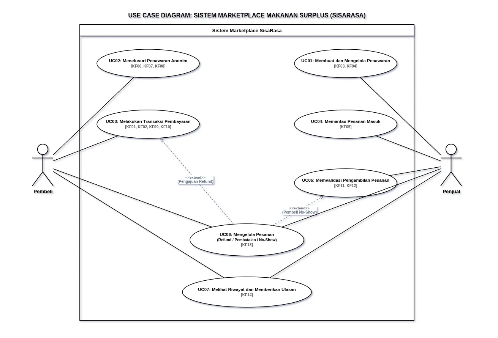

<h1>
IF2150 REKAYASA PERANGKAT LUNAK
 
TUGAS 10
 
HASIL IMPLEMENTASI DAN UJI PERANGKAT LUNAK (HIUPL)
</h1>
 

## *SisaRasa*

  

### Untuk: *Amanda Aurellia Salsabilla*

Dipersiapkan oleh:
| Informasi | Keterangan |
| --------- | ---------- |
| Kelas     | K1         |
| Kelompok  | 6          |

| NIM      | Nama                         |
| -------- | ---------------------------- |
| 13525067 | Fathar Atandra Denaya        |
| 13525040 | Muhammad Zaky Amani          |
| 13525139 | Josephine Bintang N.L        |
| 13525070 | Devina Athalia Putri Kusumah |
| 13525004 | Nabil Rabbani                |

---

## Daftar Isi

- [BAB 1: Pendahuluan](#bab-1-pendahuluan)
  - [1.1 Tujuan Penulisan Dokumen](#11-tujuan-penulisan-dokumen)
  - [1.2 Lingkup Masalah](#12-lingkup-masalah)
  - [1.3 Definisi, Istilah, dan Singkatan](#13-definisi-istilah-dan-singkatan)
  - [1.4 Aturan Penomoran](#14-aturan-penomoran)
  - [1.5 Referensi](#15-referensi)
  - [1.6 Deskripsi Umum Dokumen (Ikhtisar)](#16-deskripsi-umum-dokumen-ikhtisar)
- [BAB 2: Deskripsi Umum Perangkat Lunak](#bab-2-deskripsi-umum-perangkat-lunak)
- [BAB 3: Implementasi](#bab-3-implementasi)
  - [3.1 Lingkungan Implementasi](#31-lingkungan-implementasi)
  - [3.2 Implementasi Modul](#32-implementasi-modul)
  - [3.3 Implementasi Antarmuka](#33-implementasi-antarmuka)
  - [3.4 File Lain](#34-file-lain)
- [BAB 4: Hasil Pengujian](#bab-4-hasil-pengujian)
  - [4.1 Strategi dan Kedalaman Pengujian Kelas](#41-strategi-dan-kedalaman-pengujian-kelas)
  - [4.2 Pengujian Unit Kelas](#42-pengujian-unit-kelas)
  - [4.3 Pengujian Integrasi](#43-pengujian-integrasi)
  - [4.4 Pengujian Use Case](#44-pengujian-use-case)
  - [4.5 Pengujian Kebutuhan Non-Fungsional (KNF)](#45-pengujian-kebutuhan-non-fungsional-knf)
  - [4.6 Tangkapan Layar dan Bukti Hasil Pengujian](#46-tangkapan-layar-dan-bukti-hasil-pengujian)
- [BAB 5: Traceability](#bab-5-traceability)

---

## Daftar Perubahan

| Revisi | Deskripsi |
| :--- | :--- |
| *A* | *Deskripsikan perubahan yang dilakukan dari dokumen sebelumnya pada dokumen ini. Jika tidak terdapat perubahan, harap kosongkan tabel.* |
| *B* |  |
| *C* |  |
| ... |  |

---

# BAB 1: Pendahuluan

## 1.1 Tujuan Penulisan Dokumen
Dokumen Hasil Implementasi dan Uji Perangkat Lunak (HIUPL) ini disusun untuk melaporkan hasil implementasi dan pengujian perangkat lunak SisaRasa, yang mencakup gambaran umum perangkat lunak, elemen yang telah diimplementasikan beserta perubahannya terhadap rancangan pada DPPL, hasil pengujian pada tingkat unit, integrasi, use case, dan kebutuhan non-fungsional, serta matriks kerunutan (traceability) dari kebutuhan fungsional hingga test case. Dokumen ini bertujuan menjadi bukti bahwa perangkat lunak yang dibangun telah sesuai dengan SKPL dan DPPL, sekaligus menjadi acuan evaluasi dan perbaikan bagi tim pengembang. Pembaca yang dituju adalah dosen dan asisten pengampu mata kuliah IF2150 Rekayasa Perangkat Lunak sebagai penilai, serta anggota tim pengembang SisaRasa.

## 1.2 Lingkup Masalah
SisaRasa adalah aplikasi *marketplace* penyelamat makanan surplus berbasis Android native (Flutter) yang memfasilitasi transaksi "paket kejutan" (*mystery box*) anonim antara *merchant* makanan (Penjual) dan konsumen (Pembeli). Solusi ini dirancang untuk mengatasi kerugian finansial *merchant* akibat penumpukan makanan layak makan yang tak terjual, sekaligus menyediakan akses pangan berkualitas dengan harga terjangkau (diskon 50%–70%) bagi masyarakat. Sistem membatasi interaksi secara anonim hingga transaksi lunas, serta mewajibkan mekanisme pengambilan mandiri (*pickup-only*) menggunakan kode QR dinamis untuk menjamin kepraktisan operasional tanpa mengganggu sistem kasir internal toko.

## 1.3 Definisi, Istilah, dan Singkatan
Semua definisi, singkatan, dan akronim yang digunakan beserta penjelasannya diuraikan pada Tabel 1.3 di bawah ini:

Tabel 1.3. Definisi Istilah dan Singkatan

| Singkatan, Akronim, atau Istilah | Penjelasan |
| :--- | :--- |
| *SisaRasa* | Nama perangkat lunak berupa aplikasi *marketplace* penyelamat makanan surplus berbasis Android native (Flutter). |
| *P/L* | Singkatan dari Perangkat Lunak, yaitu aplikasi yang memberikan perintah kepada komputer untuk menjalankan tugas tertentu. |
| *SKPL* | Singkatan dari Spesifikasi Kebutuhan Perangkat Lunak, yaitu dokumen yang merangkum kriteria yang diperlukan untuk membangun aplikasi. |
| *KF* | Singkatan dari Kebutuhan Fungsional. |
| *KNF* | Singkatan dari Kebutuhan Non-Fungsional. |
| *UC* | Singkatan dari *Use Case*. |
| *EARS* | *Easy Approach to Requirements Syntax*, yaitu pola penulisan kebutuhan agar konsisten dan mudah diuji. |
| *Flutter* | *Framework open-source* berbasis bahasa Dart yang digunakan untuk membangun aplikasi Android native. |
| *QRIS* | *Quick Response Code Indonesian Standard*, yaitu standarisasi pembayaran menggunakan kode QR nasional untuk memproses transaksi digital. |
| *WebSocket* | Protokol komunikasi dua arah secara *real-time* antara server API dan aplikasi Android. |
| *Payout* | Proses pencairan dana dari platform kepada penjual setelah pesanan berhasil diserahkan dan divalidasi. |
| *Pickup-only* | Mekanisme pemenuhan pesanan di mana pembeli wajib mengambil makanan secara mandiri ke lokasi penjual tanpa menggunakan jasa kurir pengantaran. |

## 1.4 Aturan Penomoran
Dokumen Hasil Implementasi dan Uji Perangkat Lunak (HIUPL) ini menggunakan aturan penomoran identitas (ID) yang konsisten dengan dokumen-dokumen perancangan sebelumnya. Penomoran ID digunakan untuk mempermudah pemetaan dan pelacakan (*traceability*) antar-elemen kebutuhan, aktor, *use case*, dan kelas.

Tabel 1.4. Aturan Penomoran

| Hal/Bagian | Penomoran | Keterangan |
| :--- | :--- | :--- |
| *Kebutuhan Fungsional* | *KFXX* | *Sesuai SKPL* |
| *Kebutuhan Non-Fungsional* | *KNFXX* | *Sesuai SKPL* |
| *Use Case* | *UCXX* | *Sesuai SKPL* |
| *Kelas* | *CXX* | *Sesuai DPPL* |
| *Antarmuka* | *I-XX* | *Sesuai DPPL* |
| *Test Case Unit* | *CXX-UTYY* | *XX adalah nomor kelas, YY adalah nomor urut test case unit pada kelas tersebut* |
| *Test Case Integrasi* | *INT-TCYY* | *YY adalah nomor urut test case integrasi* |
| *Test Case Use Case* | *UCXX-TCYY* | *XX adalah nomor use case, YY adalah nomor urut test case pada use case tersebut* |
| *Test Case KNF* | *KNFXX-TCYY* | *XX adalah nomor KNF, YY adalah nomor urut test case pada KNF tersebut* |

## 1.5 Referensi
Dokumentasi dan acuan standar yang dirujuk dalam penyusunan dokumen aplikasi SisaRasa ini meliputi:

1. **Kementerian PPN/Bappenas.** (2021). *Kajian Food Loss and Waste di Indonesia dalam Rangka Membangun Ekonomi Sirkular*.
2. **Republik Indonesia.** (2012). *Undang-Undang Nomor 18 Tahun 2012 tentang Pangan*.
3. **Republik Indonesia.** (2022). *Undang-Undang Nomor 27 Tahun 2022 tentang Pelindungan Data Pribadi (UU PDP)*.
4. **IEEE Computer Society.** (1998). *IEEE Std 830-1998: IEEE Recommended Practice for Software Requirements Specifications*.
5. **PlantUML Documentation.** (n.d.). *Class Diagram Syntax and Features*. Diakses dari https://plantuml.com/class-diagram
6. **Draw.io / Diagrams.net.** (n.d.). *Open source diagramming software for UML*. Diakses dari https://www.drawio.com/
7. **Kelompok 6 K1 IF2150.** (2026). *Spesifikasi Kebutuhan Perangkat Lunak (SKPL) SisaRasa. Program Studi Teknik Informatika ITB*.   
8. **Kelompok 6 K1 IF2150.** (2026). *Arsitektur Perangkat Lunak (APL) SisaRasa. Program Studi Teknik Informatika ITB*.

## 1.6 Deskripsi Umum Dokumen (Ikhtisar)
Dokumen HIUPL ini terdiri dari 5 bab. Bab 1 berisi pendahuluan yang memuat tujuan penulisan dokumen, lingkup masalah, definisi, istilah, dan singkatan, aturan penomoran, referensi, serta deskripsi umum dokumen. Bab 2 memaparkan deskripsi umum perangkat lunak SisaRasa berupa system overview dan pemodelan kasus dalam bentuk use case diagram. Bab 3 menjelaskan implementasi, yaitu lingkungan implementasi, daftar modul atau kelas dan antarmuka yang telah diimplementasikan, serta file lain yang dibuat. Bab 4 melaporkan hasil pengujian, yang mencakup strategi dan kedalaman pengujian kelas, pengujian unit, pengujian integrasi, pengujian use case, pengujian kebutuhan non-fungsional, serta tangkapan layar dan bukti hasil pengujian. Bab 5 memuat traceability yang memetakan setiap kebutuhan fungsional ke kebutuhan non-fungsional, use case, kelas, file implementasi, dan test case sebagai sarana verifikasi pemenuhan kebutuhan.

 

---

# BAB 2: Deskripsi Umum Perangkat Lunak

SisaRasa adalah aplikasi marketplace penyelamat makanan surplus berbasis Android native (Flutter). Aplikasi ini menghubungkan Penjual (mitra gerai makanan) dengan Pembeli melalui “paket kejutan” (mystery box) berdiskon 50–70%. Penjual menerbitkan penawaran beserta kuota, alergen, dan jadwal pengambilan. Pembeli menelusuri katalog secara anonim, melakukan checkout dan pembayaran, lalu mengambil pesanan secara mandiri (pickup-only) dengan menunjukkan kode QR atau OTP. Identitas dan alamat gerai baru terbuka setelah pembayaran berhasil.

Sistem terdiri dari dua bagian utama dengan arsitektur client-server berlapis. Aplikasi Android (Flutter) dipakai oleh Pembeli dan Penjual dalam satu aplikasi, dan berkomunikasi dengan server API Node.js/Express melalui HTTPS (REST/JSON) dan WebSocket untuk notifikasi pesanan masuk. Server menjalankan aturan bisnis, menyimpan data pada PostgreSQL, menyimpan foto gerai dan bukti pengaduan sebagai media privat, serta menjalankan worker latar belakang untuk kedaluwarsa pembayaran, no-show, refund, dan pencairan.

<i>Gambar 2.1. Use Case Diagram SisaRasa</i>

Tabel 2.1. Daftar Use Case

| ID UC | Nama Use Case                         | Aktor            | Deskripsi Singkat                                                                              |
| ----- | ------------------------------------- | ---------------- | ---------------------------------------------------------------------------------------------- |
| UC01  | Membuat dan Mengelola Penawaran       | Penjual          | Menerbitkan, mengubah, dan menutup penawaran (diskon, kuota, alergen, jadwal pengambilan).     |
| UC02  | Menelusuri Penawaran Anonim           | Pembeli          | Melihat katalog tanpa identitas gerai, dengan filter alergen dan perkiraan jarak.              |
| UC03  | Melakukan Transaksi Pembayaran        | Pembeli          | *Checkout*, invoice, pembayaran simulasi, lalu menerima tiket QR/OTP dan identitas gerai.      |
| UC04  | Memantau Pesanan Masuk                | Penjual          | Melihat pesanan yang sudah dibayar dan menerima notifikasi *real-time*.                        |
| UC05  | Memvalidasi Pengambilan Pesanan       | Penjual, Pembeli | Penjual memindai QR atau memasukkan OTP dari tiket Pembeli untuk menyelesaikan pesanan.        |
| UC06  | Mengelola Pesanan                     | Penjual, Pembeli | Pengaduan, persetujuan/penolakan, pembatalan, dan *refund*.                                    |
| UC07  | Melihat Riwayat dan Memberikan Ulasan | Pembeli, Penjual | Melihat riwayat transaksi dan memberi ulasan untuk pesanan yang sudah selesai.                 |

 

---

# BAB 3: Implementasi

Bagian ini memuat informasi mengenai lingkungan implementasi, daftar modul/kelas, antarmuka pengguna, serta file pendukung lainnya yang telah dikembangkan untuk perangkat lunak SisaRasa, beserta penyesuaian terhadap rancangan pada dokumen DPPL.

## 3.1 Lingkungan Implementasi

Spesifikasi perangkat keras dan perangkat lunak yang digunakan pada tahap implementasi dan pengujian SisaRasa disajikan pada Tabel 3.1. Lingkungan ini konsisten dengan **Subbab 2.1 DPPL**, dengan penyesuaian pada bahasa pemrograman *backend* yang menggunakan **TypeScript** (dikompilasi ke JavaScript untuk dijalankan di atas runtime Node.js 18+) guna menjaga keamanan tipe data (*type safety*), serta penambahan *worker* pemrosesan *job* latar belakang dan *outbox* notifikasi.

Tabel 3.1. Lingkungan Implementasi

| Aspek | Keterangan |
| :--- | :--- |
| Hardware | PC/Laptop pengembang (server lokal & emulator Android), VPS Linux untuk server operasional, serta perangkat *smartphone* Android untuk pengujian klien. |
| Operating System | Linux (Ubuntu LTS) pada VPS server operasional; Linux/Windows/macOS pada lingkungan pengembangan lokal; Android (minimal Android 10 / API level 29) pada perangkat klien. |
| Bahasa Pemrograman | Dart (aplikasi klien Android Flutter) dan TypeScript / JavaScript pada runtime Node.js 18+ (server *backend*). |
| Framework/Library | **Klien Android:** Flutter, `dio` (HTTP REST client), `mobile_scanner` (pemindai kamera QR), `geolocator` (layanan lokasi), `flutter_foreground_task` (layanan latar belakang WebSocket). **Server Backend:** Express.js 4, `pg` (PostgreSQL driver & *connection pooling*), WebSocket (`/ws`). |
| DBMS | PostgreSQL 15 yang dijalankan dalam kontainer terisolasi Docker (port 5433 untuk pengembangan lokal / port 5432 untuk produksi), dilengkapi penyimpanan berkas lokal POSIX (`uploads/`) untuk foto gerai. |
| Development Tools | Visual Studio Code, Android Studio, Docker & Docker Compose, Git & GitHub, serta Postman. |
| Testing Tools | `flutter_test` (pengujian unit & widget Flutter), `integration_test` (pengujian *end-to-end* native Android), *test runner* backend TypeScript (`src/backend/test/`), `src/scripts/benchmark.sh` (pengukuran latensi HTTP), dan PostgreSQL `EXPLAIN (ANALYZE, BUFFERS)`. |

Daftar modul dan kelas perancangan (`C01`–`C11`) yang telah diimplementasikan beserta lokasi file fisiknya mengacu pada Tabel 4.1 DPPL dan Tabel B.5 Laporan Implementasi (Tugas 9). Seluruh modul klien Flutter dikompilasi ke dalam satu berkas paket aplikasi Android (`SisaRasaApp.apk`), sedangkan modul *backend* TypeScript dijalankan sebagai layanan server Node.js sehingga tidak menghasilkan file *executable* mandiri per kelas.

## 3.2 Implementasi Modul

Daftar modul dan kelas perancangan (`C01`–`C11`) yang telah diimplementasikan beserta lokasi file fisiknya mengacu pada Tabel 4.1 DPPL dan Tabel B.5 Laporan Implementasi (Tugas 9). Seluruh modul klien Flutter dikompilasi ke dalam satu berkas paket aplikasi Android (`SisaRasaApp.apk`), sedangkan modul *backend* TypeScript dijalankan sebagai layanan server Node.js sehingga tidak menghasilkan file *executable* mandiri per kelas.

Tabel 3.2. Implementasi Modul

| No | ID Kelas | Nama Modul/Kelas | Nama File Fisik | Nama File Executable |
| :--- | :--- | :--- | :--- | :--- |
| 1 | C01 | Penjual | `src/backend/src/modules/merchants/service.ts` `src/backend/src/modules/merchants/repository.ts` `src/backend/src/modules/merchants/schema.ts` `src/android-app/lib/features/seller/profile_screen.dart` | - |
| 2 | C02 | Pembeli | `src/backend/src/modules/auth/routes.ts` `src/backend/src/modules/auth/schema.ts` `src/backend/src/modules/auth/service.ts` `src/backend/src/modules/auth/repository.ts` `src/backend/src/core/labels.ts` `src/backend/src/modules/catalog/repository.ts` `src/android-app/lib/core/models/user.dart` `src/android-app/lib/core/storage/session_store.dart` `src/android-app/lib/features/buyer/allergen_screen.dart` | - |
| 3 | C03 | Penawaran | `src/backend/src/modules/offers/routes.ts` `src/backend/src/modules/offers/service.ts` `src/backend/src/modules/offers/repository.ts` `src/backend/src/modules/offers/schema.ts` `src/backend/src/modules/catalog/routes.ts` `src/backend/src/modules/catalog/service.ts` `src/backend/src/modules/catalog/repository.ts` `src/android-app/lib/core/models/offer.dart` `src/android-app/lib/features/seller/offer_form_controller.dart` `src/android-app/lib/features/seller/seller_controller.dart` `src/android-app/lib/features/seller/seller_repository.dart` `src/android-app/lib/features/buyer/catalog_controller.dart` | - |
| 4 | C04 | Pesanan | `src/backend/src/modules/orders/routes.ts` `src/backend/src/modules/orders/service.ts` `src/backend/src/modules/orders/repository.ts` `src/android-app/lib/core/models/order.dart` `src/android-app/lib/features/checkout/checkout_controller.dart` | - |
| 5 | C05 | MetodePembayaran | `src/android-app/lib/core/models/payment_method.dart` `src/backend/src/modules/payment/schema.ts` | - |
| 6 | C06 | QRIS | `src/android-app/lib/core/models/payment_method.dart` `src/backend/src/modules/payment/simulator.ts` | - |
| 7 | C07 | EWallet | `src/android-app/lib/core/models/payment_method.dart` `src/backend/src/modules/payment/simulator.ts` | - |
| 8 | C08 | QRPickup | `src/backend/src/modules/pickup/service.ts` `src/backend/src/modules/pickup/routes.ts` `src/android-app/lib/features/seller/scan_controller.dart` `src/android-app/lib/features/orders/tickets_screen.dart` | - |
| 9 | C09 | Pengaduan | `src/backend/src/modules/complaints/service.ts` `src/backend/src/modules/complaints/routes.ts` `src/backend/src/modules/complaints/schema.ts` `src/android-app/lib/core/models/complaint.dart` `src/android-app/lib/features/orders/complaint_controller.dart` | - |
| 10 | C10 | Ulasan | `src/backend/src/modules/reviews/service.ts` `src/backend/src/modules/reviews/repository.ts` `src/backend/src/modules/reviews/schema.ts` `src/backend/src/modules/reviews/routes.ts` `src/android-app/lib/core/models/review.dart` `src/android-app/lib/features/orders/review_controller.dart` | - |
| 11 | C11 | RiwayatTransaksi | `src/backend/src/modules/orders/repository.ts` `src/backend/src/modules/metrics/` `src/android-app/lib/features/orders/order_repository.dart` `src/android-app/lib/features/orders/history_screen.dart` | - |

## 3.3 Implementasi Antarmuka

Daftar antarmuka aplikasi Android yang telah diimplementasikan mengacu pada ID dan nama layar pada Bab 6 dokumen DPPL (`I-01` s.d. `I-08`), dilengkapi layar tambahan yang dikembangkan untuk memenuhi seluruh alur peran Pembeli dan Penjual pada Tugas 9.

Tabel 3.3. Implementasi Antarmuka

| No | ID Antarmuka | Nama Antarmuka | Nama File Fisik | Nama File Executable |
| :--- | :--- | :--- | :--- | :--- |
| 1 | I-01 | Masuk | `src/android-app/lib/features/auth/` (layar login) | `SisaRasaApp.apk` |
| 2 | I-02 | Registrasi Akun | `src/android-app/lib/features/auth/` (layar registrasi) | `SisaRasaApp.apk` |
| 3 | I-03 | Katalog Penawaran | `src/android-app/lib/features/buyer/catalog_screen.dart` | `SisaRasaApp.apk` |
| 4 | I-04 | Filter Alergen | `src/android-app/lib/features/buyer/allergen_screen.dart` | `SisaRasaApp.apk` |
| 5 | I-05 | Pop up Izin Lokasi | `src/android-app/lib/features/buyer/catalog_screen.dart` (dialog izin lokasi) | `SisaRasaApp.apk` |
| 6 | I-06 | Daftar Pesanan Pembeli | `src/android-app/lib/features/orders/history_screen.dart` | `SisaRasaApp.apk` |
| 7 | I-07 | Tiket Pengambilan (Mode Offline) | `src/android-app/lib/features/orders/tickets_screen.dart` | `SisaRasaApp.apk` |
| 8 | I-08 | Akun | `src/android-app/lib/features/auth/` (layar profil/akun pengguna) | `SisaRasaApp.apk` |
| 9 | - | Detail Penawaran | `src/android-app/lib/features/buyer/offer_detail_screen.dart` | `SisaRasaApp.apk` |
| 10 | - | Checkout & Pembayaran | `src/android-app/lib/features/checkout/checkout_screen.dart` | `SisaRasaApp.apk` |
| 11 | - | Tiket Pickup Aktif | `src/android-app/lib/features/orders/ticket_pickup_screen.dart` | `SisaRasaApp.apk` |
| 12 | - | Form & Detail Pengaduan | `src/android-app/lib/features/orders/complaint_form_screen.dart` `src/android-app/lib/features/orders/complaint_detail_screen.dart` | `SisaRasaApp.apk` |
| 13 | - | Form Ulasan & Ulasan Gerai | `src/android-app/lib/features/orders/review_screen.dart` `src/android-app/lib/features/orders/merchant_reviews_screen.dart` | `SisaRasaApp.apk` |
| 14 | - | Profil & Manajemen Penawaran Penjual | `src/android-app/lib/features/seller/profile_screen.dart` `src/android-app/lib/features/seller/offers_screen.dart` `src/android-app/lib/features/seller/offer_form_screen.dart` | `SisaRasaApp.apk` |
| 15 | - | Daftar Pesanan Masuk Penjual | `src/android-app/lib/features/seller/seller_orders_screen.dart` | `SisaRasaApp.apk` |

## 3.4 File Lain

Selain file modul/kelas dan antarmuka pengguna, beberapa file konfigurasi, migrasi basis data, pengujian, serta skrip pengukuran turut dibuat untuk mendukung operasional dan verifikasi sistem SisaRasa.

Tabel 3.4. File Lain

| No | Nama File | Keterangan |
| :--- | :--- | :--- |
| 1 | `src/backend/migrations/001_initial.sql` | Skema migrasi awal basis data relasional PostgreSQL (`users`, `merchant_profiles`, `offers`, `orders`, `checkout_sessions`, `complaints`, `reviews`, `audit_logs`, dan `platform_metrics`). |
| 2 | `src/backend/test/` (termasuk `integration/notifications.test.ts`) | Kumpulan berkas pengujian unit dan integrasi untuk layanan *backend*, validasi transaksi, dan notifikasi WebSocket. |
| 3 | `src/android-app/test/` (termasuk `core/socket_client_test.dart`, `features/notifications_test.dart`) | Kumpulan berkas pengujian unit dan widget aplikasi Android Flutter. |
| 4 | `src/android-app/integration_test/` | Berkas pengujian integrasi *end-to-end* (E2E) aplikasi Android. |
| 5 | `src/scripts/benchmark.sh` | Skrip pengujian performa dan pengukuran waktu respons HTTP lokal. |
| 6 | `src/docs/verification.md` | Laporan catatan verifikasi hasil pengujian integrasi *backend* dan Android. |
| 7 | `src/docs/evidence/benchmark.json` | Data artefak hasil pengukuran performa dan keluaran kueri `EXPLAIN (ANALYZE, BUFFERS)`. |
| 8 | `compose.yaml` & `Dockerfile` | Konfigurasi kontainer Docker untuk menjalankan layanan PostgreSQL 15 dan *backend* server. |
| 9 | `openapi.yaml` | Dokumen spesifikasi kontrak REST API antara aplikasi klien Android dan server *backend*. |
| 10 | `src/README.md` | Panduan pengaturan lingkungan lokal, instalasi dependensi, dan cara menjalankan aplikasi. |

 

---

# BAB 4: Hasil Pengujian

Bab ini melaporkan hasil pengujian P/L pada level unit, integrasi, dan sistem. Pengujian dilakukan pada tag release terakhir Tugas 9. Hasil aktual diisi berdasarkan pengamatan saat pengujian. Kesimpulan diisi `Pass` atau `Fail`, dan untuk `Fail` dilengkapi penyebab serta usulan perbaikan.

## 4.1 Strategi dan Kedalaman Pengujian Kelas

Setiap kelas perancangan pada Tabel 4.1 DPPL diklasifikasikan ke dalam tiga tingkat kedalaman pengujian. Tingkat **Mendalam** diberikan pada kelas yang memuat logika bisnis, perhitungan, validasi, aturan status, algoritma, integrasi eksternal, atau keamanan. Tingkat **Sedang** diberikan pada kelas yang hanya mengoordinasikan atau mendelegasikan proses. Tingkat **Tidak perlu** diberikan pada kelas tanpa logika, seperti *entity/DTO* dan kelas konfigurasi, yang teruji secara tidak langsung melalui test case use case. 

Tabel 4.1.1. Identifikasi Tingkat Pengujian Kelas

| ID Kelas | Nama Kelas       | Tingkat      | Alasan | Test Case Terkait |
| -------- | ---------------- | ------------ | ------ | ----------------- |
| C01 | Penjual | Sedang | `getIdPenjual()` dan `getProfil()` hanya mengembalikan data profil. Algoritmanya terbatas pada pembatasan peran Penjual, validasi isian profil (nama, alamat, koordinat, rekening 6–30 digit), dan penyimpanan nomor rekening hanya dalam bentuk tersamar (empat digit terakhir). Selebihnya didelegasikan ke repository. | C01-UT01 s.d. C01-UT03, INT-TC12 |
| C02 | Pembeli | Sedang | Menyimpan identitas dan preferensi alergen. `updatePreferensi()` hanya membatasi nilai (daftar alergen tetap, tidak ganda/double, maksimal delapan) lalu mendelegasikan penyimpanan ke repository. Tidak ada perhitungan atau logika bisnis lain. | C02-UT01 s.d. C02-UT04, INT-TC03 |
| C03 | Penawaran | Mendalam | Memuat validasi dan aturan status: diskon 50–70% (dihitung dengan integer), waktu mulai pickup antara sekarang dan dua jam ke depan, batas konsumsi tidak sebelum pickup selesai, kuota 1–500, dan penguncian ubah/tutup saat kuota ditahan, terjual, atau pesanan pernah dibayar. Katalog juga menyaring alergen dan menghitung jarak di server. | C03-UT01 s.d. C03-UT10, INT-TC01, INT-TC02, INT-TC04 |
| C04 | Pesanan | Mendalam | `buatPesanan()` membuat pesanan dengan reservasi kuota dan checkout. `ubahStatus()` mengelola nilai status yang dibatasi constraint basis data; perpindahannya dilakukan bersama modul pembayaran, pickup, dan pengaduan. Pembatalan oleh Penjual dan penandaan tidak diambil (no-show) dilakukan di modul pesanan, dan perubahan yang tidak sah ditolak. | C04-UT01 s.d. C04-UT10, INT-TC04, INT-TC11 |
| C06 | QRIS | Sedang | `generateQRIS()` diwujudkan sebagai invoice pesanan yang digambar menjadi QR simulasi pada layar pembayaran, lengkap dengan batas waktu. Otorisasi didelegasikan ke gateway dummy. QR ini bukan QRIS bank sungguhan. | C06-UT01 s.d. C06-UT02, INT-TC05 |
| C07 | EWallet | Tidak perlu | Tidak diimplementasikan sebagai kelas tersendiri. Aplikasi hanya menyediakan satu alur pembayaran simulasi (QR invoice dan tombol simulasi berhasil/gagal), tanpa pilihan e-wallet, nomor HP, atau penyedia. Tidak ada logika yang dapat diuji, dan perbedaan dari DPPL dicatat di Laporan Implementasi. | UC03-TC01 (tidak langsung) |
| C08 | QRPickup | Mendalam | Token acak sekali pakai (disimpan sebagai hash untuk verifikasi dan salinan terenkripsi), OTP enam digit pada pesanan, batas lima percobaan salah per 15 menit, serta penolakan untuk token yang sudah terpakai atau dinonaktifkan. | C08-UT01 s.d. C08-UT09, INT-TC07, INT-TC08 |
| C09 | Pengaduan | Mendalam | Aturan status pengaduan: alasan dari empat pilihan (tidak layak, tidak tersedia, alergen, toko tutup) dengan deskripsi minimal 10 karakter, bukti maksimal dua berkas/file, setujui atau tolak, refund penuh, dan penahanan dana penjual sampai ada keputusan. Pengaduan "toko tutup" yang tidak ditanggapi dalam 24 jam akan direfund otomatis. | C09-UT01 s.d. C09-UT08, INT-TC09 |
| C11 | RiwayatTransaksi | Sedang | `getRiwayatPembeli()` dan `getRiwayatPenjual()` hanya menyusun query pesanan per pengguna dan menampilkan riwayat kejadian pesanan dari `audit_logs`, lalu mendelegasikan pembacaan data ke repository. Tidak ada logika bisnis atau perhitungan. | C11-UT01 s.d. C11-UT03, INT-TC11 |

 

## 4.2 Pengujian Unit Kelas

Pengujian unit dilakukan pada kelas bertingkat Mendalam dan Sedang. Kelas Mendalam diuji pada seluruh operasi public dengan kasus normal, batas, dan negatif, serta mencapai *coverage* minimal 70%. Kelas Sedang diuji minimal dengan satu kasus normal dan satu kasus gagal pada operasi public utama.

Cara menjalankan unit test: dari direktori `src/backend`, jalankan `npm run test:unit`.

Lokasi file test: `src/backend/test/unit/`.

### 4.2.1 Kelas Penjual

**ID Kelas:** C01  
**Nama Kelas:** Penjual  
**Tingkat:** Sedang

Tabel 4.2.1. Hasil Pengujian Unit Kelas C01

| ID Pengujian | Operasi yang Diuji | Jenis Kasus | Prosedur/Masukan | Hasil yang Diharapkan | Hasil Pengujian | Kesimpulan |
| :--- | :--- | :--- | :--- | :--- | :--- | :--- |
| C01-UT01 | Validasi profil penjual | Normal | Parse profil berisi nama gerai, alamat, latitude, dan longitude valid. | Profil valid diterima dan nama gerai dipertahankan. | Pass — test runner lulus. | Pass |
| C01-UT02 | Validasi profil penjual | Negatif/batas | Parse profil dengan nama terlalu pendek, alamat kosong, dan koordinat di luar rentang. | Profil tidak valid ditolak. | Pass — test runner lulus. | Pass |
| C01-UT03 | Validasi rekening pada profil | Normal/negatif | Parse profil dengan nomor rekening 6 digit, lalu dengan karakter nonangka. | Nomor rekening valid diterima; nilai nonangka ditolak. | Pass — test runner lulus. | Pass |

### 4.2.2 Kelas Pembeli

**ID Kelas:** C02  
**Nama Kelas:** Pembeli  
**Tingkat:** Sedang

Tabel 4.2.2. Hasil Pengujian Unit Kelas C02

| ID Pengujian | Operasi yang Diuji | Jenis Kasus | Prosedur/Masukan | Hasil yang Diharapkan | Hasil Pengujian | Kesimpulan |
| :--- | :--- | :--- | :--- | :--- | :--- | :--- |
| C02-UT01 | Preferensi alergen pembeli | Normal | Pastikan struktur preferensi dengan daftar alergen kosong terbentuk. | Daftar preferensi kosong tersedia. | Pass — test runner lulus. | Pass |
| C02-UT02 | Validasi daftar alergen | Normal/batas | Parse penawaran dengan daftar alergen kosong. | Daftar kosong diterima. | Pass — test runner lulus. | Pass |
| C02-UT03 | Validasi daftar alergen | Negatif | Parse penawaran dengan alergen `gluten` berulang. | Duplikasi ditolak. | Pass — test runner lulus. | Pass |
| C02-UT04 | Validasi daftar alergen | Batas/negatif | Parse penawaran dengan sembilan nilai alergen. | Jumlah lebih dari delapan ditolak. | Pass — test runner lulus. | Pass |

### 4.2.3 Kelas Penawaran

**ID Kelas:** C03  
**Nama Kelas:** Penawaran  
**Tingkat:** Mendalam

Tabel 4.2.3. Hasil Pengujian Unit Kelas C03

| ID Pengujian | Operasi yang Diuji | Jenis Kasus | Prosedur/Masukan | Hasil yang Diharapkan | Hasil Pengujian | Kesimpulan |
| :--- | :--- | :--- | :--- | :--- | :--- | :--- |
| C03-UT01 | Validasi detail penawaran | Normal | Validasi penawaran valid dengan kategori `makanan_berat`. | Data penawaran valid dikembalikan. | Pass — test runner lulus. | Pass |
| C03-UT02 | Validasi kuota | Batas/negatif | Validasi kuota 0 dan kuota 1. | Kuota 0 ditolak; kuota 1 diterima. | Pass — test runner lulus. | Pass |
| C03-UT03 | `getDetailPenawaran()` (validasi data) | Normal | Validasi penawaran dengan harga normal 100000 dan harga diskon 40000. | Harga normal dan diskon sesuai masukan. | Pass — test runner lulus. | Pass |
| C03-UT04 | Validasi jadwal pickup | Negatif/batas | Validasi waktu mulai sebelum waktu sekarang dan dua jam ke depan. | Waktu mulai yang lampau ditolak; waktu dalam batas diterima. | Pass — test runner lulus. | Pass |
| C03-UT05 | Validasi aturan penawaran | Batas/negatif | Periksa diskon 51%, kuota 500 dan 501, waktu selesai pickup sebelum mulai, batas konsumsi sebelum pickup selesai, serta konfirmasi kelayakan false. | Diskon/kuota/jadwal/konfirmasi yang melanggar aturan ditolak; kuota 500 diterima. | Pass — test runner lulus. | Pass |

Tabel 4.2.3b. Ringkasan Cakupan Kelas [C03]

| Informasi | Keterangan |
| :--- | :--- |
| Daftar operasi public pada DPPL | `getIdPenawaran()`, `kurangiKuota(qty)`, `getDetailPenawaran()`, `ubahStatus(status)` |
| Operasi yang diuji | Pengujian validasi melalui `validateOffer()`: data penawaran, batas kuota, harga/diskon, jadwal pickup, dan batas konsumsi. Operasi public DPPL belum dipanggil langsung. |
| ID Algoritma yang tercakup | Belum dapat diidentifikasi dari informasi DPPL yang tersedia. |
| Coverage (wajib ≥ 70%) | `offers/schema.ts`: **100% baris / 100% cabang**. Ini coverage file skema, bukan keseluruhan kelas. Alat: Node.js `--experimental-test-coverage`.|

### 4.2.4 Kelas Pesanan

**ID Kelas:** C04  
**Nama Kelas:** Pesanan  
**Tingkat:** Mendalam

Tabel 4.2.4. Hasil Pengujian Unit Kelas C04

| ID Pengujian | Operasi yang Diuji | Jenis Kasus | Prosedur/Masukan | Hasil yang Diharapkan | Hasil Pengujian | Kesimpulan |
| :--- | :--- | :--- | :--- | :--- | :--- | :--- |
| C04-UT01 | Batas waktu checkout | Batas | Hitung batas pembayaran 15 menit dari waktu sekarang, dengan akhir pickup lebih awal. | Deadline pembayaran dibatasi ke akhir pickup. | Pass — test runner lulus. | Pass |
| C04-UT02 | Status pesanan | Normal/negatif | Periksa status `paid` dan status tidak dikenal dalam daftar status yang diperbolehkan. | Status yang dikenal diterima; status tidak dikenal tidak termasuk. | Pass — test runner lulus. | Pass |
| C04-UT03 | Aksi berdasarkan status | Normal | Periksa aksi untuk pesanan berstatus `paid`. | Aksi pickup tersedia. | Pass — test runner lulus. | Pass |
| C04-UT04 | Kepemilikan detail pesanan | Normal/negatif | Cocokkan ID pembeli dan penjual dengan aktor, termasuk ID aktor yang berbeda. | Pemilik yang sesuai dikenali; ID lain tidak cocok. | Pass — test runner lulus. | Pass |
| C04-UT05 | Ketersediaan reservasi checkout | Negatif | Evaluasi penawaran tertutup dengan kuota tersedia 0. | Penawaran dinilai tidak tersedia untuk checkout. | Pass — test runner lulus. | Pass |

Khusus kelas **Mendalam**:

Tabel 4.2.4b. Ringkasan Cakupan Kelas [C04]

| Informasi | Keterangan |
| :--- | :--- |
| Daftar operasi public pada DPPL | `buatPesanan()`, `ubahStatus(statusBaru)`, `getStatusPesanan()`, `getDetailPesanan()` |
| Operasi yang diuji | `OrderRepository.read()`, `OrderRepository.release()`, dan `OrderService.list()` (cakupan buyer dan seller, termasuk pagination). Operasi `buatPesanan()`, `ubahStatus()`, dan `detail()` belum diuji langsung oleh unit test coverage ini. |
| ID Algoritma yang tercakup | Belum dapat diidentifikasi dari informasi DPPL yang tersedia. |
| Coverage (wajib ≥ 70%) | `orders/repository.ts`: **71,64% baris / 100% cabang**; `orders/service.ts`: **48,59% baris / 100% cabang**. Jadi, coverage keseluruhan operasi layanan C04 **belum memenuhi target 70% baris**. Alat: Node.js `--experimental-test-coverage`. Bukti: keluaran terminal `test/unit/c04-c11.test.ts` untuk dilampirkan pada Subbab 4.6. |

### 4.2.5 Kelas QRIS

**ID Kelas:** C06  
**Nama Kelas:** QRIS  
**Tingkat:** Sedang

Tabel 4.2.5. Hasil Pengujian Unit Kelas C06

| ID Pengujian | Operasi yang Diuji | Jenis Kasus | Prosedur/Masukan | Hasil yang Diharapkan | Hasil Pengujian | Kesimpulan |
| :--- | :--- | :--- | :--- | :--- | :--- | :--- |
| C06-UT01 | Enkripsi data invoice QR simulasi | Normal | Enkripsi lalu dekripsi data invoice berisi nomor, jumlah, dan waktu kedaluwarsa. | Data hasil dekripsi sama dengan data asal. | Pass — test runner lulus. | Pass |
| C06-UT02 | Batas waktu pembayaran | Batas | Bandingkan waktu sekarang dengan deadline pembayaran yang telah lewat. | Deadline yang telah lewat dikenali sebagai kedaluwarsa. | Pass — test runner lulus. | Pass |
| C06-UT03 | Dekripsi payload invoice | Negatif | Dekripsi payload terenkripsi dengan format tidak valid. | Payload tidak valid ditolak. | Pass — test runner lulus. | Pass |

### 4.2.6 Kelas QRPickup

**ID Kelas:** C08  
**Nama Kelas:** QRPickup  
**Tingkat:** Mendalam

Tabel 4.2.6. Hasil Pengujian Unit Kelas C08

| ID Pengujian | Operasi yang Diuji | Jenis Kasus | Prosedur/Masukan | Hasil yang Diharapkan | Hasil Pengujian | Kesimpulan |
| :--- | :--- | :--- | :--- | :--- | :--- | :--- |
| C08-UT01 | `generateToken()` | Normal | Buat token rahasia dan enkripsi token bersama OTP. | Token berformat base64url 43 karakter dan ciphertext memiliki versi `v1`. | Pass — test runner lulus. | Pass |
| C08-UT02 | `validasiToken(token)` | Normal | Enkripsi lalu dekripsi token dan OTP, serta bandingkan hash token. | Data kembali sama dan hash yang sama cocok. | Pass — test runner lulus. | Pass |
| C08-UT02 | `validasiToken(token)` | Negatif | Bandingkan hash yang berbeda dan coba dekripsi data invalid. | Token berbeda tidak cocok; data invalid ditolak. | Pass — test runner lulus. | Pass |
| C08-UT03 | Validasi bentuk QR/OTP | Normal | Parse kode OTP enam digit dan payload QR dengan skema input pickup. | Bentuk input yang memenuhi skema diterima. | Pass — test runner lulus. | Pass |
| C08-UT04 | Validasi input pickup | Batas/negatif | Parse OTP terlalu pendek dan QR dengan ID/payload tidak valid. | Input tidak valid ditolak. | Pass — test runner lulus. | Pass |

Tabel 4.2.6b. Ringkasan Cakupan Kelas [C08]

| Informasi | Keterangan |
| :--- | :--- |
| Daftar operasi public pada DPPL | `generateToken()`, `validasiToken(token)`, `tandaiDigunakan()` |
| Operasi yang diuji | Pembuatan token, enkripsi/dekripsi token dan OTP, perbandingan hash, serta validasi format QR/OTP. Alur layanan `PickupService.validate()`—termasuk penggunaan sekali pakai, kedaluwarsa, dan batas percobaan OTP—belum tercakup langsung oleh test unit ini. |
| ID Algoritma yang tercakup | Belum dapat diidentifikasi dari informasi DPPL yang tersedia. |
| Coverage (wajib ≥ 70%) | `pickup/schema.ts`: **92,31% baris / 75% cabang** pada pengukuran khusus `c08-pickup.test.ts`. Ini coverage skema input, bukan keseluruhan layanan QRPickup. Alat: Node.js `--experimental-test-coverage`.|

### 4.2.7 Kelas Pengaduan

**ID Kelas:** C09  
**Nama Kelas:** Pengaduan  
**Tingkat:** Mendalam

Tabel 4.2.7. Hasil Pengujian Unit Kelas C09

| ID Pengujian | Operasi yang Diuji | Jenis Kasus | Prosedur/Masukan | Hasil yang Diharapkan | Hasil Pengujian | Kesimpulan |
| :--- | :--- | :--- | :--- | :--- | :--- | :--- |
| C09-UT01 | `ajukanPengaduan()` — validasi masukan | Normal/negatif | Parse pengaduan valid, lalu deskripsi terlalu pendek dan alasan di luar pilihan. | Masukan valid diterima; deskripsi/alasan tidak valid ditolak. | Pass — test runner lulus. | Pass |
| C09-UT02 | `prosesPengaduan(keputusan)` — validasi keputusan | Normal/negatif | Parse keputusan dengan boolean dan respons valid, lalu tipe keputusan/respons tidak valid. | Keputusan valid diterima; nilai salah tipe atau respons terlalu pendek ditolak. | Pass — test runner lulus. | Pass |
| C09-UT03 | Validasi bukti pengaduan | Batas/negatif | Parse daftar bukti duplikat dan daftar lebih dari dua berkas. | Bukti duplikat atau lebih dari dua berkas ditolak. | Pass — test runner lulus. | Pass |
| C09 tambahan | Validasi pengaduan tanpa bukti | Normal | Parse pengaduan valid dengan `media_ids` kosong. | Pengaduan tanpa lampiran diterima. | Pass — test runner lulus. | Pass |

Tabel 4.2.7b. Ringkasan Cakupan Kelas [C09]

| Informasi | Keterangan |
| :--- | :--- |
| Daftar operasi public pada DPPL | `ajukanPengaduan()`, `prosesPengaduan(keputusan)` |
| Operasi yang diuji | Validasi skema pengajuan pengaduan dan keputusan, batas jumlah bukti, bukti duplikat, serta pengaduan tanpa bukti. Alur layanan pembukaan pengaduan, perubahan status, refund, dan keputusan belum diuji langsung oleh unit test coverage ini. |
| ID Algoritma yang tercakup | Belum dapat diidentifikasi dari informasi DPPL yang tersedia. |
| Coverage (wajib ≥ 70%) | `complaints/schema.ts`: **100% baris / 100% cabang**. Ini coverage file skema, bukan keseluruhan layanan pengaduan. Alat: Node.js `--experimental-test-coverage`.|

### 4.2.8 Kelas RiwayatTransaksi

**ID Kelas:** C11  
**Nama Kelas:** RiwayatTransaksi  
**Tingkat:** Sedang

Tabel 4.2.8. Hasil Pengujian Unit Kelas C11

| ID Pengujian | Operasi yang Diuji | Jenis Kasus | Prosedur/Masukan | Hasil yang Diharapkan | Hasil Pengujian | Kesimpulan |
| :--- | :--- | :--- | :--- | :--- | :--- | :--- |
| C11-UT01 | `getRiwayatPembeli(idPembeli)` — pemilihan cakupan pengguna | Normal | Pastikan aktor buyer diarahkan ke kolom identitas `buyer_id`. | Riwayat menggunakan identitas pembeli. | Pass — test runner lulus. | Pass |
| C11-UT02 | `getRiwayatPenjual(idPenjual)` — pemilihan cakupan pengguna | Normal | Pastikan aktor seller diarahkan ke kolom identitas `seller_id`. | Riwayat menggunakan identitas penjual. | Pass — test runner lulus. | Pass |
| C11-UT03 | Pagination riwayat | Batas | Ambil 2 item dari 3 baris dengan limit 2. | Dua item ditampilkan dan next cursor tersedia. | Pass — test runner lulus. | Pass |

 

## 4.3 Pengujian Integrasi

Pengujian integrasi memeriksa interaksi antarkomponen yang melewati batas, yaitu *Controller* ke *Model*, aplikasi ke basis data, dan aplikasi ke sistem eksternal. Daftar antarmuka mengacu pada dokumen DPPL, dengan minimal satu test case untuk setiap antarmuka. Pengujian memakai komponen nyata, bukan *mock*. Apabila ada antarmuka tambahan yang belum didaftarkan pada dokumen DPPL, cantumkan juga.

Tabel 4.3.1. Daftar Antarmuka Antarkomponen

| ID Antarmuka | Komponen Asal | Komponen Tujuan | Jenis Batas | Test Case |
| :--- | :--- | :--- | :--- | :--- |
| *I-01* | *KeranjangController* | *Keranjang (Model)* | *Controller - Model* | *INT-TC01, INT-TC02* |
| *I-02* | *Pesanan (Model)* | *Database* | *Aplikasi - Basis data* | *INT-TC03* |
| *I-03* | *PaymentGatewayAdapter* | *Payment Gateway (dummy)* | *Aplikasi - Sistem eksternal* | *INT-TC04, INT-TC05* |
| *[I-XX]* | *[Komponen asal]* | *[Komponen tujuan]* | *[Jenis batas]* | *[ID test case]* |
| *...* | *...* | *...* | *...* | *...* |

Tabel 4.3.2. Hasil Pengujian Integrasi

| ID Pengujian | ID Antarmuka | Skenario | Prosedur/Masukan | Hasil yang Diharapkan | Hasil Pengujian | Kesimpulan |
| :--- | :--- | :--- | :--- | :--- | :--- | :--- |
| *INT-TC01* | *I-01* | *Normal: tambah item ke keranjang* | *Panggil `tambahItem()` melalui KeranjangController dengan produk valid* | *Item tersimpan pada Keranjang dan tampil pada daftar item* | *[Hasil aktual]* | *Pass/Fail* |
| *INT-TC03* | *I-02* | *Normal: simpan pesanan* | *Buat pesanan, lalu baca ulang langsung dari basis data* | *Baris pesanan ada dengan nilai total dan status yang sama* | *[...]* | *Pass/Fail* |
| *INT-TC05* | *I-03* | *Gagal: gateway mengembalikan status gagal* | *Kirim otorisasi dengan saldo dummy tidak cukup* | *Status pesanan tidak berubah menjadi "Lunas", pesan gagal diteruskan ke pengguna* | *[...]* | *Pass/Fail* |
| *...* | *...* | *...* | *...* | *...* | *...* | *...* |

 

## 4.4 Pengujian Use Case

Pengujian use case dilakukan pada seluruh skenario normal dan alternatif sesuai Subbab 4.4 SKPL, dengan minimal satu test case untuk setiap skenario. Kolom ID KF menunjukkan KF yang diverifikasi oleh test case tersebut.

### 4.4.1 Use Case [Nama Use Case 1]

**ID Use Case:** *[UC01 sesuai SKPL]*  
**Nama Use Case:** *[Nama use case sesuai SKPL]*

Tabel 4.4.1. Hasil Pengujian Use Case [UC01]

| ID Pengujian | ID KF | Skenario | Prosedur Pengujian | Masukan | Hasil yang Diharapkan | Hasil Pengujian | Kesimpulan |
| :--- | :--- | :--- | :--- | :--- | :--- | :--- | :--- |
| *UC01-TC01* | *KF01* | *Normal* | *1. Buka halaman login. 2. Masukkan kredensial. 3. Klik tombol "Login".* | *User: rpl@gmail.com Pass: 123456* | *Pengguna diarahkan ke Halaman Dashboard.* | *Pengguna diarahkan ke Halaman Dashboard sesuai hasil yang diharapkan.* | *Pass* |
| *UC01-TC02* | *KF01* | *Alternatif 1: [Nama skenario]* | *[Langkah-langkah pengujian]* | *[Data masukan]* | *[Hasil yang diharapkan]* | *[Hasil aktual]* | *[Pass/Fail. Jika Fail: penjelasan dan solusi]* |
| *...* | *...* | *...* | *...* | *...* | *...* | *...* | *...* |

### 4.4.2 Use Case [Nama Use Case 2]

*[Lanjutkan untuk seluruh use case dengan pola yang sama, hingga 4.4.N.]*

 

## 4.5 Pengujian Kebutuhan Non-Fungsional (KNF)

Setiap KNF pada Tabel 3.2 SKPL diuji secara terukur berdasarkan parameter yang telah didefinisikan. Setiap pengujian memuat target terukur, metode dan alat yang sesuai dengan parameter (misalnya Chrome DevTools untuk *response time* dan inspeksi basis data untuk *security*), serta hasil aktual berupa angka atau data. KNF yang belum dipenuhi atau tidak diimplementasikan dicantumkan beserta alasan dan rencana perbaikan.

Tabel 4.5. Hasil Pengujian KNF

| ID Pengujian | ID KNF | Parameter | Target Terukur | Metode dan Alat | Hasil Aktual | Kesimpulan |
| :--- | :--- | :--- | :--- | :--- | :--- | :--- |
| *KNF01-TC01* | *KNF01* | *Reliability* | *Tidak ada data hilang/ganda saat jaringan putus di tengah transaksi* | *Simulasi putus koneksi saat bayar, lalu cek status di DB* | *[Hasil aktual]* | *Pass/Fail* |
| *KNF02-TC01* | *KNF02* | *Security* | *Password tersimpan sebagai hash, bukan plain-text* | *Inspeksi tabel pengguna di DB* | *[...]* | *Pass/Fail* |
| *KNFXX-TC01* | *KNFXX* | *Response time* | *Halaman tampil ≤ 4 detik* | *Chrome DevTools, 5 kali ukur, ambil rata-rata* | *[Rata-rata ... detik, maks ... detik]* | *Pass/Fail* |
| *...* | *...* | *...* | *...* | *...* | *...* | *...* |

 

## 4.6 Tangkapan Layar dan Bukti Hasil Pengujian

Bukti pengujian dilampirkan sesuai ID Pengujian pada Subbab 4.2 sampai 4.5, berupa tangkapan layar aplikasi, keluaran *test runner*, laporan *coverage* untuk setiap kelas Mendalam, atau hasil alat ukur.

Tabel 4.6. Bukti Hasil Pengujian

| ID Pengujian | Bukti Hasil Pengujian |
| :--- | :--- |
| *C02-UT01 – C02-UT08* | *[Sisipkan hasil keluaran unit test]* |
| *C02 (coverage)* | *[Sisipkan laporan coverage kelas C02]* |
| *INT-TC01* | *[Sisipkan bukti pengujian integrasi]* |
| *UC01-TC01* | *[Sisipkan tangkapan layar UC01-TC01 sesuai prosedur pengujian]* |
| *UC01-TC02* | *[Sisipkan tangkapan layar UC01-TC02 sesuai prosedur pengujian]* |
| *KNF01-TC01* | *[Sisipkan bukti pengukuran parameter KNF01-TC01]* |
| *...* | *...* |

 

---

# BAB 5: Traceability

Petakan setiap KF ke KNF, use case, kelas perancangan, file implementasi, dan test case. Tabel traceability berikut akan menjadi sarana verifikasi KF. Setiap KF memiliki minimal satu test case dan dinyatakan terpenuhi apabila **seluruh** test case terkaitnya berkesimpulan `Pass`. KF yang tidak diimplementasikan tetap dicantumkan beserta alasannya.

Tabel 5.1. Matriks Kerunutan KF terhadap Implementasi dan Pengujian

| KF ID | KNF Terkait | Use Case ID | Kelas Terkait | Implementasi File Terkait | Test Case (UC) | Test Case (Unit/Integrasi/KNF) |
| :--- | :--- | :--- | :--- | :--- | :--- | :--- |
| *KF05* | *KNF01* | *UC03* | *C02 - Pesanan* | *`src/...`* | *UC03-TC01* | *C02-UT05, INT-TC04, KNF01-TC01* |
| *KF01* | *-* | *UC01 UC02* | *[C01 - Nama kelas] [C02 - Nama kelas]* | *[path/ke/file1] [path/ke/file2]* | *UC01-TC01, UC01-TC02 UC02-TC01* | *-* |
| *KF02* | *[KNFXX atau -]* | *[UCXX]* | *[CXX - Nama kelas]* | *[path/ke/file]* | *[UCXX-TCYY]* | *[CXX-UTYY, INT-TCYY, KNFXX-TCYY atau -]* |
| *KFXX* | *-* | *[UCXX atau -]* | *[CXX - Nama kelas atau -]* | *Tidak diimplementasikan: [alasan]* | *-* | *-* |
| *...* | *...* | *...* | *...* | *...* | *...* | *...* |

Tabel 5.2. Matriks Kerunutan KNF terhadap Pengujian

| ID KNF | Parameter | KF/UC Terkait | Test Case |
| :--- | :--- | :--- | :--- |
| *KNF01* | *Reliability* | *KF05 / UC03* | *KNF01-TC01* |
| *KNFXX* | *[Parameter]* | *[KFXX / UCXX atau -]* | *[KNFXX-TCYY]* |
| *...* | *...* | *...* | *...* |