<h1>
IF2150 REKAYASA PERANGKAT LUNAK
 
TUGAS 10
 
HASIL IMPLEMENTASI DAN UJI PERANGKAT LUNAK (HIUPL)
</h1>
 

## *SisaRasa*

  

### Untuk: *Amanda Aurellia Salsabilla*

Dipersiapkan oleh:
| Informasi | Keterangan |
| --------- | ---------- |
| Kelas     | K1         |
| Kelompok  | 6          |

| NIM      | Nama                         |
| -------- | ---------------------------- |
| 13525067 | Fathar Atandra Denaya        |
| 13525040 | Muhammad Zaky Amani          |
| 13525139 | Josephine Bintang N.L        |
| 13525070 | Devina Athalia Putri Kusumah |
| 13525004 | Nabil Rabbani                |

---

## Daftar Isi

- [BAB 1: Pendahuluan](#bab-1-pendahuluan)
  - [1.1 Tujuan Penulisan Dokumen](#11-tujuan-penulisan-dokumen)
  - [1.2 Lingkup Masalah](#12-lingkup-masalah)
  - [1.3 Definisi, Istilah, dan Singkatan](#13-definisi-istilah-dan-singkatan)
  - [1.4 Aturan Penomoran](#14-aturan-penomoran)
  - [1.5 Referensi](#15-referensi)
  - [1.6 Deskripsi Umum Dokumen (Ikhtisar)](#16-deskripsi-umum-dokumen-ikhtisar)
- [BAB 2: Deskripsi Umum Perangkat Lunak](#bab-2-deskripsi-umum-perangkat-lunak)
- [BAB 3: Implementasi](#bab-3-implementasi)
  - [3.1 Lingkungan Implementasi](#31-lingkungan-implementasi)
  - [3.2 Implementasi Modul](#32-implementasi-modul)
  - [3.3 Implementasi Antarmuka](#33-implementasi-antarmuka)
  - [3.4 File Lain](#34-file-lain)
- [BAB 4: Hasil Pengujian](#bab-4-hasil-pengujian)
  - [4.1 Strategi dan Kedalaman Pengujian Kelas](#41-strategi-dan-kedalaman-pengujian-kelas)
  - [4.2 Pengujian Unit Kelas](#42-pengujian-unit-kelas)
  - [4.3 Pengujian Integrasi](#43-pengujian-integrasi)
  - [4.4 Pengujian Use Case](#44-pengujian-use-case)
  - [4.5 Pengujian Kebutuhan Non-Fungsional (KNF)](#45-pengujian-kebutuhan-non-fungsional-knf)
  - [4.6 Tangkapan Layar dan Bukti Hasil Pengujian](#46-tangkapan-layar-dan-bukti-hasil-pengujian)
- [BAB 5: Traceability](#bab-5-traceability)

---

## Daftar Perubahan

| Revisi | Deskripsi |
| :--- | :--- |
| A | Melengkapi hasil pengujian dan matriks kerunutan berdasarkan implementasi M10. |

---

# BAB 1: Pendahuluan

## 1.1 Tujuan Penulisan Dokumen
Dokumen Hasil Implementasi dan Uji Perangkat Lunak (HIUPL) ini disusun untuk melaporkan hasil implementasi dan pengujian perangkat lunak SisaRasa, yang mencakup gambaran umum perangkat lunak, elemen yang telah diimplementasikan beserta perubahannya terhadap rancangan pada DPPL, hasil pengujian pada tingkat unit, integrasi, use case, dan kebutuhan non-fungsional, serta matriks kerunutan (traceability) dari kebutuhan fungsional hingga test case. Dokumen ini bertujuan menjadi bukti bahwa perangkat lunak yang dibangun telah sesuai dengan SKPL dan DPPL, sekaligus menjadi acuan evaluasi dan perbaikan bagi tim pengembang. Pembaca yang dituju adalah dosen dan asisten pengampu mata kuliah IF2150 Rekayasa Perangkat Lunak sebagai penilai, serta anggota tim pengembang SisaRasa.

## 1.2 Lingkup Masalah
SisaRasa adalah aplikasi *marketplace* penyelamat makanan surplus berbasis Android native (Flutter) yang memfasilitasi transaksi "paket kejutan" (*mystery box*) anonim antara *merchant* makanan (Penjual) dan konsumen (Pembeli). Solusi ini dirancang untuk mengatasi kerugian finansial *merchant* akibat penumpukan makanan layak makan yang tak terjual, sekaligus menyediakan akses pangan berkualitas dengan harga terjangkau (diskon 50%–70%) bagi masyarakat. Sistem membatasi interaksi secara anonim hingga transaksi lunas, serta mewajibkan mekanisme pengambilan mandiri (*pickup-only*) menggunakan kode QR dinamis untuk menjamin kepraktisan operasional tanpa mengganggu sistem kasir internal toko.

## 1.3 Definisi, Istilah, dan Singkatan
Tabel 1.3 memuat definisi, istilah, dan singkatan yang digunakan dalam dokumen.

Tabel 1.3. Definisi Istilah dan Singkatan

| Singkatan, Akronim, atau Istilah | Penjelasan |
| :--- | :--- |
| *SisaRasa* | Nama perangkat lunak berupa aplikasi *marketplace* penyelamat makanan surplus berbasis Android native (Flutter). |
| *P/L* | Singkatan dari Perangkat Lunak, yaitu aplikasi yang memberikan perintah kepada komputer untuk menjalankan tugas tertentu. |
| *SKPL* | Singkatan dari Spesifikasi Kebutuhan Perangkat Lunak, yaitu dokumen yang merangkum kriteria yang diperlukan untuk membangun aplikasi. |
| *KF* | Singkatan dari Kebutuhan Fungsional. |
| *KNF* | Singkatan dari Kebutuhan Non-Fungsional. |
| *UC* | Singkatan dari *Use Case*. |
| *EARS* | *Easy Approach to Requirements Syntax*, yaitu pola penulisan kebutuhan agar konsisten dan mudah diuji. |
| *Flutter* | *Framework open-source* berbasis bahasa Dart yang digunakan untuk membangun aplikasi Android native. |
| *QRIS* | *Quick Response Code Indonesian Standard*, yaitu standarisasi pembayaran menggunakan kode QR nasional untuk memproses transaksi digital. |
| *WebSocket* | Protokol komunikasi dua arah secara *real-time* antara server API dan aplikasi Android. |
| *Payout* | Proses pencairan dana dari platform kepada penjual setelah pesanan berhasil diserahkan dan divalidasi. |
| *Pickup-only* | Mekanisme pemenuhan pesanan di mana pembeli wajib mengambil makanan secara mandiri ke lokasi penjual tanpa menggunakan jasa kurir pengantaran. |

## 1.4 Aturan Penomoran
Dokumen Hasil Implementasi dan Uji Perangkat Lunak (HIUPL) ini menggunakan aturan penomoran identitas (ID) yang konsisten dengan dokumen-dokumen perancangan sebelumnya. Penomoran ID digunakan untuk mempermudah pemetaan dan pelacakan (*traceability*) antar-elemen kebutuhan, aktor, *use case*, dan kelas.

Tabel 1.4. Aturan Penomoran

| Hal/Bagian | Penomoran | Keterangan |
| :--- | :--- | :--- |
| *Kebutuhan Fungsional* | *KFXX* | *Sesuai SKPL* |
| *Kebutuhan Non-Fungsional* | *KNFXX* | *Sesuai SKPL* |
| *Use Case* | *UCXX* | *Sesuai SKPL* |
| *Kelas* | *CXX* | *Sesuai DPPL* |
| *Antarmuka* | *I-XX* | *Sesuai DPPL* |
| *Test Case Unit* | *CXX-UTYY* | *XX adalah nomor kelas, YY adalah nomor urut test case unit pada kelas tersebut* |
| *Test Case Integrasi* | *INT-TCYY* | *YY adalah nomor urut test case integrasi* |
| *Test Case Use Case* | *UCXX-TCYY* | *XX adalah nomor use case, YY adalah nomor urut test case pada use case tersebut* |
| *Test Case KNF* | *KNFXX-TCYY* | *XX adalah nomor KNF, YY adalah nomor urut test case pada KNF tersebut* |

## 1.5 Referensi
Dokumentasi dan acuan standar yang dirujuk dalam penyusunan dokumen aplikasi SisaRasa ini meliputi:

1. **Kementerian PPN/Bappenas.** (2021). *Kajian Food Loss and Waste di Indonesia dalam Rangka Membangun Ekonomi Sirkular*.
2. **Republik Indonesia.** (2012). *Undang-Undang Nomor 18 Tahun 2012 tentang Pangan*.
3. **Republik Indonesia.** (2022). *Undang-Undang Nomor 27 Tahun 2022 tentang Pelindungan Data Pribadi (UU PDP)*.
4. **IEEE Computer Society.** (1998). *IEEE Std 830-1998: IEEE Recommended Practice for Software Requirements Specifications*.
5. **PlantUML Documentation.** (n.d.). *Class Diagram Syntax and Features*. Diakses dari https://plantuml.com/class-diagram
6. **Draw.io / Diagrams.net.** (n.d.). *Open source diagramming software for UML*. Diakses dari https://www.drawio.com/
7. **Kelompok 6 K1 IF2150.** (2026). *Spesifikasi Kebutuhan Perangkat Lunak (SKPL) SisaRasa. Program Studi Teknik Informatika ITB*.   
8. **Kelompok 6 K1 IF2150.** (2026). *Arsitektur Perangkat Lunak (APL) SisaRasa. Program Studi Teknik Informatika ITB*.

## 1.6 Deskripsi Umum Dokumen (Ikhtisar)
Dokumen HIUPL ini terdiri dari 5 bab. Bab 1 berisi pendahuluan yang memuat tujuan penulisan dokumen, lingkup masalah, definisi, istilah, dan singkatan, aturan penomoran, referensi, serta deskripsi umum dokumen. Bab 2 memaparkan deskripsi umum perangkat lunak SisaRasa berupa system overview dan pemodelan kasus dalam bentuk use case diagram. Bab 3 menjelaskan implementasi, yaitu lingkungan implementasi, daftar modul atau kelas dan antarmuka yang telah diimplementasikan, serta file lain yang dibuat. Bab 4 melaporkan hasil pengujian, yang mencakup strategi dan kedalaman pengujian kelas, pengujian unit, pengujian integrasi, pengujian use case, pengujian kebutuhan non-fungsional, serta tangkapan layar dan bukti hasil pengujian. Bab 5 memuat traceability yang memetakan setiap kebutuhan fungsional ke kebutuhan non-fungsional, use case, kelas, file implementasi, dan test case sebagai sarana verifikasi pemenuhan kebutuhan.

 

---

# BAB 2: Deskripsi Umum Perangkat Lunak

SisaRasa adalah aplikasi marketplace penyelamat makanan surplus berbasis Android native (Flutter). Aplikasi ini menghubungkan Penjual (mitra gerai makanan) dengan Pembeli melalui “paket kejutan” (mystery box) berdiskon 50–70%. Penjual menerbitkan penawaran beserta kuota, alergen, dan jadwal pengambilan. Pembeli menelusuri katalog secara anonim, melakukan checkout dan pembayaran, lalu mengambil pesanan secara mandiri (pickup-only) dengan menunjukkan kode QR atau OTP. Identitas dan alamat gerai baru terbuka setelah pembayaran berhasil.

Sistem terdiri dari dua bagian utama dengan arsitektur client-server berlapis. Aplikasi Android (Flutter) dipakai oleh Pembeli dan Penjual dalam satu aplikasi, dan berkomunikasi dengan server API Node.js/Express melalui HTTPS (REST/JSON) dan WebSocket untuk notifikasi pesanan masuk. Server menjalankan aturan bisnis, menyimpan data pada PostgreSQL, menyimpan foto gerai dan bukti pengaduan sebagai media privat, serta menjalankan worker latar belakang untuk kedaluwarsa pembayaran, no-show, refund, dan pencairan.

<i>Gambar 2.1. Use Case Diagram SisaRasa</i>

Tabel 2.1. Daftar Use Case

| ID UC | Nama Use Case                         | Aktor            | Deskripsi Singkat                                                                              |
| ----- | ------------------------------------- | ---------------- | ---------------------------------------------------------------------------------------------- |
| UC01  | Membuat dan Mengelola Penawaran       | Penjual          | Menerbitkan, mengubah, dan menutup penawaran (diskon, kuota, alergen, jadwal pengambilan).     |
| UC02  | Menelusuri Penawaran Anonim           | Pembeli          | Melihat katalog tanpa identitas gerai, dengan filter alergen dan perkiraan jarak.              |
| UC03  | Melakukan Transaksi Pembayaran        | Pembeli          | *Checkout*, invoice, pembayaran simulasi, lalu menerima tiket QR/OTP dan identitas gerai.      |
| UC04  | Memantau Pesanan Masuk                | Penjual          | Melihat pesanan yang sudah dibayar dan menerima notifikasi *real-time*.                        |
| UC05  | Memvalidasi Pengambilan Pesanan       | Penjual, Pembeli | Penjual memindai QR atau memasukkan OTP dari tiket Pembeli untuk menyelesaikan pesanan.        |
| UC06  | Mengelola Pesanan                     | Penjual, Pembeli | Pengaduan, persetujuan/penolakan, pembatalan, dan *refund*.                                    |
| UC07  | Melihat Riwayat dan Memberikan Ulasan | Pembeli, Penjual | Melihat riwayat transaksi dan memberi ulasan untuk pesanan yang sudah selesai.                 |

 

---

# BAB 3: Implementasi

Bagian ini memuat informasi mengenai lingkungan implementasi, daftar modul/kelas, antarmuka pengguna, serta file pendukung lainnya yang telah dikembangkan untuk perangkat lunak SisaRasa, beserta penyesuaian terhadap rancangan pada dokumen DPPL.

## 3.1 Lingkungan Implementasi

Spesifikasi perangkat keras dan perangkat lunak yang digunakan pada tahap implementasi dan pengujian SisaRasa disajikan pada Tabel 3.1. Lingkungan ini konsisten dengan **Subbab 2.1 DPPL**, dengan penyesuaian pada bahasa pemrograman *backend* yang menggunakan **TypeScript** (dikompilasi ke JavaScript untuk dijalankan di atas runtime Node.js 22+) guna menjaga keamanan tipe data (*type safety*), serta penambahan *worker* pemrosesan *job* latar belakang dan *outbox* notifikasi.

Tabel 3.1. Lingkungan Implementasi

| Aspek | Keterangan |
| :--- | :--- |
| Hardware | PC/Laptop pengembang (server lokal & emulator Android), VPS Linux untuk server operasional, dan emulator Android API 35 untuk pengujian klien pada laporan ini. |
| Operating System | Linux (Ubuntu LTS) pada VPS server operasional; Linux/Windows/macOS pada lingkungan pengembangan lokal; Android (minimal Android 10 / API level 29) pada perangkat klien. |
| Bahasa Pemrograman | Dart (aplikasi klien Android Flutter) dan TypeScript / JavaScript pada runtime Node.js 22+ (server *backend*). |
| Framework/Library | **Klien Android:** Flutter, `dio` (HTTP REST client), `mobile_scanner` (pemindai kamera QR), `geolocator` (layanan lokasi), `flutter_foreground_task` (layanan latar belakang WebSocket). **Server Backend:** Express.js 4, `pg` (PostgreSQL driver & *connection pooling*), WebSocket (`/ws`). |
| DBMS | PostgreSQL 15 yang dijalankan dalam kontainer terisolasi Docker (port 5432 di kontainer dan port host yang dapat dikonfigurasi), dilengkapi penyimpanan berkas lokal POSIX (`uploads/`) untuk foto gerai. |
| Development Tools | Visual Studio Code, Android Studio, Docker & Docker Compose, Git & GitHub, serta Postman. |
| Testing Tools | `flutter_test` (pengujian unit & widget Flutter), `integration_test` (pengujian *end-to-end* native Android), *test runner* backend TypeScript (`src/backend/test/`), `src/scripts/benchmark.sh` (pengukuran latensi HTTP), dan PostgreSQL `EXPLAIN (ANALYZE, BUFFERS)`. |

## 3.2 Implementasi Modul

Tabel 3.2 memetakan kelas C01–C11 pada DPPL ke file aplikasi. Android dibangun sebagai `app-debug.apk` untuk pengujian. Backend dikompilasi ke JavaScript dan dijalankan dengan Node.js.

Tabel 3.2. Implementasi Modul

| No | ID Kelas | Nama Modul/Kelas | Nama File Fisik | Nama File Executable |
| :--- | :--- | :--- | :--- | :--- |
| 1 | C01 | Penjual | `src/backend/src/modules/merchants/service.ts` `src/backend/src/modules/merchants/repository.ts` `src/backend/src/modules/merchants/schema.ts` `src/android-app/lib/features/seller/profile_screen.dart` | - |
| 2 | C02 | Pembeli | `src/backend/src/modules/auth/routes.ts` `src/backend/src/modules/auth/schema.ts` `src/backend/src/modules/auth/service.ts` `src/backend/src/modules/auth/repository.ts` `src/backend/src/core/labels.ts` `src/backend/src/modules/catalog/repository.ts` `src/android-app/lib/core/models/user.dart` `src/android-app/lib/core/storage/session_store.dart` `src/android-app/lib/features/buyer/allergen_screen.dart` | - |
| 3 | C03 | Penawaran | `src/backend/src/modules/offers/routes.ts` `src/backend/src/modules/offers/service.ts` `src/backend/src/modules/offers/repository.ts` `src/backend/src/modules/offers/schema.ts` `src/backend/src/modules/catalog/routes.ts` `src/backend/src/modules/catalog/service.ts` `src/backend/src/modules/catalog/repository.ts` `src/android-app/lib/core/models/offer.dart` `src/android-app/lib/features/seller/offer_form_controller.dart` `src/android-app/lib/features/seller/seller_controller.dart` `src/android-app/lib/features/seller/seller_repository.dart` `src/android-app/lib/features/buyer/catalog_controller.dart` | - |
| 4 | C04 | Pesanan | `src/backend/src/modules/orders/routes.ts` `src/backend/src/modules/orders/service.ts` `src/backend/src/modules/orders/repository.ts` `src/android-app/lib/core/models/order.dart` `src/android-app/lib/features/orders/order_controller.dart` | - |
| 5 | C05 | MetodePembayaran | `src/android-app/lib/core/models/payment.dart` `src/backend/src/modules/payments/service.ts` | - |
| 6 | C06 | QRIS simulasi | `src/android-app/lib/features/orders/payment_screen.dart` `src/backend/src/modules/payments/demo-gateway.ts` | - |
| 7 | C07 | EWallet | Kanal e-wallet belum tersedia. Checkout menggunakan satu alur pembayaran simulasi. | - |
| 8 | C08 | QRPickup | `src/backend/src/modules/pickup/service.ts` `src/backend/src/modules/pickup/routes.ts` `src/android-app/lib/features/seller/scan_controller.dart` `src/android-app/lib/features/orders/tickets_screen.dart` | - |
| 9 | C09 | Pengaduan | `src/backend/src/modules/complaints/service.ts` `src/backend/src/modules/complaints/routes.ts` `src/backend/src/modules/complaints/schema.ts` `src/android-app/lib/core/models/complaint.dart` `src/android-app/lib/features/orders/complaint_controller.dart` | - |
| 10 | C10 | Ulasan | `src/backend/src/modules/reviews/service.ts` `src/backend/src/modules/reviews/repository.ts` `src/backend/src/modules/reviews/schema.ts` `src/backend/src/modules/reviews/routes.ts` `src/android-app/lib/core/models/review.dart` `src/android-app/lib/features/orders/review_controller.dart` | - |
| 11 | C11 | RiwayatTransaksi | `src/backend/src/modules/orders/repository.ts` `src/backend/src/modules/metrics/` `src/android-app/lib/features/orders/order_repository.dart` `src/android-app/lib/features/orders/history_screen.dart` | - |

## 3.3 Implementasi Antarmuka

Daftar antarmuka aplikasi Android yang telah diimplementasikan mengacu pada ID dan nama layar pada Bab 6 dokumen DPPL (`I-01` s.d. `I-08`), dilengkapi layar tambahan yang dikembangkan untuk memenuhi seluruh alur peran Pembeli dan Penjual pada Tugas 9.

Tabel 3.3. Implementasi Antarmuka

| No | ID Antarmuka | Nama Antarmuka | Nama File Fisik | Nama File Executable |
| :--- | :--- | :--- | :--- | :--- |
| 1 | I-01 | Masuk | `src/android-app/lib/features/auth/` (layar login) | `app-debug.apk` |
| 2 | I-02 | Registrasi Akun | `src/android-app/lib/features/auth/` (layar registrasi) | `app-debug.apk` |
| 3 | I-03 | Katalog Penawaran | `src/android-app/lib/features/buyer/catalog_screen.dart` | `app-debug.apk` |
| 4 | I-04 | Filter Alergen | `src/android-app/lib/features/buyer/allergen_screen.dart` | `app-debug.apk` |
| 5 | I-05 | Pop up Izin Lokasi | `src/android-app/lib/features/buyer/catalog_screen.dart` (dialog izin lokasi) | `app-debug.apk` |
| 6 | I-06 | Daftar Pesanan Pembeli | `src/android-app/lib/features/orders/history_screen.dart` | `app-debug.apk` |
| 7 | I-07 | Tiket Pengambilan (Mode Offline) | `src/android-app/lib/features/orders/tickets_screen.dart` | `app-debug.apk` |
| 8 | I-08 | Akun | `src/android-app/lib/features/settings/account_screen.dart` | `app-debug.apk` |
| 9 | - | Detail Penawaran | `src/android-app/lib/features/buyer/offer_detail_screen.dart` | `app-debug.apk` |
| 10 | - | Checkout & Pembayaran | `src/android-app/lib/features/orders/checkout_screen.dart` `src/android-app/lib/features/orders/payment_screen.dart` | `app-debug.apk` |
| 11 | - | Tiket Pickup Aktif | `src/android-app/lib/features/orders/order_detail_screen.dart` | `app-debug.apk` |
| 12 | - | Form & Detail Pengaduan | `src/android-app/lib/features/orders/complaint_form_screen.dart` `src/android-app/lib/features/orders/complaint_detail_screen.dart` | `app-debug.apk` |
| 13 | - | Form Ulasan & Ulasan Gerai | `src/android-app/lib/features/orders/review_screen.dart` `src/android-app/lib/features/orders/merchant_reviews_screen.dart` | `app-debug.apk` |
| 14 | - | Profil & Manajemen Penawaran Penjual | `src/android-app/lib/features/seller/profile_screen.dart` `src/android-app/lib/features/seller/offers_screen.dart` `src/android-app/lib/features/seller/offer_form_screen.dart` | `app-debug.apk` |
| 15 | - | Daftar Pesanan Masuk Penjual | `src/android-app/lib/features/seller/orders_screen.dart` | `app-debug.apk` |

## 3.4 File Lain

Selain file modul/kelas dan antarmuka pengguna, beberapa file konfigurasi, migrasi basis data, pengujian, serta skrip pengukuran turut dibuat untuk mendukung operasional dan verifikasi sistem SisaRasa.

Tabel 3.4. File Lain

| No | Nama File | Keterangan |
| :--- | :--- | :--- |
| 1 | `src/backend/migrations/001_initial.sql` | Skema migrasi awal basis data relasional PostgreSQL (`users`, `merchant_profiles`, `offers`, `orders`, `checkout_reservations`, `complaints`, `reviews`, `audit_logs`, dan `payout_entitlements`). |
| 2 | `src/backend/test/` (termasuk `integration/notifications.test.ts`) | Kumpulan berkas pengujian unit dan integrasi untuk layanan *backend*, validasi transaksi, dan notifikasi WebSocket. |
| 3 | `src/android-app/test/` (termasuk `core/socket_client_test.dart`, `features/notifications_test.dart`) | Kumpulan berkas pengujian unit dan widget aplikasi Android Flutter. |
| 4 | `src/android-app/integration_test/` | Berkas pengujian integrasi *end-to-end* (E2E) aplikasi Android. |
| 5 | `src/scripts/benchmark.sh` dan `src/backend/test/benchmark/notification-latency.ts` | Skrip pengukuran waktu respons pickup HTTP dan latensi notifikasi WebSocket lokal. |
| 6 | `src/docs/verification.md` | Laporan catatan verifikasi hasil pengujian integrasi *backend* dan Android. |
| 7 | `src/docs/evidence/benchmark.json` | Data artefak hasil pengukuran performa dan keluaran kueri `EXPLAIN (ANALYZE, BUFFERS)`. |
| 8 | `src/compose.yaml` & `src/backend/Dockerfile` | Konfigurasi kontainer Docker untuk menjalankan layanan PostgreSQL 15 dan *backend* server. |
| 9 | `src/backend/openapi.yaml` | Dokumen spesifikasi kontrak REST API antara aplikasi klien Android dan server *backend*. |
| 10 | `src/README.md` | Panduan pengaturan lingkungan lokal, instalasi dependensi, dan cara menjalankan aplikasi. |

 

---

# BAB 4: Hasil Pengujian

Bab ini melaporkan pengujian unit, integrasi, dan sistem pada kode aplikasi dari rilis M9. Status **Pass** berarti hasil sesuai dengan kriteria yang diuji. **Fail** menandai ketidaksesuaian yang ditemukan. **Sebagian** menandai skenario atau kebutuhan yang baru terverifikasi sebagian.

## 4.1 Strategi dan Kedalaman Pengujian Kelas

Klasifikasi mengacu pada DPPL. Tingkat mendalam dipakai untuk aturan bisnis dan transisi penting. Tingkat sedang diuji pada operasi utama dan dilengkapi tes integrasi untuk akses serta data persisten.

| ID Kelas | Nama Kelas | Tingkat | Alasan | Tes Terkait |
| :--- | :--- | :--- | :--- | :--- |
| C01 | Penjual | Sedang | Validasi profil dan akses penjual. | C01-UT01 s.d. C01-UT03, INT-TC12 |
| C02 | Pembeli | Sedang | Validasi dan penyimpanan preferensi. | C02-UT01 s.d. C02-UT04, INT-TC03 |
| C03 | Penawaran | Mendalam | Aturan stok, diskon, jadwal, dan penguncian penawaran. | C03-UT01 s.d. C03-UT11, INT-TC01, INT-TC02 |
| C04 | Pesanan | Mendalam | Reservasi, kepemilikan, transisi, refund dan no-show. | C04-UT01 s.d. C04-UT14, INT-TC04, INT-TC11 |
| C05 | MetodePembayaran | Sedang | Kontrak adapter simulasi. Transaksi callback diuji dengan PostgreSQL. | C05-UT01 s.d. C05-UT02, INT-TC05 |
| C06 | QRIS | Sedang | Representasi invoice QR simulasi pada layar pembayaran. | C06-UT01 s.d. C06-UT03, INT-TC05, UC03-TC01 |
| C07 | EWallet | Tidak perlu | Kanal e-wallet terpisah belum diimplementasikan. | UC03-TC01 |
| C08 | QRPickup | Mendalam | Penerbitan token, aturan jendela pickup, dan validasi server. | C08-UT01 s.d. C08-UT09, INT-TC07, INT-TC08 |
| C09 | Pengaduan | Mendalam | Status sengketa, bukti media, refund dan auto-refund. | C09-UT01 s.d. C09-UT12, INT-TC09 |
| C10 | Ulasan | Sedang | Memeriksa status dan menyimpan ulasan serta audit. | C10-UT01 s.d. C10-UT02, INT-TC10, UC07-TC02, UC07-TC03 |
| C11 | RiwayatTransaksi | Sedang | Paginasi dan agregasi metrik transaksi. | C11-UT01 s.d. C11-UT02, INT-TC11, UC07-TC01 |

## 4.2 Pengujian Unit Kelas

Jalankan `npm run test:unit` dari `src/backend`. Hasil pengukuran lokal mencatat **63 tes lulus**. Rincian test runner, nama kasus dan cakupan tersedia pada [keluaran pengujian unit dan coverage](./assets/m10-coverage-unit.txt).

Tabel 4.2. Ringkasan cakupan kelas Mendalam

| Kelas | File Layanan | Baris | Cabang | Target Baris |
| :--- | :--- | :--- | :--- | :--- |
| C03 | offers/service.ts | 100,00% | 84,62% | ≥ 70% |
| C04 | orders/service.ts | 99,65% | 90,91% | ≥ 70% |
| C08 | pickup/service.ts | 89,76% | 89,47% | ≥ 70% |
| C09 | complaints/service.ts | 95,69% | 80,85% | ≥ 70% |

Cakupan diukur dengan Node.js V8 untuk tes unit pada direktori modul. Daftar operasi unit dan integrasi menunjukkan skenario yang diperiksa. C05 menguji kontrak adapter pada unit, sementara transaksi pembayaran diuji di INT-TC05.

### 4.2.1 Kelas Penjual (C01)

| ID Pengujian | Operasi dan Skenario | Prosedur dan Masukan | Hasil Aktual | Kesimpulan |
| :--- | :--- | :--- | :--- | :--- |
| C01-UT01 | Profil valid | Validasi nama, alamat dan koordinat. | Skema menerima profil lengkap. | Pass |
| C01-UT02 | Profil tidak valid | Masukkan nama terlalu pendek, alamat kosong dan koordinat di luar batas. | Skema menolak nilai yang tidak valid. | Pass |
| C01-UT03 | Tujuan demo | Uji nomor enam digit dan nilai yang mengandung huruf. | Enam digit diterima. Nilai nonangka ditolak. | Pass |

### 4.2.2 Kelas Pembeli (C02)

| ID Pengujian | Operasi dan Skenario | Prosedur dan Masukan | Hasil Aktual | Kesimpulan |
| :--- | :--- | :--- | :--- | :--- |
| C02-UT01 s.d. C02-UT02 | Preferensi normal dan kosong | Validasi struktur preferensi dan daftar kosong. | Preferensi diterima. | Pass |
| C02-UT03 s.d. C02-UT04 | Preferensi di luar batas | Masukkan duplikasi dan daftar lebih dari delapan alergen. | Kedua masukan ditolak. | Pass |

### 4.2.3 Kelas Penawaran (C03)

| ID Pengujian | Operasi dan Skenario | Prosedur dan Masukan | Hasil Aktual | Kesimpulan |
| :--- | :--- | :--- | :--- | :--- |
| C03-UT01 s.d. C03-UT05 | Validasi penawaran | Uji data valid, kuota 0/1/500/501, diskon, jadwal dan batas konsumsi. | Nilai valid diterima. Pelanggaran diskon, kuota atau waktu ditolak. | Pass |
| C03-UT06 s.d. C03-UT07 | Penerbitan dan hak akses | Uji penjual berprofil lengkap, penjual berprofil kosong dan peran pembeli. | Penjual berprofil lengkap berhasil dan operasi tercatat. Profil kosong dan peran salah ditolak. | Pass |
| C03-UT08 s.d. C03-UT09 | Perubahan penawaran | Uji paket aktif, ditahan, terbayar, tutup dan ID tidak ada. | Penawaran yang masih dapat diubah berhasil diperbarui. Kondisi lain ditolak. | Pass |
| C03-UT10 s.d. C03-UT11 | Penutupan, daftar dan detail | Tutup paket aktif, ulangi penutupan dan uji cursor serta kepemilikan detail. | Tutup ulang mempertahankan status, cursor dapat dipakai dan akses detail dibatasi. | Pass |

Validasi, penerbitan, perubahan, penutupan, daftar, dan detail diuji pada unit. Penahanan satu unit kuota pada `Algo-C03-01` diuji bersama C04 pada C04-UT11 dan INT-TC04.

### 4.2.4 Kelas Pesanan (C04)

| ID Pengujian | Operasi dan Skenario | Prosedur dan Masukan | Hasil Aktual | Kesimpulan |
| :--- | :--- | :--- | :--- | :--- |
| C04-UT01 s.d. C04-UT02 | Baca pesanan dan lepas reservasi | Uji pesanan ada/tidak dan reservasi berstatus held. | Pembacaan sesuai hasil. Hanya reservasi held mengubah kuota. | Pass |
| C04-UT03 s.d. C04-UT04 | Riwayat menurut peran | Baca daftar sebagai pembeli dan penjual dalam dua kondisi paginasi. | Scope sesuai akun dan cursor sesuai posisi. | Pass |
| C04-UT05 s.d. C04-UT08 | Detail dan aksi | Uji pesanan belum bayar, lunas, selesai dan akses akun asing. | Aksi bayar, pickup dan ulasan sesuai status. Akses asing ditolak. | Pass |
| C04-UT09 s.d. C04-UT10 | No-show | Uji tenggat, pengaduan terbuka dan pesanan layak no-show. | Pesanan tidak layak dilewati. Pesanan layak ditutup dan payout dijadwalkan. | Pass |
| C04-UT11 s.d. C04-UT12 | Checkout | Uji penawaran valid, peran salah, kuota habis dan konflik alergen. | Checkout valid menahan stok dan membuat intent. Kasus negatif ditolak. | Pass |
| C04-UT13 s.d. C04-UT14 | Pembatalan penjual | Uji pembatalan sah, peran salah, bukan pemilik, dan status tidak sesuai. | Pembatalan sah memicu refund. Kasus negatif ditolak. | Pass |

Alur `Algo-C04-01` diuji melalui checkout valid, stok habis, hak akses, dan reservasi. Perubahan status, pembatalan dan no-show juga diuji.

### 4.2.5 Kelas MetodePembayaran (C05)

| ID Pengujian | Operasi dan Skenario | Prosedur dan Masukan | Hasil Aktual | Kesimpulan |
| :--- | :--- | :--- | :--- | :--- |
| C05-UT01 | Event pembayaran bertanda tangan | Buat event sukses dari nomor pesanan, nominal dan mata uang invoice. | Event berisi nilai yang sama dan HMAC yang sah. | Pass |
| C05-UT02 | Validasi event | Uji outcome di luar opsi dan nominal nol. | Kedua masukan ditolak oleh skema. | Pass |

### 4.2.6 Kelas QRIS (C06)

| ID Pengujian | Operasi dan Skenario | Prosedur dan Masukan | Hasil Aktual | Kesimpulan |
| :--- | :--- | :--- | :--- | :--- |
| C06-UT01 s.d. C06-UT03 | Data pendukung invoice simulasi | Uji enkripsi/dekripsi payload, tenggat lewat, dan ciphertext tidak valid. | Payload valid pulih, tenggat dikenali, dan data rusak gagal didekripsi. Render QR diperiksa di emulator. | Pass |

### 4.2.7 Kelas EWallet (C07)

Pemilihan kanal e-wallet belum tersedia. Kekurangan terhadap KF01 tercatat pada UC03-TC01.

### 4.2.8 Kelas QRPickup (C08)

| ID Pengujian | Operasi dan Skenario | Prosedur dan Masukan | Hasil Aktual | Kesimpulan |
| :--- | :--- | :--- | :--- | :--- |
| C08-UT01 s.d. C08-UT04 | Kredensial dan masukan | Buat token dan OTP, dekripsi, lalu validasi bentuk QR/OTP. | Token terenkripsi dapat dipulihkan dan masukan salah ditolak. | Pass |
| C08-UT05 s.d. C08-UT06 | Terbitkan dan baca kredensial | Terbitkan tiket, periksa bentuk penyimpanan dan ambil kredensial aktif. | Hash dan data terenkripsi tersimpan. Kredensial aktif dapat dibaca. | Pass |
| C08-UT07 s.d. C08-UT08 | Validasi pickup | Coba QR sah, penjual keliru, kredensial bekas dan pesanan tidak layak. | QR sah menyelesaikan pesanan dan menjadwalkan payout. Kasus negatif ditolak. | Pass |
| C08-UT09 | Kredensial rusak | Bandingkan token berbeda dan dekripsi data yang telah diubah. | Token berbeda dan data rusak gagal divalidasi. | Pass |

Alur `Algo-C08-01` diuji pada QR sah, token bekas, batas waktu, percobaan OTP dan akses penjual. Uji balapan QR/OTP tercatat pada INT-TC07.

### 4.2.9 Kelas Pengaduan (C09)

| ID Pengujian | Operasi dan Skenario | Prosedur dan Masukan | Hasil Aktual | Kesimpulan |
| :--- | :--- | :--- | :--- | :--- |
| C09-UT01 s.d. C09-UT03 | Validasi pengaduan dan keputusan | Periksa alasan, deskripsi, keputusan, jumlah lampiran dan duplikasi. | Masukan valid diterima. Masukan yang melanggar skema ditolak. | Pass |
| C09-UT04 s.d. C09-UT05 | Buka pengaduan dan hak akses | Buka pengaduan sah, lalu uji peran, kepemilikan, status dan waktu. | Sengketa sah dibuat. Masukan yang tidak memenuhi syarat ditolak. | Pass |
| C09-UT06 s.d. C09-UT07 | Auto-refund serta daftar dan detail | Uji tenggat toko tutup dan pembacaan berdasarkan peran. | Refund berjalan pada tenggat yang tepat. Daftar dan detail mengikuti scope. | Pass |
| C09-UT08 s.d. C09-UT11 | Keputusan sengketa | Uji setuju, tolak, keputusan berulang dan status tidak konsisten. | Persetujuan memicu refund. Penolakan dan pengulangan mengikuti aturan status. | Pass |
| C09-UT12 | Lampiran kosong | Validasi payload pengaduan dengan media_ids kosong. | Skema menerima payload. Tes alur dengan bukti tercatat pada UC06-TC02. | Pass |

Uji mencakup pengajuan, pembacaan, persetujuan, penolakan, pengulangan keputusan, dan auto-refund. DPPL tidak mencantumkan ID algoritma tersendiri untuk C09.

### 4.2.10 Kelas Ulasan (C10)

| ID Pengujian | Operasi dan Skenario | Prosedur dan Masukan | Hasil Aktual | Kesimpulan |
| :--- | :--- | :--- | :--- | :--- |
| C10-UT01 | Simpan ulasan pesanan selesai | Kirim rating 5 dan komentar dengan spasi di awal/akhir ke ReviewService. | Komentar dirapikan, ulasan ditulis dan audit review.created tercatat. | Pass |
| C10-UT02 | Tolak ulasan sebelum selesai | Kirim ulasan pada pesanan paid yang masih menunggu pickup. | REVIEW_NOT_ELIGIBLE dikembalikan tanpa menulis ulasan. | Pass |

Alur `Algo-C10-01` mencakup penulisan ulasan dan pencatatan audit. INT-TC10 memeriksa isi ulasan di PostgreSQL dan penolakan duplikasi.

### 4.2.11 Kelas RiwayatTransaksi (C11)

| ID Pengujian | Operasi dan Skenario | Prosedur dan Masukan | Hasil Aktual | Kesimpulan |
| :--- | :--- | :--- | :--- | :--- |
| C11-UT01 | Ringkasan metrik | Panggil MetricsService.summary dengan hasil agregasi fixture. | Jumlah pesanan selesai dan definisi metrik dikembalikan. | Pass |
| C11-UT02 | Paginasi riwayat | Baca daftar dengan cursor dan data yang masih memiliki halaman berikutnya. | Cursor masukan didekode dan cursor berikutnya dikembalikan. | Pass |

## 4.3 Pengujian Integrasi

Pengujian menggunakan API Express dan basis data PostgreSQL terpisah. ID antarmuka di tabel ini merujuk pada batas antarkomponen yang diuji. Daftar layar Android ada pada Tabel 3.3.

Tabel 4.3.1. Daftar Antarmuka Antarkomponen

| ID Antarmuka | Komponen yang Berinteraksi | Skenario | Test Case |
| :--- | :--- | :--- | :--- |
| I-01 | OfferService → PostgreSQL | Pengelolaan penawaran | INT-TC01 |
| I-02 | CatalogService → PostgreSQL | Katalog dan detail anonim | INT-TC02 |
| I-03 | AuthService dan CatalogService → PostgreSQL | Preferensi alergen | INT-TC03 |
| I-04 | OrderService → PostgreSQL | Checkout dan reservasi | INT-TC04 |
| I-05 | PaymentService ↔ DemoPaymentGateway dan PostgreSQL | Callback pembayaran | INT-TC05 |
| I-06 | NotificationService → PostgreSQL dan klien WebSocket | Notifikasi dan sinkronisasi | INT-TC06 |
| I-07 | PickupService → pesanan dan payout PostgreSQL | Validasi kredensial pickup | INT-TC07 |
| I-08 | PickupService → penyimpanan percobaan dan kredensial | Penolakan token dan pembatasan OTP | INT-TC08 |
| I-09 | ComplaintService dan worker → PostgreSQL | Pengaduan dan keputusan | INT-TC09 |
| I-10 | ReviewService → pesanan, ulasan dan audit | Ulasan | INT-TC10 |
| I-11 | OrderService → pesanan dan audit PostgreSQL | Riwayat transaksi | INT-TC11 |
| I-12 | MerchantService → PostgreSQL | Profil gerai | INT-TC12 |

Tabel 4.3.2. Hasil Pengujian Integrasi

| ID Pengujian | ID Antarmuka | Skenario | Prosedur dan Masukan | Hasil yang Diharapkan | Hasil Aktual | Kesimpulan |
| :--- | :--- | :--- | :--- | :--- | :--- | :--- |
| INT-TC01 | I-01 | Pengelolaan penawaran | Buat penawaran Rp100.000 → Rp40.000, ubah kuota 1 menjadi 2 sebelum checkout, lalu tutup. | Penawaran dan kuota berubah sesuai masukan. Penutupan menghapus penawaran dari katalog. | POST 201, PATCH dan tutup 200. DB menyimpan kuota 2 dan status closed. [catalog.test.ts](../../src/backend/test/integration/catalog.test.ts) | Pass |
| INT-TC02 | I-02 | Katalog dan detail anonim | Ambil daftar dan detail paket dengan koordinat pembeli, lalu ulangi tanpa koordinat. | Detail memuat diskon, kuota dan pickup tanpa identitas gerai. Jarak hanya dihitung bila koordinat tersedia. | Detail anonim 200, jarak 0 km untuk titik yang sama, dan distance_km kosong ketika posisi tidak diberikan. [catalog.test.ts](../../src/backend/test/integration/catalog.test.ts) | Pass |
| INT-TC03 | I-03 | Preferensi alergen | Simpan filter susu, cek DB, muat daftar dan akses ID paket yang menyebut susu. | Preferensi persisten dan paket tersembunyi dari daftar serta detail. | Filter tersimpan di users. Paket hilang dari daftar, detail 404, dan respons memuat peringatan alergen. [catalog.test.ts](../../src/backend/test/integration/catalog.test.ts) | Pass |
| INT-TC04 | I-04 | Checkout dan reservasi | Jalankan 20 checkout pada paket berkuota 1. Ulangi satu permintaan dengan kunci yang sama. | Satu pesanan dan invoice tercipta. Retry mengembalikan transaksi yang sama. | Satu respons 201 dan 19 respons 409. DB berisi satu pesanan dengan kuota ditahan 1. [payment.test.ts](../../src/backend/test/integration/payment.test.ts) | Pass |
| INT-TC05 | I-05 | Callback pembayaran | Kirim callback valid dua kali, callback bertanda tangan tidak valid, nominal salah, dan konfirmasi pada batas kedaluwarsa. | Bayar valid diproses sekali. Callback yang salah ditolak. Kedaluwarsa melepas kuota. | Satu pencatatan pembayaran dan kuota terjual 1. Signature salah 401, nominal salah 400, dan invoice kedaluwarsa tidak menghidupkan pesanan. [payment.test.ts](../../src/backend/test/integration/payment.test.ts) | Pass |
| INT-TC06 | I-06 | Notifikasi dan sinkronisasi | Hubungkan WebSocket, kirim event transaksi, putuskan koneksi, sambungkan kembali dan restart API. | Event tiba satu kali dan event yang tertinggal tetap tersedia. | Empat tes WebSocket lulus, termasuk tiket sekali pakai, catch-up, konsistensi cursor, dan pemulihan inbox/outbox. [notifications.test.ts](../../src/backend/test/integration/notifications.test.ts) | Pass |
| INT-TC07 | I-07 | Validasi kredensial pickup | Validasi QR dan OTP bersamaan untuk satu pesanan lunas. | Satu validasi menyelesaikan pesanan dan menjadwalkan satu payout. | Satu validasi berhasil, permintaan lain ditolak, dan satu payout tercatat. [pickup.test.ts](../../src/backend/test/integration/pickup.test.ts) | Pass |
| INT-TC08 | I-08 | Penolakan token dan pembatasan OTP | Kirim QR rusak, uji batas waktu pickup, dan ulangi OTP salah sampai permintaan keenam. | Masukan tidak sah ditolak. Percobaan dibatasi dan dapat dilanjutkan setelah jendela berakhir. | QR rusak ditolak, awal jendela diterima dan akhir ditolak. Percobaan keenam dibatasi dan penghitung pulih setelah jendela berakhir. [pickup.test.ts](../../src/backend/test/integration/pickup.test.ts) | Pass |
| INT-TC09 | I-09 | Pengaduan dan keputusan | Ajukan bukti milik akun lain, lalu ajukan bukti sah. Uji persetujuan, penolakan, dan toko tutup pada batas 24 jam. | Bukti asing ditolak. Sengketa menahan payout. Keputusan yang memenuhi syarat menghasilkan refund tunggal. | Validasi kepemilikan, hold, refund penuh, no-show setelah penolakan, dan auto-refund toko tutup lulus. [complaint.test.ts](../../src/backend/test/integration/complaint.test.ts) | Pass |
| INT-TC10 | I-10 | Ulasan | Kirim rating sebelum dan sesudah pickup. Ulangi pengiriman dan baca dari akun yang belum berhak. | Hanya pembeli yang berhak dapat mengirim satu ulasan pesanan selesai. | Sebelum selesai 409, pengiriman sah 201, duplikasi 409, dan akses asing 403. Rating 5 serta komentar cocok di PostgreSQL. [review-payout.test.ts](../../src/backend/test/integration/review-payout.test.ts) | Pass |
| INT-TC11 | I-11 | Riwayat transaksi | Selesaikan satu pesanan dan buat pesanan lain pada akun berbeda. Filter status sebagai pembeli dan penjual serta coba buka detail milik akun lain. | Riwayat hanya memuat transaksi akun terkait beserta status dan audit. | Kedua pemilik melihat pesanan selesai, log status tersedia, filter paid kosong, dan detail untuk akun lain ditolak 404. [m10-profile-history.test.ts](../../src/backend/test/integration/m10-profile-history.test.ts) | Pass |
| INT-TC12 | I-12 | Profil gerai | Ubah nama, alamat, lokasi dan tujuan demo. Baca ulang profil sebagai penjual, lalu coba baca dan ubah sebagai pembeli. | Profil persisten, nomor demo tersamar, dan akses pembeli ditolak. | Profil terbaca kembali dengan empat digit terakhir. Nomor lengkap tidak tersimpan. GET dan PATCH pembeli ditolak 403. [m10-profile-history.test.ts](../../src/backend/test/integration/m10-profile-history.test.ts) | Pass |

Uji batas 24 jam untuk INT-TC09 menggunakan jam uji pada [jobs.test.ts](../../src/backend/test/integration/jobs.test.ts). Di luar perubahan waktu, worker dan PostgreSQL tetap digunakan.

## 4.4 Pengujian Use Case

Skenario mengacu pada Subbab 4.4 SKPL. Hasil API, tes widget, dan pengujian Android pada emulator disebutkan pada masing-masing baris sesuai cara verifikasinya.

### 4.4.1 Use Case Membuat dan Mengelola Penawaran

**ID Use Case:** UC01

| ID Pengujian | ID KF | Skenario | Prosedur dan Masukan | Hasil yang Diharapkan | Hasil Aktual | Kesimpulan |
| :--- | :--- | :--- | :--- | :--- | :--- | :--- |
| UC01-TC01 | KF03 | Terbitkan penawaran | Kirim penawaran lengkap dengan kuota 1, harga Rp100.000 dan harga diskon Rp40.000. | Penawaran valid masuk katalog. | API mengembalikan 201 dan paket tampil pada katalog. Formulir Penawaran baru tampil pada emulator. | Pass |
| UC01-TC02 | KF03 | Diskon tidak valid | Coba diskon 49% dan 71% dengan harga normal Rp100.000. | Simpan ditolak. | Kedua permintaan ditolak dengan HTTP 400. | Pass |
| UC01-TC03 | KF04 | Ubah penawaran terkunci | Ubah harga atau kuota saat paket ditahan atau memiliki riwayat pembayaran. | Penawaran tidak dapat diubah. | Ubah atau tutup dikembalikan 409 saat kuota ditahan. Uji layanan juga menolak perubahan untuk penawaran yang pernah dibayar. | Pass |
| UC01-TC04 | KF04 | Kelola penawaran aktif | Ubah kuota sebelum checkout, baca kuota dari katalog dan tutup penawaran. | Kuota diperbarui dan penawaran tertutup hilang dari katalog. | Katalog menampilkan kuota 2 setelah perubahan. Sesudah ditutup, daftar kosong dan DB menunjukkan closed. | Pass |

### 4.4.2 Use Case Menelusuri Penawaran Anonim

**ID Use Case:** UC02

| ID Pengujian | ID KF | Skenario | Prosedur dan Masukan | Hasil yang Diharapkan | Hasil Aktual | Kesimpulan |
| :--- | :--- | :--- | :--- | :--- | :--- | :--- |
| UC02-TC01 | KF06, KF07, KF08 | Daftar, filter dan detail | Buka katalog, ambil detail dengan lokasi pembeli, lalu simpan filter susu. | Gerai tetap anonim, jarak dihitung dan paket beralergen disembunyikan. | Katalog Android menampilkan paket anonim. API mengembalikan jarak dan detail tanpa identitas gerai, lalu menyaring paket setelah filter tersimpan. | Pass |
| UC02-TC02 | KF07 | Filter tanpa hasil | Simpan filter susu ketika hanya paket dengan alergen susu tersedia. | Daftar kosong disertai peringatan kontaminasi silang. | API mengembalikan daftar kosong, peringatan masih tersedia, dan paket tidak dapat dibuka lewat ID. | Pass |
| UC02-TC03 | KF06, KF08 | Izin lokasi ditolak | Jalankan tes Flutter dengan lokasi ditolak dan muat katalog tanpa koordinat. | Katalog tetap dapat dibuka dan memberikan petunjuk lokasi. | Tes Flutter mengonfirmasi katalog dan paginasi tetap tersedia. API mengembalikan distance_km kosong. | Pass |

### 4.4.3 Use Case Melakukan Transaksi Pembayaran

**ID Use Case:** UC03

| ID Pengujian | ID KF | Skenario | Prosedur dan Masukan | Hasil yang Diharapkan | Hasil Aktual | Kesimpulan |
| :--- | :--- | :--- | :--- | :--- | :--- | :--- |
| UC03-TC01 | KF01, KF02, KF09, KF10 | Pembayaran berhasil | Buat checkout, buka invoice QR simulasi, jalankan simulasi berhasil, lalu buka tiket. | Pilihan kanal tersedia, tagihan diproses, kuota berkurang sekali, dan tiket serta identitas gerai terbuka. | Invoice QR simulasi berhasil di Android. Kuota, identitas dan tiket sesuai. Pemilih kanal QRIS/e-wallet belum tersedia. KF01 gagal, bagian KF02, KF09, dan KF10 lulus. | Sebagian |
| UC03-TC02 | KF02, KF09 | Tagihan kedaluwarsa | Majukan jam uji ke batas waktu pembayaran, lalu kirim ulang event pembayaran. | Tagihan berakhir, reservasi dilepas, dan pembayaran terlambat ditolak. | Invoice kedaluwarsa pada batas waktu. Kuota dilepas satu kali dan callback terlambat tidak mengubah status. | Pass |
| UC03-TC03 | KF02, KF09 | Kuota habis | Jalankan 20 checkout terhadap penawaran berkuota 1. | Checkout setelah kuota ditahan ditolak tanpa membuat invoice tambahan. | Satu checkout berhasil, 19 ditolak, dan DB berisi tepat satu pesanan. | Pass |

### 4.4.4 Use Case Memantau Pesanan Masuk

**ID Use Case:** UC04

| ID Pengujian | ID KF | Skenario | Prosedur dan Masukan | Hasil yang Diharapkan | Hasil Aktual | Kesimpulan |
| :--- | :--- | :--- | :--- | :--- | :--- | :--- |
| UC04-TC01 | KF05 | Pesanan baru masuk | Selesaikan pembayaran simulasi ketika penjual tersambung. Cocokkan payload WebSocket dan daftar riwayat penjual. | Notifikasi tiba dan pesanan lunas beserta jadwal pickup tersedia. | Tes PostgreSQL/WebSocket mengirim event dan tes Flutter memperbarui daftar yang terbuka. Emulator menampilkan kode pesanan lunas, status Siap diambil, dan batas pickup. | Pass |
| UC04-TC02 | KF05 | Belum ada pesanan | Buka daftar pesanan penjual pada emulator sebelum pembeli melakukan checkout. | Tampilan kosong menjelaskan bahwa pesanan belum tersedia. | Emulator menampilkan Belum ada pesanan. Skenario pembaruan ketika event lunas tiba lulus pada tes Flutter. | Pass |

### 4.4.5 Use Case Memvalidasi Pengambilan Pesanan

**ID Use Case:** UC05

| ID Pengujian | ID KF | Skenario | Prosedur dan Masukan | Hasil yang Diharapkan | Hasil Aktual | Kesimpulan |
| :--- | :--- | :--- | :--- | :--- | :--- | :--- |
| UC05-TC01 | KF11 | Validasi QR | Kirim payload QR tiket lunas ke endpoint pickup dan periksa status pesanan serta payout. | Kamera membaca QR, lalu pesanan selesai dan payout dijadwalkan. | Backend memvalidasi token QR, mempertahankan transisi tunggal dan membuat satu payout. Bukti yang tersedia untuk validasi QR berasal dari pengujian backend. Bukti Android memperlihatkan konfirmasi OTP. | Sebagian |
| UC05-TC02 | KF11, KF12 | Fallback OTP | Buka masukan manual, masukkan OTP tiket lunas, dan konfirmasi pengambilan pada emulator. | Pesanan selesai setelah OTP valid. | Pesanan berubah menjadi completed. Tes Android memeriksa payout simulasi Rp38.000 dari pesanan Rp40.000. | Pass |
| UC05-TC03 | KF11, KF12 | Token atau waktu tidak valid | Kirim QR rusak, ulangi kredensial dan uji batas jendela pickup. | Token rusak, pemakaian ulang dan pengambilan di luar jendela ditolak. | Tes API lulus, termasuk balapan QR/OTP, QR rusak, dan pembatasan percobaan OTP. | Pass |

### 4.4.6 Use Case Mengelola Pesanan

**ID Use Case:** UC06

| ID Pengujian | ID KF | Skenario | Prosedur dan Masukan | Hasil yang Diharapkan | Hasil Aktual | Kesimpulan |
| :--- | :--- | :--- | :--- | :--- | :--- | :--- |
| UC06-TC01 | KF13 | Penjual membatalkan pesanan | Buka pesanan lunas pada emulator sebagai penjual. Tekan Batalkan & refund simulasi dan konfirmasi. Uji balapan dengan pickup di backend. | Sistem mencapai satu status akhir dan mengembalikan pembayaran bila batal. | Dialog menampilkan refund penuh. Setelah konfirmasi, API mengembalikan status refunded. Tes integrasi memastikan satu hasil akhir tanpa refund ganda. | Pass |
| UC06-TC02 | KF13 | Pengaduan paket tidak layak | Ajukan alasan unfit dengan bukti yang sah, lalu setujui sebagai penjual. | Payout ditahan. Persetujuan memproses refund penuh. | Payout berstatus held dan refund penuh diproses satu kali untuk paket tidak layak. | Pass |
| UC06-TC03 | KF13 | No-show dan gerai tutup | Jalankan worker pada akhir jendela pickup dan pada batas 24 jam untuk pengaduan gerai tutup. | No-show menjadwalkan payout tanpa refund. Gerai tutup yang memenuhi syarat mendapat refund penuh. | Worker mengubah pesanan kedaluwarsa ke no-show. Pada 24 jam, hanya jenis gerai tutup yang otomatis direfund. | Pass |

### 4.4.7 Use Case Melihat Riwayat dan Memberikan Ulasan

**ID Use Case:** UC07

| ID Pengujian | ID KF | Skenario | Prosedur dan Masukan | Hasil yang Diharapkan | Hasil Aktual | Kesimpulan |
| :--- | :--- | :--- | :--- | :--- | :--- | :--- |
| UC07-TC01 | KF14 | Lihat riwayat transaksi | Buka layar riwayat pembeli setelah verifikasi pickup. Periksa kode dan label status. | Riwayat menampilkan pesanan dengan status Selesai. | Emulator menampilkan kode pesanan dan status Selesai. INT-TC11 memverifikasi hak akses dan audit. | Pass |
| UC07-TC02 | KF14 | Kirim rating dan ulasan | Buka detail dari riwayat, pilih Beri ulasan, isi 5 bintang dan komentar, lalu kirim. | Ulasan tersimpan dan masuk daftar penilaian gerai. | Aplikasi menampilkan konfirmasi simpan. API penjual mengembalikan komentar yang sama. INT-TC10 memeriksa nilai di DB. | Pass |
| UC07-TC03 | KF14 | Pesanan belum selesai | Buka detail pesanan berstatus Siap diambil dan periksa tindakan yang tersedia. | Tombol Beri ulasan tidak tersedia sebelum pesanan selesai. | Tombol tidak dirender di Android. API menolak pengiriman sebelum pickup dengan 409. | Pass |

## 4.5 Pengujian Kebutuhan Non-Fungsional (KNF)

ID KNF mengikuti [Tabel 3.2 SKPL](../M5/K01_G06_SKPL.md#32-kebutuhan-non-fungsional-knf). Benchmark notifikasi dicatat sebagai pengukuran pendukung KF05. Status **Sebagian** berarti ada syarat yang lulus dan syarat lain yang masih terbuka.

| ID Pengujian | ID Kebutuhan | Parameter | Target | Metode dan Alat | Hasil Aktual | Kesimpulan |
| :--- | :--- | :--- | :--- | :--- | :--- | :--- |
| KNF01-TC01 | KNF01 | Reliabilitas pembayaran | Kuota dan pencatatan dana tetap konsisten setelah kegagalan jaringan. | Jalankan checkout konkuren, putuskan koneksi melalui proksi setelah API menyelesaikan pembayaran, baca status dan ulangi permintaan. | Satu dari 20 checkout berhasil untuk kuota 1. Pembayaran yang kehilangan respons tetap dapat dibaca kembali. Satu kuota terjual dan satu entri dana tertahan. | Pass |
| KNF02-TC01 | KNF02 | Keamanan | Kata sandi berupa hash lambat, token QR sekali pakai, dan percobaan OTP dibatasi. | Periksa format bcrypt di PostgreSQL dalam fixture tes. Uji balapan validasi, pemakaian ulang QR dan percobaan OTP. | Tes memverifikasi bcrypt cost 12 tanpa kata sandi polos di database atau respons. QR hanya menyelesaikan sekali dan percobaan OTP keenam ditolak. | Pass |
| KNF03-TC01 | KNF03 | Waktu respons pickup | Dari pemindaian kamera penjual hingga status Selesai kurang dari 3 detik pada jaringan sesuai SKPL. | Jalankan benchmark endpoint HTTP lokal dan EXPLAIN ANALYZE pada katalog. Uji kamera hingga status Selesai pada jaringan sesuai SKPL masih diperlukan. | 30 permintaan pickup, 0 gagal. Endpoint HTTP lokal: p50 8,34 ms, p95 11,92 ms, maksimum 23,12 ms. Kueri katalog pada 5.000 penawaran selesai dalam 0,835 ms. | Sebagian |
| KNF04-TC01 | KNF04 | Portabilitas dan tiket offline | Tiket QR tetap tampil setelah koneksi putus. Android mendukung layar kecil. | Tutup proses aplikasi, blokir jaringan di tes Android, buka kembali tiket dari cache, dan uji layout 320 px dengan teks 2×. | Tiket dan label OFFLINE tampil setelah aplikasi dibuka kembali. Tes layout Flutter dan emulator API 35 lulus. | Pass |
| KNF05-TC01 | KNF05 | Privasi lokasi | Koordinat presisi gerai tidak dikirim sebelum pembayaran sukses. | Inspeksi field respons daftar/detail katalog dan detail pesanan sebelum dan sesudah pembayaran. | Respons katalog hanya berisi jarak relatif. Pesanan sebelum pembayaran tidak memuat objek gerai atau tiket, dan data gerai tersedia setelah pembayaran berhasil. | Pass |
| KF05-PERF01 | KF05 | Latensi notifikasi WebSocket | Target uji lokal tim ≤ 2.000 ms dari perubahan transaksi sampai klien menerima event. | Jalankan notification-latency.ts dengan 30 sampel pada klien WebSocket lokal. | 0 gagal. Outbox sampai klien: p50 1,41 ms, p95 3,39 ms, maksimum 3,67 ms. Transaksi sampai klien: p50 7,27 ms, p95 15,44 ms, maksimum 16,53 ms. | Pass |

## 4.6 Tangkapan Layar dan Bukti Hasil Pengujian

Pengujian dilakukan pada 20 November 2026 dengan Node.js 22.18, PostgreSQL 15 dan Flutter 3.47.2. Kode runtime backend, aplikasi Android, konfigurasi build, migrasi, dan dependensi yang diuji sama dengan tag `v9.0` (`e07c29d`). Tes tambahan disiapkan untuk M10. Build backend dan APK debug aplikasi berhasil. APK dipasang dan dibuka di emulator. Analisis Flutter juga lulus. Suite backend mencatat **113 tes lulus**, suite Flutter **63 tes lulus**, dan instrumentation Android **6 dari 6 skenario lulus**. Tangkapan layar berikut membedakan emulator yang terhubung ke backend dari tes widget dengan data fixture.

| ID Pengujian | Bukti Hasil Pengujian |
| :--- | :--- |
| Unit C01–C11 dan coverage | [Keluaran tes unit dan V8 coverage](./assets/m10-coverage-unit.txt) |
| INT-TC01 s.d. INT-TC12 | [Keluaran test runner backend](./assets/m10-verifikasi-backend.txt) |
| INT-TC06, INT-TC09 | [Bukti integrasi tim](./assets/int-tc06-tc09-backend.png) dan [bukti auto-refund](./assets/int-tc09-autorefund.png) |
| INT-TC12 | 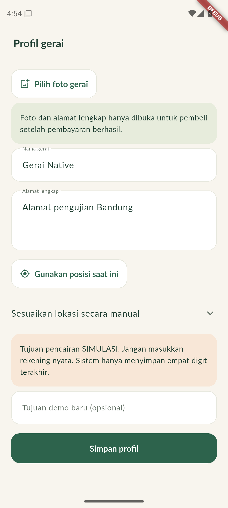 |
| UC01-TC01 s.d. UC01-TC04 | 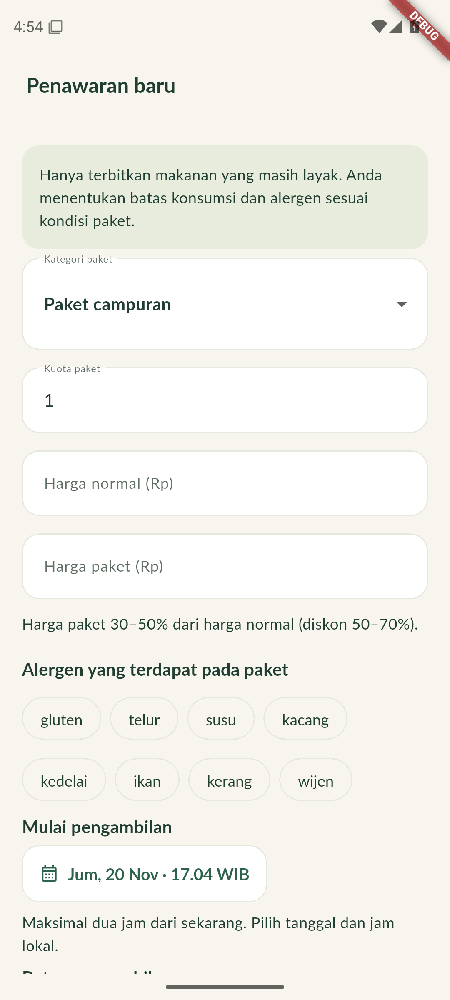 Hasil simpan, ubah, tutup dan validasi tercatat di INT-TC01. |
| UC02-TC01 s.d. UC02-TC03 | 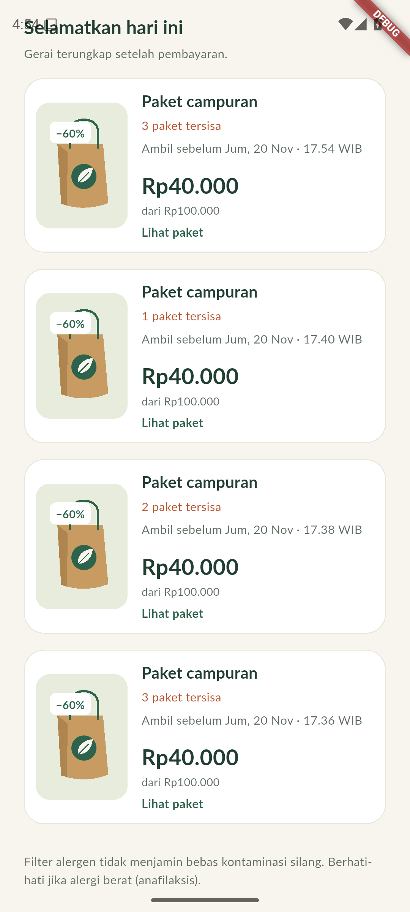 Hasil filter dan lokasi ditolak tercatat pada bukti backend dan Flutter. |
| UC03-TC01 s.d. UC03-TC03 | 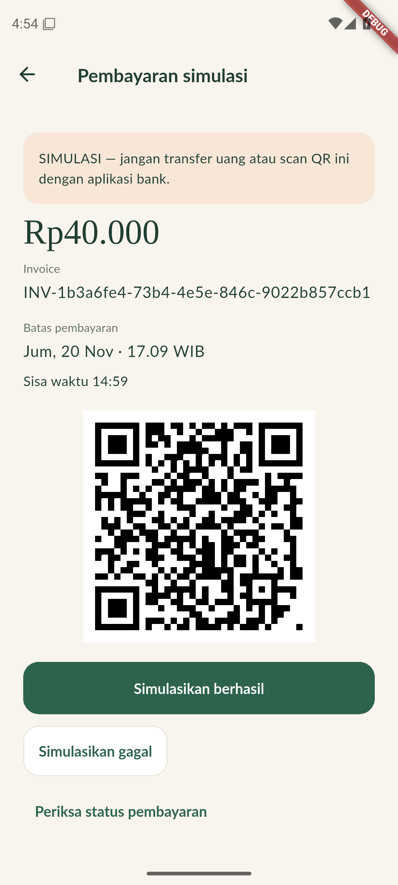 [Tiket lunas setelah pembayaran](./assets/m10-tiket-lunas.png) dan [hasil kedaluwarsa serta checkout konkuren](./assets/m10-verifikasi-backend.txt) |
| UC04-TC01 s.d. UC04-TC02 | 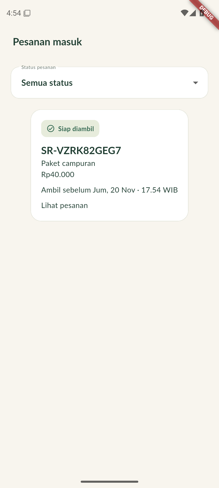 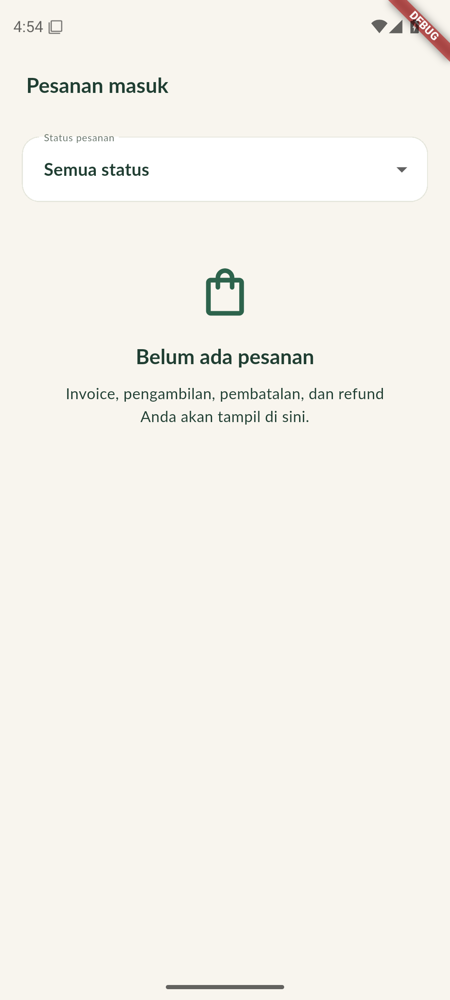 [Bukti pembaruan layar pada tes Flutter](./assets/uc04-uc06-flutter-test.png) |
| UC05-TC01 s.d. UC05-TC03 | 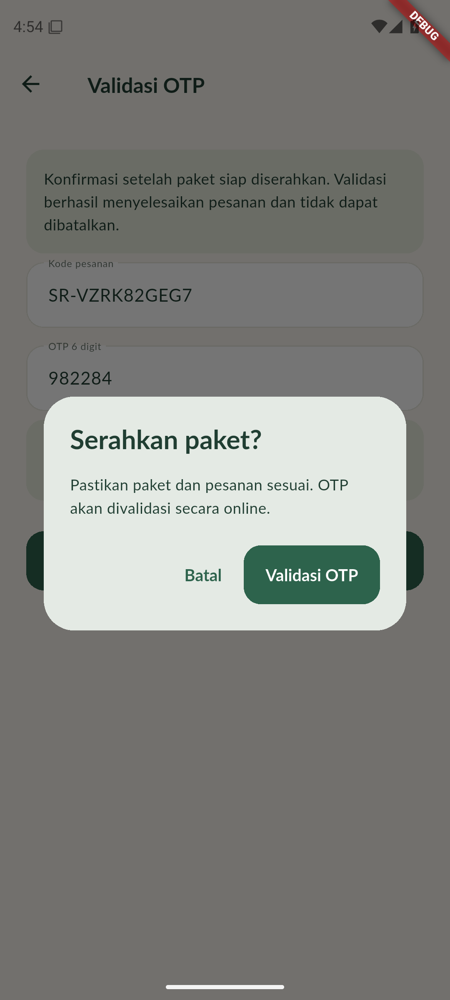 Validasi payload QR dan kasus negatif tercatat dalam hasil backend. |
| UC06-TC01 s.d. UC06-TC03 | 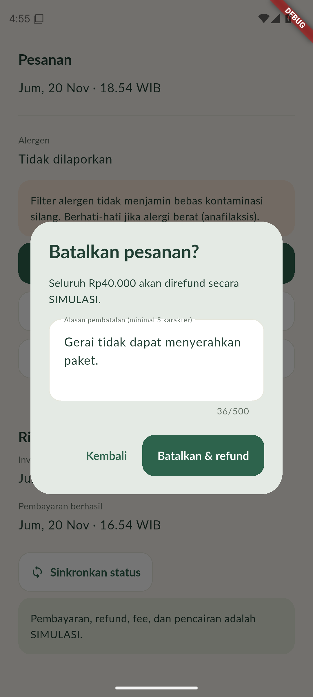 [Detail pengaduan pada tes widget](./assets/m10-widget-detail-pengaduan.png) dan [bukti auto-refund 24 jam](./assets/int-tc09-autorefund.png) |
| UC07-TC01 | 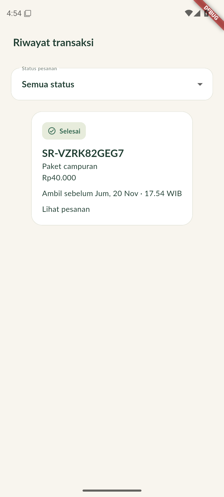 |
| UC07-TC02 | 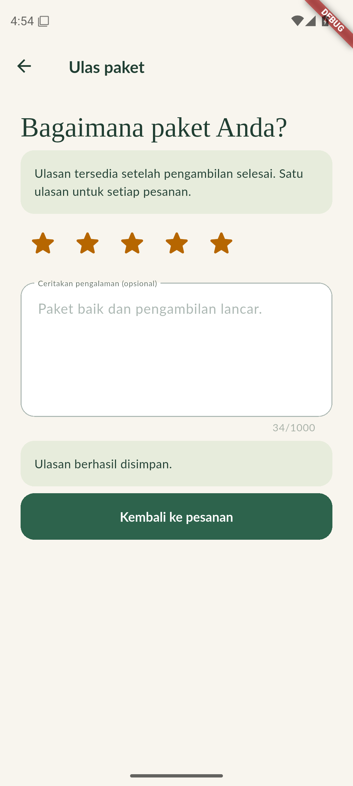 |
| UC07-TC03 | 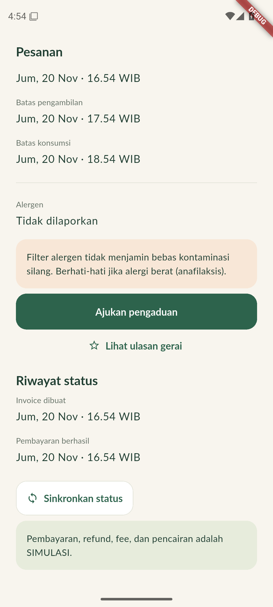 |
| KNF01-TC01 | [Uji kuota konkuren dan putus koneksi pembayaran](./assets/m10-verifikasi-backend.txt) · [Bukti tambahan pemulihan worker dari tim](./assets/knf02-tc01-reliability.png) |
| KNF02-TC01, KNF05-TC01 | [Hasil uji hash, QR sekali pakai, batas OTP, dan privasi respons](./assets/m10-verifikasi-backend.txt) |
| KNF03-TC01 | [Benchmark HTTP lokal dan EXPLAIN ANALYZE](./assets/m10-benchmark-pickup.json) |
| KNF04-TC01 | 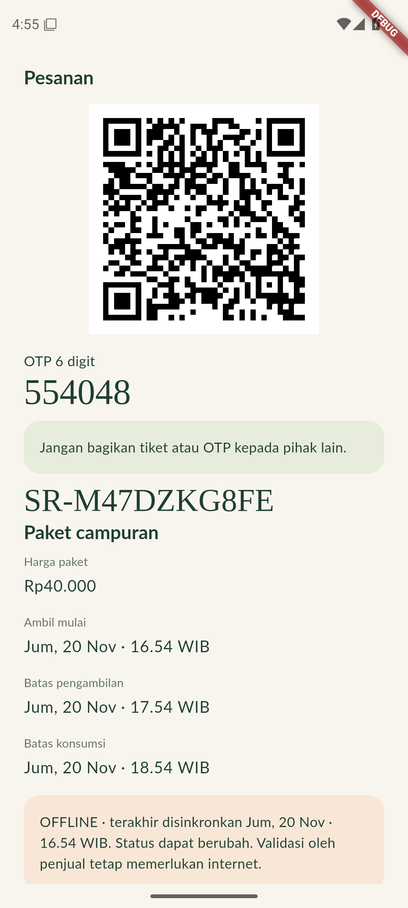 [Hasil uji Android dan Flutter](./assets/m10-verifikasi-android.txt) |
| KF05-PERF01 | [Hasil pengukuran WebSocket 30 sampel](./assets/m10-benchmark-notifikasi.json) |

Bukti pengujian anggota berikut melengkapi hasil di atas. Pengujian keamanan dan privasi serta pengukuran latensi WebSocket menggunakan ID kebutuhan dari SKPL pada tabel ini.

| ID Pengujian | Bukti Tambahan |
| :--- | :--- |
| Unit C01–C11 | [All Unit test C01 - C11](./assets/all-unit-test-C01-C11.png) |
| Coverage C03, C04, C08, C09 | [All Unit test C01 - C11](./assets/all-unit-test-C01-C11.png) · [C03 Coverage](./assets/C03-coverage.png) · [C04 Coverage](./assets/C04-coverage.png) · [C08 Coverage](./assets/C08-coverage.png) · [C09 Coverage](./assets/C09-coverage.png) |
| INT-TC01 | [INT-TC01 Formulir Penawaran](./assets/FatharINT-TC01-1-form-penawaran.png.png) · [INT-TC01 Penawaran Terbit](./assets/FatharINT-TC01-2-penawaran-terbit.png.png) · [INT-TC01 Daftar Penawaran Penjual](./assets/FatharINT-TC01-3-daftar-penjual.png.png) |
| INT-TC02 | [INT-TC02 Katalog Penawaran Pembeli](./assets/FatharINT-TC02-1-katalog.png.png) · [INT-TC02 Rincian Penawaran Anonim](./assets/FatharINT-TC02-2-rincian-anonim.png.png) |
| UC01-TC01 | [UC01-TC01 Form Penawaran Valid](./assets/FatharUC01-TC01-1-form-valid.png.png) · [UC01-TC01 Penawaran Berhasil Disimpan](./assets/FatharUC01-TC01-2-sukses.png.png) |
| UC01-TC02 | [UC01-TC02 Pesan Diskon Ditolak](./assets/FatharUC01-TC02-2-pesan-ditolak.png.png) |
| UC01-TC03 | [UC01-TC03 Form Ubah Penawaran](./assets/FatharUC01-TC03-1-ubah.png.png) · [UC01-TC03 Hasil Perubahan Penawaran](./assets/FatharUC01-TC03-2-hasil-perubahan.png.png) |
| UC01-TC04 | [UC01-TC04 Penawaran Terkunci atau Ditutup](./assets/FatharUC01-TC04-1-penawaran-terkunci.png.png) |
| UC02-TC01 | [UC02-TC01 Filter Alergen](./assets/FatharUC02-TC01-2-filter.png.png) · [UC02-TC01 Hasil Filter Alergen](./assets/FatharUC02-TC01-3-hasil-filter.png.png) · [UC02-TC01 Rincian Penawaran](./assets/FatharUC02-TC01-4-rincian.png.png) |
| UC02-TC02 | [UC02-TC02 Kombinasi Alergen](./assets/FatharUC02-TC02-1-kombinasi-alergen.png.png) · [UC02-TC02 Tidak Ada Penawaran Cocok](./assets/FatharUC02-TC02-2-tidak-ada-hasil.png.png) |
| UC02-TC03 | [UC02-TC03 Lokasi Ditolak](./assets/FatharUC02-TC03-2-lokasi-ditolak.png.png) · [UC02-TC03 Katalog Tetap Berfungsi](./assets/FatharUC02-TC03-3-katalog-tetap-berfungsi.png.png) |
| UC03-TC03 | [UC03-TC03 Penolakan Checkout Kuota Habis atau Konflik Alergen](./assets/Bintang-backend-unit-summary.jpg) |
| UC05-TC03 | [UC05-TC03 Penolakan QR atau OTP Tidak Valid dan Terpakai](./assets/Bintang-backend-unit-summary.jpg) · [UC05-TC03 Validasi Jendela Waktu Pickup dan QR Rusak](./assets/Bintang-backend-checkout-pickup-security.jpg) |
| KNF02-TC01 dan KNF05-TC01 | [Hash dan enkripsi kredensial](./assets/Bintang-backend-unit-summary.jpg) · [Pembatasan percobaan OTP](./assets/Bintang-backend-checkout-pickup-security.jpg) · [Privasi koordinat dan tiket](./assets/Bintang-android-security-summary.jpg) |
| KF05-PERF01 | [Pengukuran WebSocket oleh tim](./assets/knf05-tc01-latency.jpeg) |

---

# BAB 5: Traceability

Setiap ID mengikuti [SKPL Tabel 3.1, 3.2 dan 4.2](../M5/K01_G06_SKPL.md#bab-3-spesifikasi-kebutuhan-perangkat-lunak). Hasil kebutuhan dinilai dari bagian skenario yang mengujinya. UC03-TC01 menguji empat kebutuhan dan hasilnya dipisahkan per kebutuhan. **Sebagian** berarti ada syarat yang lulus dan syarat lain yang belum terpenuhi atau belum terverifikasi.

Tabel 5.1. Matriks Kerunutan KF terhadap Implementasi dan Pengujian

| KF ID | KNF Terkait | Use Case | Kelas | File Implementasi | Test Case Use Case | Test Case Pendukung | Status Kebutuhan |
| :--- | :--- | :--- | :--- | :--- | :--- | :--- | :--- |
| KF01 | — | UC03 | C05, C06, C07 | [checkout_screen.dart](../../src/android-app/lib/features/orders/checkout_screen.dart) [payment_screen.dart](../../src/android-app/lib/features/orders/payment_screen.dart) | UC03-TC01 | C05-UT01, C05-UT02, INT-TC05 | Fail. Pemilih kanal belum tersedia. |
| KF02 | KNF01 | UC03 | C04, C05, C06 | [service.ts](../../src/backend/src/modules/payments/service.ts) [demo-gateway.ts](../../src/backend/src/modules/payments/demo-gateway.ts) | UC03-TC01–03 | INT-TC04, INT-TC05, KNF01-TC01 | Pass untuk pembuatan, pemrosesan dan kedaluwarsa invoice simulasi. |
| KF03 | — | UC01 | C01, C03 | [schema.ts](../../src/backend/src/modules/offers/schema.ts) [service.ts](../../src/backend/src/modules/offers/service.ts) [offer_form_screen.dart](../../src/android-app/lib/features/seller/offer_form_screen.dart) | UC01-TC01–02 | C03-UT01 s.d. C03-UT07, INT-TC01 | Pass. |
| KF04 | — | UC01 | C01, C03 | [service.ts](../../src/backend/src/modules/offers/service.ts) [offers_screen.dart](../../src/android-app/lib/features/seller/offers_screen.dart) | UC01-TC03–04 | C03-UT08 s.d. C03-UT11, INT-TC01 | Pass. |
| KF05 | — | UC04 | C01, C04 | [socket-server.ts](../../src/backend/src/modules/notifications/socket-server.ts) [orders_screen.dart](../../src/android-app/lib/features/seller/orders_screen.dart) | UC04-TC01–02 | INT-TC06, KF05-PERF01 | Pass. |
| KF06 | KNF05 | UC02 | C02, C03 | [service.ts](../../src/backend/src/modules/catalog/service.ts) [catalog_screen.dart](../../src/android-app/lib/features/buyer/catalog_screen.dart) | UC02-TC01, UC02-TC03 | INT-TC02, KNF05-TC01 | Pass. |
| KF07 | — | UC02 | C02, C03 | [service.ts](../../src/backend/src/modules/auth/service.ts) [repository.ts](../../src/backend/src/modules/catalog/repository.ts) [allergen_screen.dart](../../src/android-app/lib/features/buyer/allergen_screen.dart) | UC02-TC01–02 | C02-UT01 s.d. C02-UT04, INT-TC03 | Pass. |
| KF08 | KNF05 | UC02 | C01, C02, C03 | [repository.ts](../../src/backend/src/modules/catalog/repository.ts) [catalog_controller.dart](../../src/android-app/lib/features/buyer/catalog_controller.dart) | UC02-TC01, UC02-TC03 | INT-TC02, KNF05-TC01 | Pass. |
| KF09 | KNF01 | UC03 | C03, C04, C05 | [service.ts](../../src/backend/src/modules/orders/service.ts) [service.ts](../../src/backend/src/modules/payments/service.ts) | UC03-TC01–03 | INT-TC04, INT-TC05, KNF01-TC01 | Pass untuk reservasi, perubahan kuota dan callback. |
| KF10 | KNF02, KNF04, KNF05 | UC03 | C01, C02, C04, C08 | [service.ts](../../src/backend/src/modules/orders/service.ts) [service.ts](../../src/backend/src/modules/pickup/service.ts) [order_detail_screen.dart](../../src/android-app/lib/features/orders/order_detail_screen.dart) | UC03-TC01 | INT-TC05, INT-TC07, KNF05-TC01 | Pass untuk reveal gerai dan penerbitan tiket. |
| KF11 | KNF02, KNF03 | UC05 | C01, C04, C08 | [scan_screen.dart](../../src/android-app/lib/features/seller/scan_screen.dart) [otp_screen.dart](../../src/android-app/lib/features/seller/otp_screen.dart) [service.ts](../../src/backend/src/modules/pickup/service.ts) | UC05-TC01–03 | INT-TC07, INT-TC08, KNF02-TC01, KNF03-TC01 | Sebagian. OTP dan validasi backend lulus, verifikasi kamera masih terbuka. |
| KF12 | KNF03 | UC05 | C01, C04, C08 | [service.ts](../../src/backend/src/modules/pickup/service.ts) [service.ts](../../src/backend/src/modules/payouts/service.ts) | UC05-TC02–03 | INT-TC07, INT-TC08 | Pass untuk status selesai dan jadwal payout pada validasi server/OTP. |
| KF13 | — | UC06 | C01, C02, C04, C09 | [service.ts](../../src/backend/src/modules/complaints/service.ts) [service.ts](../../src/backend/src/modules/jobs/service.ts) [complaint_form_screen.dart](../../src/android-app/lib/features/orders/complaint_form_screen.dart) | UC06-TC01–03 | C09-UT01 s.d. C09-UT12, INT-TC09 | Sebagian. Alur refund untuk paket tidak layak dan gerai tutup lulus. Pembatasan pilihan alasan pengaduan masih perlu diselaraskan dengan SKPL. |
| KF14 | — | UC07 | C01, C02, C04, C10, C11 | [service.ts](../../src/backend/src/modules/reviews/service.ts) [service.ts](../../src/backend/src/modules/metrics/service.ts) [history_screen.dart](../../src/android-app/lib/features/orders/history_screen.dart) [review_screen.dart](../../src/android-app/lib/features/orders/review_screen.dart) | UC07-TC01–03 | C10-UT01, C10-UT02, C11-UT01, C11-UT02, INT-TC10, INT-TC11 | Pass. Metrik paket selesai juga diperiksa pada [tes balapan pickup dan no-show](../../src/backend/test/integration/acceptance-races.test.ts). |

Tabel 5.2. Matriks Kerunutan KNF terhadap Pengujian

| ID KNF | Parameter SKPL | KF/UC Terkait | Test Case | Status |
| :--- | :--- | :--- | :--- | :--- |
| KNF01 | Reliabilitas transaksi pembayaran | KF02, KF09 / UC03 | KNF01-TC01 | Pass |
| KNF02 | Keamanan kata sandi dan token pickup | KF10, KF11 / UC03, UC05 | KNF02-TC01 | Pass |
| KNF03 | Waktu respons penjemputan melalui kamera | KF11, KF12 / UC05 | KNF03-TC01 | Sebagian |
| KNF04 | Portabilitas Android dan tiket offline | KF10 / UC03, UC05 | KNF04-TC01 | Pass |
| KNF05 | Privasi koordinat gerai | KF06, KF08, KF10 / UC02, UC03 | KNF05-TC01 | Pass |

Tindak lanjut untuk hasil yang masih terbuka:

- **KF01**. Tambahkan pemilih kanal pembayaran simulasi dan uji checkout melalui setiap kanal.
- **KF11 dan KNF03**. Uji pemindaian QR melalui kamera hingga status Selesai pada jaringan sesuai SKPL, lalu catat waktu dari pemindaian sampai pembaruan status.
- **KF13**. Selaraskan pilihan alasan pengaduan dengan SKPL. Jika dua alasan tambahan tetap digunakan, perbarui kebutuhan dan skenario pengujiannya.
