<h1>
IF2150 REKAYASA PERANGKAT LUNAK
 
TUGAS 5
 
DESKRIPSI PERANCANGAN PERANGKAT LUNAK (DPPL)
</h1>
 

## *SisaRasa*

  

### Untuk: *[Amanda Aurellia Salsabilla]*

Dipersiapkan oleh:
| Informasi | Keterangan |
| --------- | ---------- |
| Kelas     | K1         |
| Kelompok  | 6          |

| NIM      | Nama                         |
| -------- | ---------------------------- |
| 13525067 | Fathar Atandra Denaya        |
| 13525040 | Muhammad Zaky Amani          |
| 13525139 | Josephine Bintang N.L        |
| 13525070 | Devina Athalia Putri Kusumah |
| 13525004 | Nabil Rabbani                |
---

## Daftar Perubahan

| Revisi | Deskripsi |
| :--- | :--- |
| *A* | *Mengganti Format Penulisan BAB 1.5 dan 1.6* |
| *B* |  |
| *C* |  |
| ... |  |

---

# BAB 1: Pendahuluan

## 1.1 Tujuan Penulisan Dokumen
Dokumen Spesifikasi Kebutuhan Perangkat Lunak (SKPL) ini bertujuan untuk merinci secara komprehensif seluruh spesifikasi fungsional, non-fungsional, serta batasan operasional yang dibutuhkan dalam pengembangan aplikasi SisaRasa. Dokumen ini dirancang sebagai acuan teknis utama bagi tim pengembang, perancang sistem, penguji (*tester*), serta pihak asisten mata kuliah Rekayasa Perangkat Lunak dalam memahami ruang lingkup dan perilaku sistem secara utuh sebelum tahap implementasi kode dilakukan.

## 1.2 Lingkup Masalah
SisaRasa adalah aplikasi *marketplace* penyelamat makanan surplus berbasis Android native (Flutter) yang memfasilitasi transaksi "paket kejutan" (*mystery box*) anonim antara *merchant* makanan (Penjual) dan konsumen (Pembeli). Solusi ini dirancang untuk mengatasi kerugian finansial *merchant* akibat penumpukan makanan layak makan yang tak terjual, sekaligus menyediakan akses pangan berkualitas dengan harga terjangkau (diskon 50%–70%) bagi masyarakat. Sistem membatasi interaksi secara anonim hingga transaksi lunas, serta mewajibkan mekanisme pengambilan mandiri (*pickup-only*) menggunakan kode QR dinamis untuk menjamin kepraktisan operasional tanpa mengganggu sistem kasir internal toko.

## 1.3 Definisi, Istilah, dan Singkatan
Semua definisi, singkatan, dan akronim yang digunakan dalam dokumen SKPL ini beserta penjelasannya diuraikan pada Tabel 1.3 di bawah ini:

Tabel 1.3. Definisi Istilah dan Singkatan

| Singkatan, Akronim, atau Istilah | Penjelasan |
| :--- | :--- |
| *SisaRasa* | Nama perangkat lunak berupa aplikasi *marketplace* penyelamat makanan surplus berbasis Android native (Flutter). |
| *P/L* | Singkatan dari Perangkat Lunak, yaitu aplikasi yang memberikan perintah kepada komputer untuk menjalankan tugas tertentu. |
| *SKPL* | Singkatan dari Spesifikasi Kebutuhan Perangkat Lunak, yaitu dokumen yang merangkum kriteria yang diperlukan untuk membangun aplikasi. |
| *KF* | Singkatan dari Kebutuhan Fungsional. |
| *KNF* | Singkatan dari Kebutuhan Non-Fungsional. |
| *UC* | Singkatan dari *Use Case*. |
| *EARS* | *Easy Approach to Requirements Syntax*, yaitu pola penulisan kebutuhan agar konsisten dan mudah diuji. |
| *Flutter* | *Framework open-source* berbasis bahasa Dart yang digunakan untuk membangun aplikasi Android native. |
| *QRIS* | *Quick Response Code Indonesian Standard*, yaitu standarisasi pembayaran menggunakan kode QR nasional untuk memproses transaksi digital. |
| *WebSocket* | Protokol komunikasi dua arah secara *real-time* antara server API dan aplikasi Android. |
| *Payout* | Proses pencairan dana dari platform kepada penjual setelah pesanan berhasil diserahkan dan divalidasi. |
| *Pickup-only* | Mekanisme pemenuhan pesanan di mana pembeli wajib mengambil makanan secara mandiri ke lokasi penjual tanpa menggunakan jasa kurir pengantaran. |

## 1.4 Aturan Penomoran
Dokumen Spesifikasi Kebutuhan Perangkat Lunak (SKPL) ini menggunakan aturan penomoran identitas (ID) yang konsisten dengan dokumen-dokumen perancangan sebelumnya. Penomoran ID digunakan untuk mempermudah pemetaan dan pelacakan (*traceability*) antar-elemen kebutuhan, aktor, *use case*, dan kelas.

Tabel 1.4. Aturan Penomoran

| Hal/Bagian | Penomoran | Keterangan |
| :--- | :--- | :--- |
| *Pemetaan Kebutuhan* | *RXX* | Menunjukkan ID kebutuhan dasar hasil analisis masalah. |
| *Kebutuhan Fungsional* | *KFXX* | Menunjukkan ID Kebutuhan Fungsional perangkat lunak. |
| *Kebutuhan Non-Fungsional* | *KNFXX* | Menunjukkan ID Kebutuhan Non-Fungsional (kualitas, keamanan, performa). |
| *Aktor* | *AXX* | Menunjukkan ID aktor pengguna yang berinteraksi dengan sistem. |
| *Use Case* | *UCXX* | Menunjukkan ID fungsi/unit interaksi pada *Use Case Diagram*. |
| *Kelas* | *CXX* | Menunjukkan ID struktur entitas data/kelas pada *Class Diagram*. |

## 1.5 Referensi
Dokumentasi dan acuan standar yang dirujuk dalam penyusunan dokumen SKPL aplikasi SisaRasa ini meliputi:

1. **Kementerian PPN/Bappenas.** (2021). *Kajian Food Loss and Waste di Indonesia dalam Rangka Membangun Ekonomi Sirkular*.
2. **Republik Indonesia.** (2012). *Undang-Undang Nomor 18 Tahun 2012 tentang Pangan*.
3. **Republik Indonesia.** (2022). *Undang-Undang Nomor 27 Tahun 2022 tentang Pelindungan Data Pribadi (UU PDP)*.
4. **IEEE Computer Society.** (1998). *IEEE Std 830-1998: IEEE Recommended Practice for Software Requirements Specifications*.
5. **PlantUML Documentation.** (n.d.). *Class Diagram Syntax and Features*. Diakses dari https://plantuml.com/class-diagram
6. **Draw.io / Diagrams.net.** (n.d.). *Open source diagramming software for UML*. Diakses dari https://www.drawio.com/
7. **Kelompok 6 K1 IF2150.** (2026). *Spesifikasi Kebutuhan Perangkat Lunak (SKPL) SisaRasa. Program Studi Teknik Informatika ITB*.   
8. **Kelompok 6 K1 IF2150.** (2026). *Arsitektur Perangkat Lunak (APL) SisaRasa. Program Studi Teknik Informatika ITB*.

## 1.6 Deskripsi Umum Dokumen (Ikhtisar)
Dokumen DPPL ini disusun secara sistematis ke dalam 5 bab utama untuk memberikan gambaran rancangan terstruktur aplikasi SisaRasa: Bab 1 menyajikan pendahuluan, lingkup masalah, daftar definisi, aturan penomoran ID, dan referensi; Bab 2 mendeskripsikan perancangan arsitektur meliputi lingkungan implementasi, pola Client-Server/MVC, identifikasi komponen, dan view arsitektur (Logical & Deployment View); Bab 3 menjabarkan realisasi seluruh use case (UC01–UC07) mencakup identifikasi kelas, sequence diagram skenario normal/alternatif, dan class diagram per use case; Bab 4 menampilkan class diagram keseluruhan beserta rincian lengkap atribut dan metodenya; serta Bab 5 memuat matriks kerunutan yang memetakan kelas terhadap use case yang direalisasikannya.

 

---

# BAB 2: Perancangan Arsitektur

## 2.1 Rancangan Lingkungan Implementasi

Spesifikasi teknis lingkungan implementasi perangkat lunak SisaRasa dirancang sebagai berikut:

* **Sistem Operasi Server**: Linux (Ubuntu LTS) pada Virtual Private Server (VPS) untuk lingkungan produksi, serta Windows/macOS/Linux untuk lingkungan pengembangan lokal.
* **Sistem Operasi Klien**: Android (minimal Android 10 / API level 29 ke atas).
* **Bahasa Pemrograman**: Dart (untuk klien Android Flutter) dan JavaScript / Node.js (untuk server *backend*).
* **Framework & Library Utama**: Flutter (Klien Mobile), Express.js 4 (Web Server API), `pg` (Database Driver), `mobile_scanner` (Kamera QR), dan `flutter_foreground_task` (Layanan Latar Belakang WebSocket).
* **DBMS**: PostgreSQL 15 yang dijalankan di dalam kontainer terisolasi Docker (port 5433 untuk dev / 5432 untuk prod).
* **Filing System**: POSIX Local File System pada direktori terproteksi server (`uploads/`) untuk penyimpanan foto gerai *merchant*.
* **Development Tools**: Visual Studio Code / Android Studio, Docker Desktop, Git & GitHub, serta Postman untuk pengujian API.

## 2.2 Style/Pattern Arsitektur Acuan

Dalam perancangan arsitektur perangkat lunak SisaRasa, _architectural pattern_ utama yang dipilih adallah **Client-Server Architecture** yang dipadukan dengan **Layered Architecture (MVC)** di masing-masing sisi. Pola ini memisahkan secara tegas antarmuka pengguna pada perangkat seluler (_Client_) dengan pusat pengolahan data dan logika bisnis pada infrastruktur belakang (_Server_) melalui protokol komunikasi REST API (HTTP/HTTPS) dan WebSocket.

  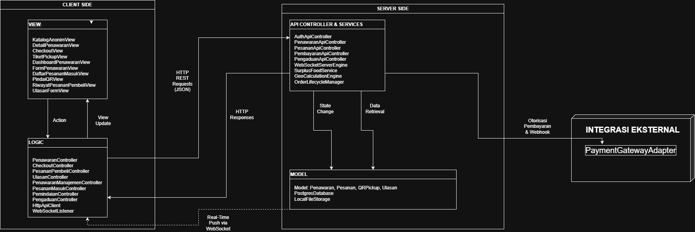

  <i>Gambar 2.1. Penerapan Arsitektur Client-Server pada Aplikasi SisaRasa</i>

Pembagian peran dan tanggung jawab tiap komponen dalam arsitektur ini meliputi:

1. **Client Side (Android Flutter Application):**
   - **View (UI Layer):** Bertanggung jawab menyajikan antarmuka bagi Pembeli (katalog anonim, _checkout_, filter alergen, tampilan QR _pickup_) dan Penjual (_dashboard_ pesanan, formulir penawaran, pemindai QR kamera).
   - **State Controller / Client Logic:** Mengelola keadaan lokal (_state_), menangani _user events_, menyimpan token autentikasi/QR secara _cached_, serta mempertahankan koneksi _WebSocket Background Service_ untuk menerima notifikasi pesanan masuk.

2. **Server Side (Node.js Express Backend):**
   - **API Controller Layer:** Menangani _endpoint_ REST API, memvalidasi _payload_ JSON masukan dari klien, serta mengelola lalu lintas koneksi WebSocket (`/ws`).
   - **Business Service Layer:** Mengeksekusi aturan bisnis inti (_business rules_), seperti validasi jendela terbit penawaran (maksimal 2 jam), perhitungan jarak relatif berbasis geolokasi di _server_, pembuatan token QR dinamis & _fallback_ OTP 6-digit, serta penanganan sengketa/pembatalan.
   - **Data Access / Repository Layer:** Berinteraksi langsung dengan basis data terpusat (PostgreSQL) dan penyimpanan berkas lokal server (`uploads/`) untuk operasi CRUD data entitas.

3. **Modul Eksternal / Subsistem Terintegrasi:**
   - **Dummy Payment Gateway Module:** Modul simulasi transaksi pembayaran digital (QRIS & _E-Wallet_) yang berjalan di dalam _server_ untuk mengelola penahanan kuota, waktu kedaluwarsa tagihan, dan pengiriman _webhook callback_.

## 2.3 Identifikasi Komponen / Modul / Subsistem

Komponen-komponen penyusun aplikasi SisaRasa diidentifikasi dari dokumen APL dan dikelompokkan berdasarkan lapisan arsitekturnya (View, Controller, Model, Service, Penyimpanan Data, dan Integrasi Eksternal):

Tabel 2.3. Identifikasi Komponen/Modul/Subsistem

| Nama Komponen/Modul/Subsistem | Jenis | Penjelasan |
| :--- | :--- | :--- |
| **Modul Pembeli** | *Subsistem* | Mewadahi seluruh view, controller, dan lokal yang digunakan peran Pembeli di aplikasi. |
| **Modul Penjual** | *Subsistem* | Mewadahi seluruh view, controller, dan lokal yang digunakan peran Penjual di aplikasi. |
| **Modul Server Side** | *Subsistem* | Mewadahi seluruh routing, controller, dan integrasi yang memproses logika bisnis di sisi server Node.js. |
| **KatalogAnonimView** | *View* | Menampilkan daftar penawaran paket surplus secara anonim beserta kontrol filter alergen dan pengurutan jarak (meneruskan aksi pencarian/filter ke PenawaranController). |
| **DetailPenawaranView** | *View* | Menampilkan rincian satu penawaran (kategori, info alergen, harga normal/diskon, jendela pickup) sebelum Pembeli melanjutkan ke checkout. |
| **CheckoutView** | *View* | Menampilkan ringkasan pesanan dan pilihan metode pembayaran (QRIS/E-Wallet), meneruskan konfirmasi ke CheckoutController. |
| **KatalogController** | *View* | Memproses permintaan daftar produk dan penambahan produk ke keranjang. |
| **TiketPickupView** | *View* | Menampilkan kode QR pickup beserta nama dan alamat merchant yang baru terbuka setelah pembayaran terverifikasi. |
| **RiwayatPesananPembeliView** | *View* | Memproses pemilihan metode pembayaran dan meneruskan permintaan otorisasi ke PaymentGatewayAdapter. |
| **UlasanFormView** | *View* | Menampilkan form rating bintang dan komentar untuk pesanan berstatus "Selesai". |
| **DashboardPenawaranView** | *View* | Menampilkan daftar penawaran aktif milik Penjual beserta sisa kuota, dan aksi edit/tutup penawaran. |
| **FormPenawaranView** | *View* | Formulir untuk membuat atau mengubah penawaran (kategori, nilai normal, harga diskon, kuota, jendela pickup), dengan validasi lokal rentang diskon 50–70%. |
| **DaftarPesananMasukView** | *View* | Menampilkan pesanan yang sudah dibayar dan perlu disiapkan, lengkap jadwal pickup-nya. |
| **PindaiQRView** | *View* | Antarmuka/Interface kamera untuk memindai kode QR pickup Pembeli sebagai bukti serah-terima. |
| **RiwayatTransaksiPenjualView** | *View* | Menampilkan riwayat transaksi milik Penjual. |
| **PesananController** | *Controller* | Menampilkan daftar pesanan milik Pembeli beserta status (menunggu bayar, menunggu pickup, selesai, gagal diambil) dan akses ke form ulasan. |
| **PenawaranController** | *Controller* | Memproses permintaan daftar penawaran dari KatalogAnonimView, meneruskan parameter filter alergen/lokasi ke HttpApiClient. |
| **CheckoutController** | *Controller* | Memproses pemilihan metode pembayaran dan mengirimkan permintaan checkout/otorisasi pembayaran ke server melalui HttpApiClient. |
| **PesananPembeliController** | *Controller* | Mengambil status dan detail pesanan Pembeli (termasuk token QR pickup) secara berkala dari server. |
| **UlasanController** | *Controller* | Memvalidasi input ulasan melalui ValidasiFormInput, lalu mengirimkan data rating/komentar ke server. |
| **PenawaranManajemenController**| *Controller* | Memproses pembuatan, perubahan, dan penutupan penawaran dari FormPenawaranView/DashboardPenawaranView, memanggil ValidasiFormInput sebelum mengirim ke server. |
| **PesananMasukController** | *Controller* | Mengambil daftar pesanan masuk dari server dan memperbarui tampilan DaftarPesananMasukView saat ada notifikasi baru dari WebSocketListener. |
| **PemindaianController** | *Controller* | Menerima hasil pemindaian dari KameraScannerAdapter, lalu mengirimkan token QR ke server untuk divalidasi. |
| **PengaduanController** | *Controller* | Memproses konfirmasi/penolakan Penjual atas pengajuan sengketa/refund dari Pembeli. |
| **PenawaranController (Server)** | *Controller (Server)* | Mengeksekusi logika bisnis untuk menerbitkan, mengubah, menutup, dan memfilter penawaran makanan surplus dari sisi server. |
| **PesananController (Server)** | *Controller (Server)* | Menangani pembuatan pesanan, verifikasi pemindaian token kode QR pickup, serta memperbarui status transaksi di basis data. |
| **PembayaranController (Server)**| *Controller (Server)* | Memproses permintaan checkout dari klien dan meneruskannya ke PaymentGatewaySimulator. |
| **Penawaran** | *Model* | Representasi lokal data satu paket penawaran (kategori, harga, kuota, jendela pickup) yang diterima dari server, dipakai oleh KatalogAnonimView dan DetailPenawaranView. |
| **Pesanan** | *Model* | Representasi lokal data satu pesanan beserta status alurnya, dipakai bersama oleh Modul Pembeli dan Modul Penjual. |
| **QRPickup** | *Model* | Representasi lokal token QR pickup dan masa berlakunya, ditampilkan oleh TiketPickupView. |
| **Ulasan** | *Model* | Representasi lokal rating dan komentar yang akan dikirim lewat UlasanController. |
| **Router API** | *Routing* | Mengelola dan mengarahkan jalur permintaan HTTP (REST API) dari aplikasi Android klien ke Controller yang sesuai. |
| **WebSocket Engine** | *Integrasi / Komunikasi* | Mengelola saluran komunikasi persisten dua arah (`/ws`) untuk menyiarkan notifikasi pesanan baru secara real-time ke perangkat Penjual. |
| **HaversineGeoService** | *Pendukung (Service)* | Menghitung perkiraan jarak spasial antara Pembeli dan Penjual sepenuhnya di sisi server untuk melindungi privasi koordinat merchant. |
| **PaymentGatewaySimulator** | *Integrasi Eksternal (Dummy)* | Subsistem internal yang mensimulasikan otorisasi pembayaran (QRIS/E-Wallet), menahan kuota sementara, dan membatalkan tagihan kedaluwarsa. |
| **FileStorageService** | *Penyimpanan Berkas* | Mengelola otorisasi akses dan penyimpanan fisik foto gerai pada direktori lokal `uploads/` di server. |
| **Database (PostgreSQL)** | *Penyimpanan Data* | Menjalankan transaksi ACID untuk menyimpan data pengguna, penawaran, pesanan, dan log audit secara persisten. |

## 2.4 Model Arsitektur Perangkat Lunak

### 2.4.1 Logical View

#### 2.4.1.1 Deksripsi Logical View

Logical View mendeskripsikan abstraksi utama sistem dan hubungannya untuk mendukung kebutuhan fungsional perangkat lunak. Fokus utama dari view ini adalah memetakan layanan dan fitur yang disediakan sistem agar pembagian fungsi dan hubungan layanan yang memenuhi kebutuhan bisnis SisaRasa dapat lebih mudah dipahami.

Logical View ini menstrukturkan komponen-komponen sistem ke dalam pola Model-View-Controller (MVC). Pola MVC secara tegas memisahkan pengelolaan data dan perilaku domain pada lapisan Model, penyajian informasi pada lapisan View, serta koordinasi interaksi pengguna pada lapisan Controller. Pembagian ini menjamin modularitas tinggi antara Modul Pembeli dan Modul Penjual, meskipun keduanya berinteraksi dengan entitas domain sentral yang sama.

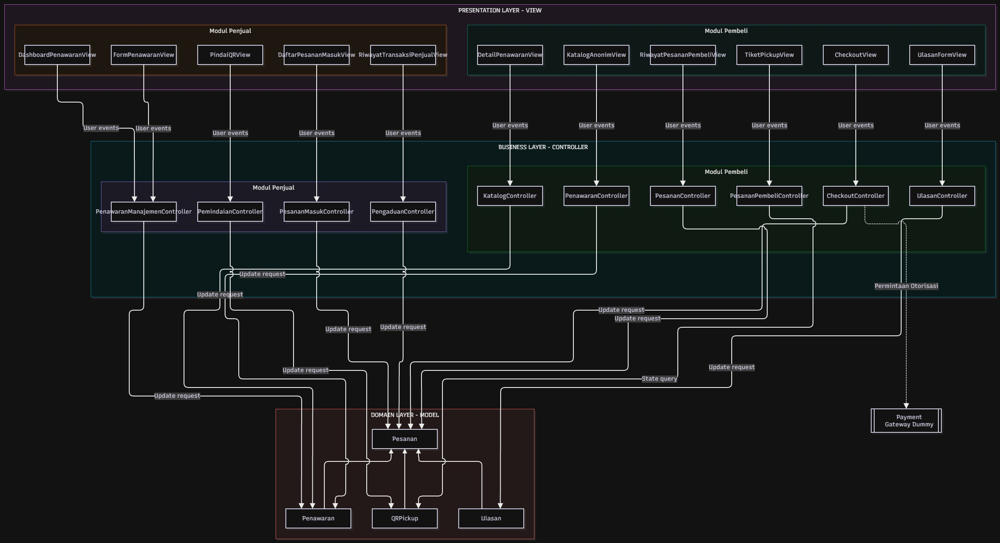

<i>Gambar 2.2. Diagram Logical View SisaRasa</i>

#### 2.4.1.2 Relasi dan Interaksi Antarkomponen

Diagram keseluruhan sistem di atas mendeskripsikan abstraksi relasi fungsional. Hubungan antarkomponen diatur berdasarkan prinsip arsitektur MVC:

1. View --> Controller (User Events): Komponen View bertanggung jawab menyajikan antarmuka dan menangkap interaksi pengguna (seperti menekan tombol checkout atau menyimpan penawaran). Interaksi ini diteruskan ke Controller dalam bentuk User events.
2. Controller --> Model (Update Request): Controller memetakan aksi pengguna menjadi pembaruan pada entitas data. Controller mengirimkan Update request ke komponen Model untuk mengubah status, memotong kuota, atau memvalidasi logika bisnis.
3. Model --> Model (Agregasi & Komposisi): Entitas data pada Model saling berelasi. Pesanan memiliki relasi agregasi dengan Penawaran (karena penawaran tetap ada meskipun pesanan dibatalkan). Sebaliknya, Pesanan memiliki relasi komposisi dengan QRPickup dan Ulasan (karena QR dan Ulasan tidak dapat berdiri sendiri tanpa adanya pesanan).
4. Controller --> Eksternal: CheckoutController mendelegasikan proses penahanan kuota dan pemrosesan dana ke sistem eksternal Payment Gateway Dummy melalui koneksi terpisah.

#### 2.4.1.3 Audit Konsistensi Arsitektur Logis

Audit ini memastikan bahwa rancangan _Logical View_ telah mencakup seluruh komponen, kelas, dan subsistem yang diidentifikasi pada Bab 2, serta mendukung seluruh _use case_ yang ditetapkan pada SKPL.

| Aspek Arsitektur                  | Kriteria Acuan (Bab 1, Bab 2 & SKPL)                                       | Implementasi pada Logical View                                                                         | Status Evaluasi |
| :-------------------------------- | :------------------------------------------------------------------------- | :----------------------------------------------------------------------------------------------------- | :-------------: |
| **Kepatuhan Pola (Pattern)**      | Memisahkan data, penyajian, dan koordinasi interaksi pada pola MVC.        | Diagram dikelompokkan secara hierarkis menjadi tiga lapisan utama: _View_, _Controller_, dan _Model_.  |    **Valid**    |
| **Kelengkapan Subsistem Pembeli** | Mencakup seluruh kelas _View_ dan _Controller_ Modul Pembeli (Tabel 2.1).  | `KatalogAnonimView`, `CheckoutView`, `KatalogController`, dll., seluruhnya terpetakan di zona Pembeli. |    **Valid**    |
| **Kelengkapan Subsistem Penjual** | Mencakup seluruh kelas _View_ dan _Controller_ Modul Penjual (Tabel 2.2).  | `FormPenawaranView`, `PindaiQRView`, `PesananMasukController`, dll., terpetakan di zona Penjual.       |    **Valid**    |
| **Sentralisasi Domain (Model)**   | Berisi entitas data: `Penawaran`, `Pesanan`, `QRPickup`, `Ulasan` (Bab 2). | Dikelompokkan pada _Domain Layer_ yang diakses oleh _Controller_ dari kedua aktor (Pembeli & Penjual). |    **Valid**    |
| **Dukungan Kebutuhan Eksternal**  | Mendukung integrasi dengan _Payment Gateway dummy_ sesuai alur bisnis.     | `CheckoutController` memiliki relasi _Permintaan Otorisasi_ terhadap modul `Payment Gateway Dummy`.    |    **Valid**    |

### 2.4.2 Deployment View (Physical View) & Audit Konsistensi

#### 2.4.2.1 Deskripsi Deployment View

Deployment View (Physical View) menggambarkan pemetaan fisik antara modul dan artefak perangkat lunak SisaRasa ke dalam simpul komputasi (_nodes_), lingkungan eksekusi (_runtime_), serta media komunikasi fisik yang menghubungkannya. Seluruh pemetaan pada _view_ ini diturunkan secara langsung dari spesifikasi lingkungan operasi pada Tabel 1.1 dokumen ini (serta subbab 2.5 dokumen SKPL).

  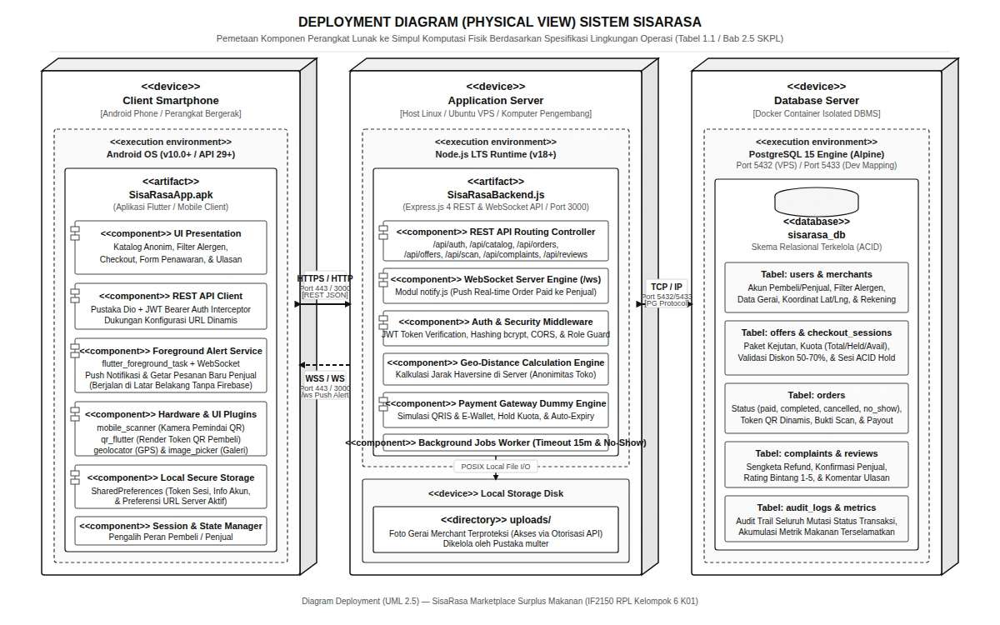

  <i>Gambar 2.3. Deployment Diagram (Physical View) Sistem SisaRasa</i>

Sistem SisaRasa terdistribusi ke dalam 3 simpul fisik (_tier_) utama:

1. **Client Node (Smartphone Android Pengguna):**
   - **Simpul Fisik**: Perangkat bergerak (_smartphone_) pengguna yang menjalankan sistem operasi Android (minimal Android 10 / API level 29 ke atas).
   - **Artefak Perangkat Lunak**: Berkas biner tunggal `SisaRasaApp.apk` yang dibangun menggunakan framework Flutter. Berkas aplikasi ini memuat peran Pembeli dan Penjual sekaligus yang dapat diakses sesuai kredensial saat autentikasi.
   - **Subsistem & Modul Internal**:
     - _Modul Pembeli_: Penelusuran katalog makanan surplus secara anonim, pengaturan preferensi filter alergen, formulir checkout, penampil tiket penjemputan (kode QR dinamis), serta antarmuka pemberian ulasan/rating.
     - _Modul Penjual_: Manajemen formulir penawaran (validasi diskon 50–70% dan kelayakan konsumsi), pemantau jadwal penjemputan, serta antarmuka pemindai kode QR penjemputan.
     - _Layanan Native & Jaringan_: Pustaka kamera `mobile_scanner` untuk validasi serah-terima fisik, plugin geolokasi perangkat (`geolocator`) untuk penghitungan jarak, modul HTTP REST client berbasis JSON (`dio`) dengan penyisipan _Bearer JWT Token_, serta _Android Foreground Service_ (`flutter_foreground_task`) yang menjaga koneksi WebSocket tetap hidup di latar belakang agar notifikasi pesanan baru dapat diterima oleh Penjual secara seketika.
2. **Application Server Node (Host Server Aplikasi):**
   - **Simpul Fisik**: Server komputasi fisik atau Virtual Private Server (VPS) berbasis sistem operasi Linux (Ubuntu LTS). Pada fase pengembangan lokal, simpul ini dapat berjalan langsung di komputer pengembang.
   - **Lingkungan Eksekusi**: Runtime Node.js LTS (versi 18 ke atas) yang menjalankan aplikasi web server berbasis Express.js 4 pada port 3000.
   - **Subsistem & Modul Internal**:
     - _Router & Controller API_: Mengelola jalur permintaan REST API (`/api/auth`, `/api/catalog`, `/api/orders`, `/api/scan`, `/api/complaints`, dll.).
     - _WebSocket Server Engine_: Mengelola saluran komunikasi persisten `/ws` untuk menyiarkan pemberitahuan pesanan masuk baru ke HP Penjual secara _real-time_.
     - _Geo-Calculation Engine_: Menghitung perkiraan jarak relatif antara pembeli dan merchant di sisi server menggunakan formula Haversine tanpa mengekspos koordinat GPS presisi toko sebelum pembayaran.
     - _In-Server Payment Gateway Simulator_: Modul dummy terintegrasi di dalam server untuk memproses simulasi pembayaran digital (QRIS dan e-wallet), penahanan kuota, serta pembatalan tagihan kedaluwarsa.
     - _Background Job Worker_: Proses latar belakang terjadwal untuk membatalkan sesi checkout yang melewati batas waktu 15 menit, menonaktifkan kode QR yang kedaluwarsa, dan menjadwalkan pencairan dana (_payout_).
     - _Penyimpanan Berkas Terproteksi_: Direktori disk lokal server (`uploads/`) untuk menyimpan foto gerai toko yang hanya dapat diakses melalui otorisasi API setelah transaksi berhasil.
3. **Database Server Node (Simpul Persistensi Data):**
   - **Simpul Fisik / Kontainer**: Kontainer terisolasi Docker yang menjalankan sistem manajemen basis data relasional PostgreSQL 15.
   - **Basis Data Relasional (`sisarasa_db`)**: Mengelola tabel persisten sistem, meliputi `users`, `merchants`, `offers`, `orders`, `checkout_sessions` (pengendali isolasi ACID kuota), `complaints` (pengaduan refund), `reviews` (ulasan pembeli), serta `audit_logs` dan `platform_metrics`.

#### 2.4.2.2 Protokol Jaringan dan Komunikasi Antar-Simpul

Interaksi antar-simpul fisik diatur dengan ketentuan protokol sebagai berikut:

1. **Client Node ↔ Application Server Node (REST API)**:
   - Menggunakan protokol **HTTPS / HTTP** pada port 443 / 3000 dengan format muatan data pertukaran terstandarisasi **JSON**.
   - Seluruh permintaan yang memerlukan hak akses dilindungi oleh _Authorization Header_ berbasis JSON Web Token (JWT).
2. **Client Node ↔ Application Server Node (Notifikasi Real-time)**:
   - Menggunakan protokol **WebSocket (WSS / WS)** pada port 443 / 3000 melalui endpoint `/ws`.
   - Saluran ini beroperasi secara _full-duplex_ dan dipertahankan oleh layanan latar depan Android (_Android Foreground Service_) sehingga penjual langsung memperoleh getaran/notifikasi saat ada pesanan masuk meskipun aplikasi tidak sedang aktif dibuka di layar utama.
3. **Application Server Node ↔ Database Server Node**:
   - Menggunakan protokol biner bawaan basis data (**PostgreSQL Wire Protocol**) melalui jaringan TCP/IP internal pada port 5432 (atau port 5433 pada pemetaan Docker lokal pengembang) dengan mekanisme _connection pooling_ (`pg.Pool`).
4. **Application Server Node ↔ Storage Disk**:
   - Menggunakan panggilan antarmuka I/O berkas lokal sistem operasi (_POSIX Local File System API_) untuk operasi baca/tulis berkas foto gerai.

#### 2.4.2.3 Audit Konsistensi Arsitektur Fisik

Bagian audit ini mengevaluasi keselarasan antara perancangan Deployment View terhadap spesifikasi Lingkungan Operasi pada Tabel 1.1 dokumen APL (serta subbab 2.5 dokumen SKPL) dan pemenuhan Kebutuhan Non-Fungsional (KNF):

| Komponen / Kebutuhan         | Spesifikasi Acuan (Tabel 1.1 / SKPL)                           | Implementasi Fisik pada Deployment View                                                                     |      Status Evaluasi       |
| :--------------------------- | :------------------------------------------------------------- | :---------------------------------------------------------------------------------------------------------- | :------------------------: |
| **Klien Mobile**             | Aplikasi Android dibangun dengan Flutter (berkas APK)          | Simpul `Client Smartphone` memuat artefak `SisaRasaApp.apk` (gabungan peran Pembeli & Penjual)              | **Valid (100% Konsisten)** |
| **Server Aplikasi**          | Node.js 18+ dengan Express 4 (Port 3000, rute WebSocket `/ws`) | Simpul `Application Server` menjalankan runtime Node.js dan Express 4 API + WebSocket Engine pada port 3000 | **Valid (100% Konsisten)** |
| **DBMS**                     | PostgreSQL 15 via Docker (port 5433 dev / 5432 VPS)            | Simpul `Database Server` menjalankan kontainer Docker PostgreSQL 15 (`sisarasa_db`)                         | **Valid (100% Konsisten)** |
| **Penyimpanan Berkas**       | Foto gerai disimpan di direktori `uploads/` server terproteksi | Direktori lokal `uploads/` pada disk simpul Application Server dengan gerbang otorisasi API                 | **Valid (100% Konsisten)** |
| **Payment Gateway**          | Modul simulasi dummy in-server (QRIS & e-wallet)               | Subkomponen simulator terintegrasi di dalam simpul `Application Server`                                     | **Valid (100% Konsisten)** |
| **Pemberitahuan Penjual**    | WebSocket via layanan latar depan Android (tanpa Firebase)     | Jalur protokol WSS/WS terdedikasi antara HP Penjual dan `/ws` pada server aplikasi                          | **Valid (100% Konsisten)** |
| **KNF01 (Keandalan ACID)**   | Transaksi pembayaran & kuota memenuhi prinsip ACID             | Ditangani oleh transaksi terisolasi PostgreSQL 15 (`checkout_sessions` & kuota `offers`)                    |       **Terpenuhi**        |
| **KNF02 (Keamanan Data)**    | Enkripsi data & perlindungan identitas                         | Jalur komunikasi HTTPS/TLS, otorisasi token JWT, dan koordinat GPS presisi toko tidak terekspos             |       **Terpenuhi**        |
| **KNF03 (Notifikasi Cepat)** | Pemberitahuan pesanan masuk seketika                           | Mekanisme _event push_ WebSocket seketika ke HP Penjual begitu status pembayaran berhasil                   |       **Terpenuhi**        |
| **KNF04 (Efisiensi Biaya)**  | Biaya pihak ketiga Rp 0 (Self-hosted open-source)              | Seluruh stack berjalan mandiri di VPS/lokal tanpa layanan berbayar pihak ketiga                             |       **Terpenuhi**        |

---

# BAB 3: Realisasi Use Case

## 3.1 Use Case Membuat dan Mengelola Penawaran

**ID Use Case:** UC01  
**Nama Use Case:** Membuat dan Mengelola Penawaran

### 3.1.1 Identifikasi Kelas

Tabel 3.1. Identifikasi Kelas Use Case UC01

| No | Nama Kelas Perancangan | Nama Kelas Analisis Terkait |
|:--- | :--- | :--- |
| 1 | DashboardPenawaranView | - |
| 2 | FormPenawaranView | - |
| 3 | PenawaranManajemenController | - |
| 4 | PenawaranController (Server) | - |
| 5 | Penjual | Penjual (C01) |
| 6 | Penawaran | Penawaran (C03) |

### 3.1.2 Sequence Diagram

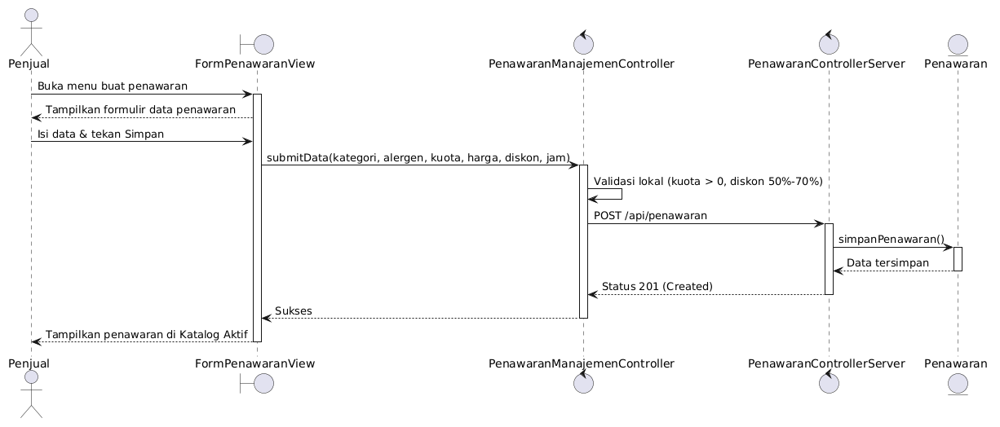

<i>Gambar 3.1. Sequence Diagram Skenario Normal UC01</i>

 

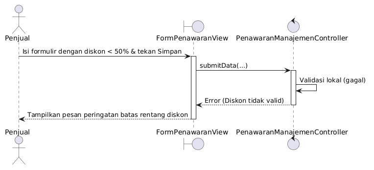

<i>Gambar 3.2. Sequence Diagram Skenario Alternatif 1 UC01</i>

 

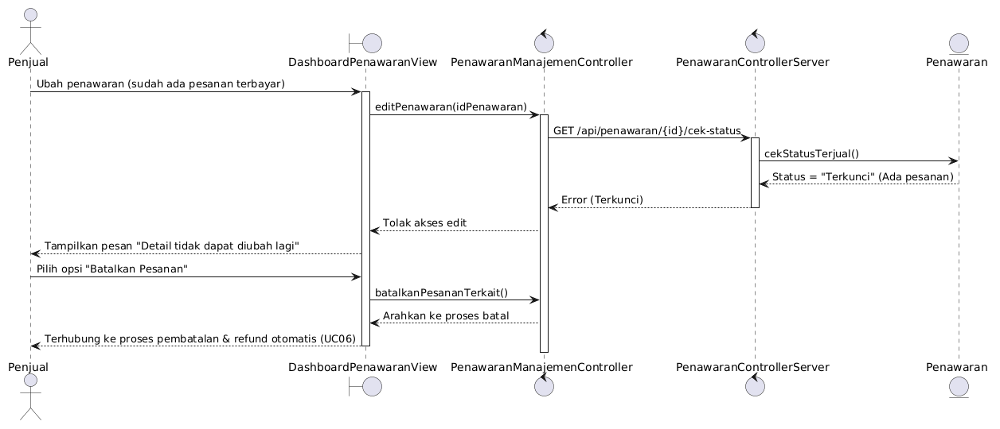

<i>Gambar 3.3. Sequence Diagram Skenario Alternatif 2 UC01</i>

 

### 3.1.3 Diagram Kelas

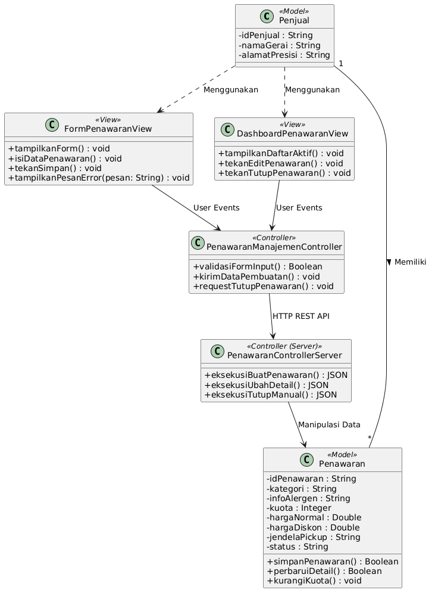

<i>Gambar 3.4. Diagram Kelas UC01</i>

 

---

## 3.2 Use Case Menelusuri Penawaran Anonim

**ID Use Case:** UC02  
**Nama Use Case:** Menelusuri Penawaran Anonim

### 3.2.1 Identifikasi Kelas

Tabel 3.2. Identifikasi Kelas Use Case UC02

| No | Nama Kelas Perancangan | Nama Kelas Analisis Terkait |
|:--- | :--- | :--- |
| 1 | KatalogAnonimView | - |
| 2 | DetailPenawaranView | - |
| 3 | KatalogController | - |
| 4 | PenawaranController (Server) | - |
| 5 | Pembeli | Pembeli (C02) |
| 6 | Penawaran | Penawaran (C03) |

### 3.2.2 Sequence Diagram

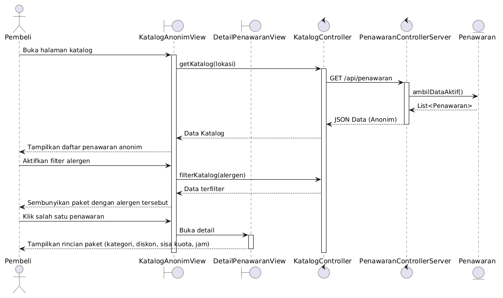

<i>Gambar 3.5. Sequence Diagram Skenario Normal UC02</i>

 

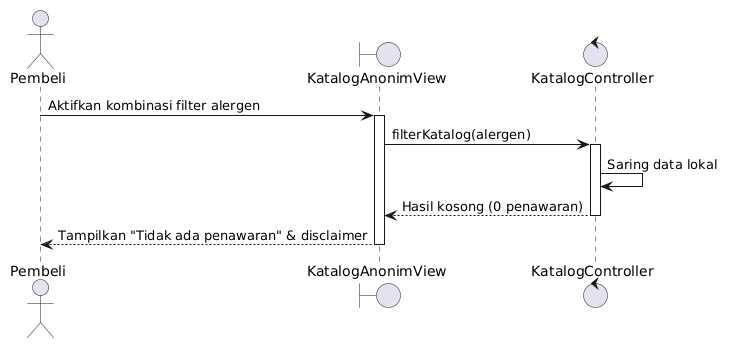

<i>Gambar 3.6. Sequence Diagram Skenario Alternatif 1 UC02</i>

 

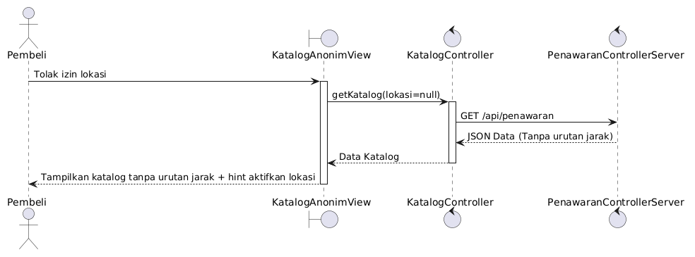

<i>Gambar 3.7. Sequence Diagram Skenario Alternatif 2 UC02</i>

 

### 3.2.3 Diagram Kelas

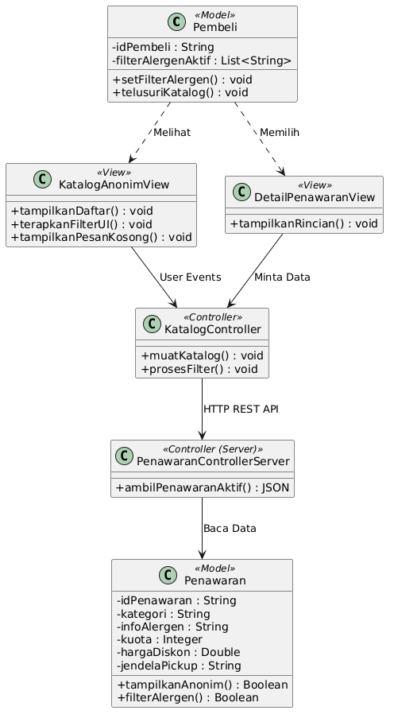

<i>Gambar 3.8. Diagram Kelas UC02</i>

 

---

## 3.3 Use Case Melakukan Transaksi Pembayaran

**ID Use Case:** UC03  
**Nama Use Case:** Melakukan Transaksi Pembayaran

### 3.3.1 Identifikasi Kelas

Tabel 3.3. Identifikasi Kelas Use Case UC03

| No | Nama Kelas Perancangan | Nama Kelas Analisis Terkait |
|:--- | :--- | :--- |
| 1 | CheckoutView | - |
| 2 | TiketPickupView | - |
| 3 | CheckoutController | - |
| 4 | PembayaranController (Server) | - |
| 5 | PaymentGatewaySimulator | - |
| 6 | Pembeli | Pembeli (C02) |
| 7 | Penawaran | Penawaran (C03) |
| 8 | Pesanan | Pesanan (C04) |
| 9 | MetodePembayaran | MetodePembayaran (C05) |
| 10 | QRIS | QRIS (C06) |
| 11 | EWallet | EWallet (C07) |
| 12 | QRPickup | QRPickup (C08) |

### 3.3.2 Sequence Diagram

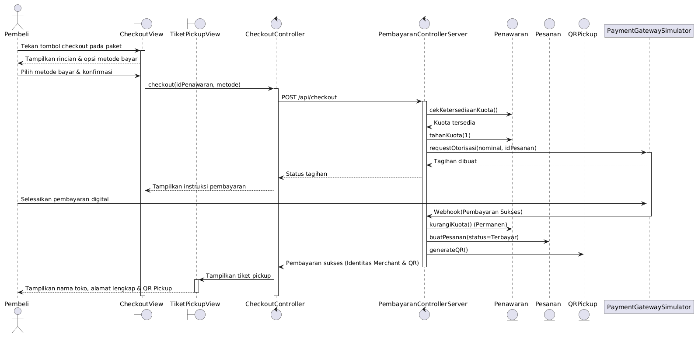

<i>Gambar 3.9. Sequence Diagram Skenario Normal UC03</i>

 

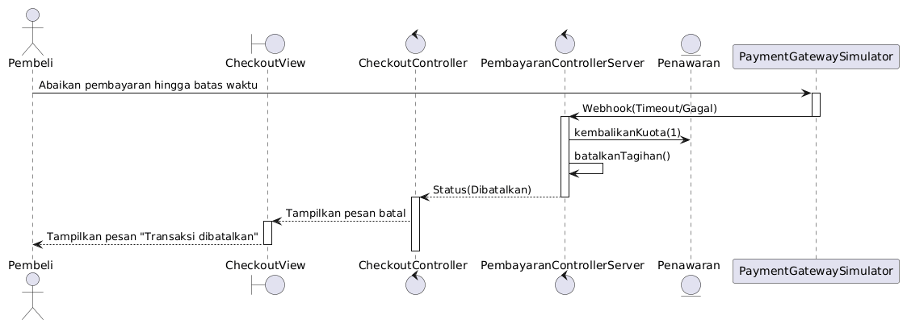

<i>Gambar 3.10. Sequence Diagram Skenario Alternatif 1 UC03</i>

 

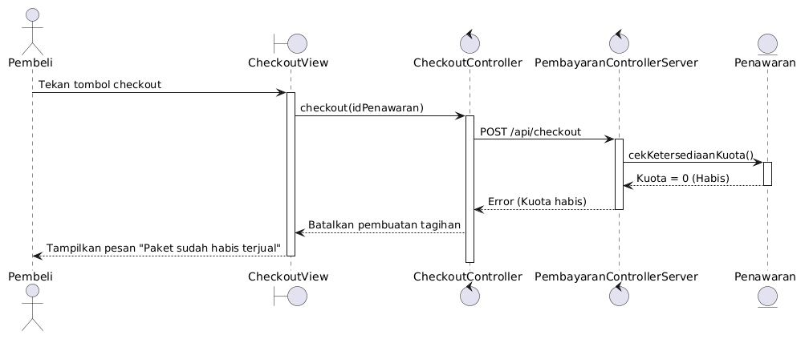

<i>Gambar 3.11. Sequence Diagram Skenario Alternatif 2 UC03</i>

 

### 3.3.3 Diagram Kelas

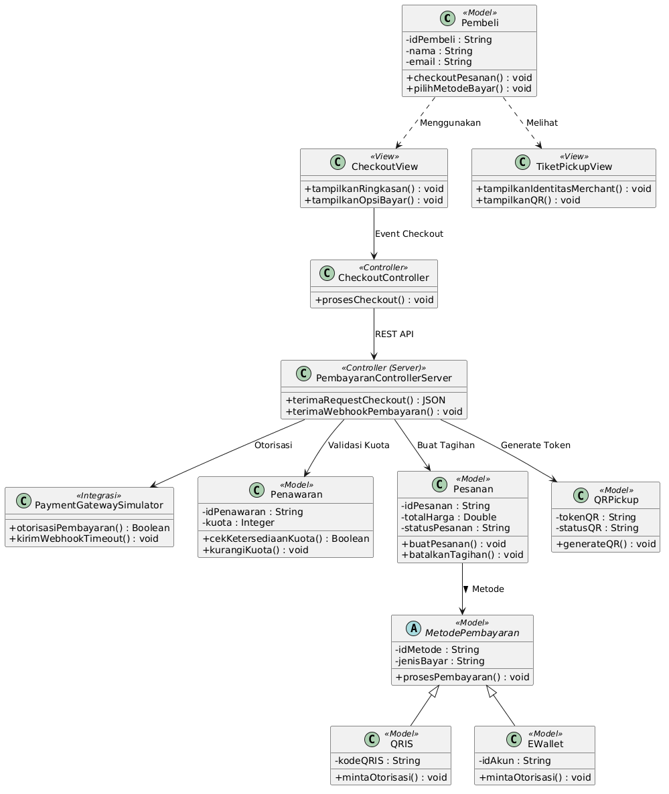

<i>Gambar 3.12. Diagram Kelas UC03</i>

 

---

## 3.4 Use Case Memantau Pesanan Masuk

**ID Use Case:** UC04  
**Nama Use Case:** Memantau Pesanan Masuk

### 3.4.1 Identifikasi Kelas

Tabel 3.4. Identifikasi Kelas Use Case UC04

| No | Nama Kelas Perancangan | Nama Kelas Analisis Terkait |
|:--- | :--- | :--- |
| 1 | DaftarPesananMasukView | - |
| 2 | PesananMasukController | - |
| 3 | WebSocket Engine | - |
| 4 | Penjual | Penjual (C01) |
| 5 | Pesanan | Pesanan (C04) |

### 3.4.2 Sequence Diagram

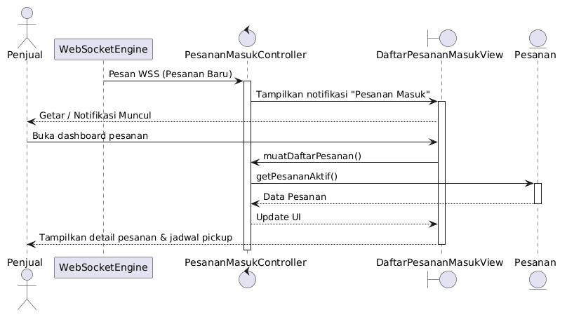

<i>Gambar 3.13. Sequence Diagram Skenario Normal UC04</i>

 

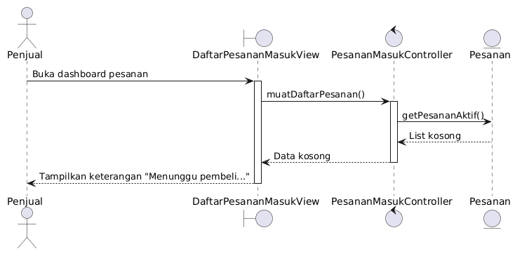

<i>Gambar 3.14. Sequence Diagram Skenario Alternatif 1 UC04</i>

 

### 3.4.3 Diagram Kelas

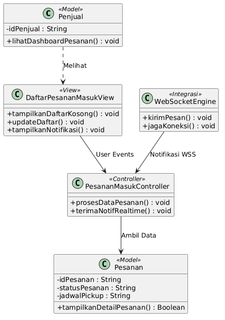

<i>Gambar 3.15. Diagram Kelas UC04</i>

 

---

## 3.5 Use Case Memvalidasi Pengambilan Pesanan

**ID Use Case:** UC05  
**Nama Use Case:** Memvalidasi Pengambilan Pesanan

### 3.5.1 Identifikasi Kelas

Tabel 3.5. Identifikasi Kelas Use Case UC05

| No | Nama Kelas Perancangan | Nama Kelas Analisis Terkait |
|:--- | :--- | :--- |
| 1 | PindaiQRView | - |
| 2 | PemindaianController | - |
| 3 | PesananController (Server) | - |
| 4 | Penjual | Penjual (C01) |
| 5 | Pembeli | Pembeli (C02) |
| 6 | Pesanan | Pesanan (C04) |
| 7 | QRPickup | QRPickup (C08) |

### 3.5.2 Sequence Diagram

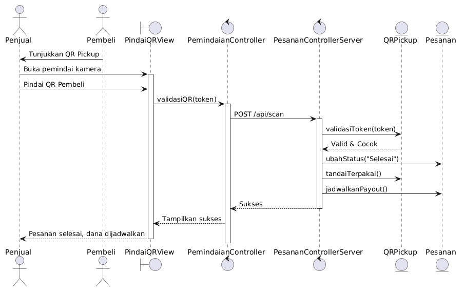

<i>Gambar 3.16. Sequence Diagram Skenario Normal UC05</i>

 

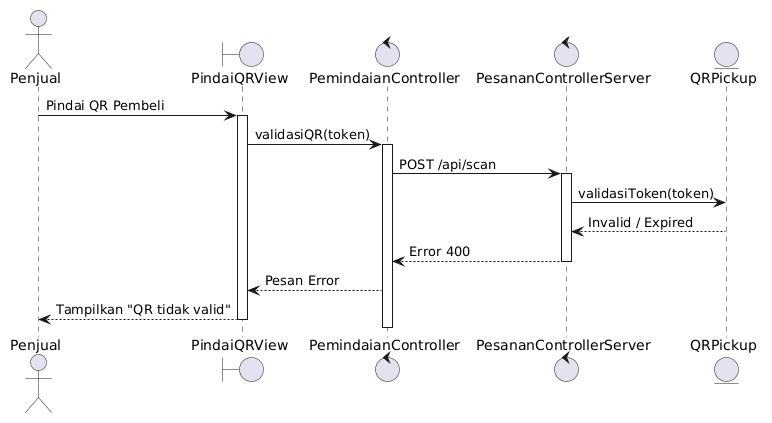

<i>Gambar 3.17. Sequence Diagram Skenario Alternatif 1 UC05</i>

 

### 3.5.3 Diagram Kelas

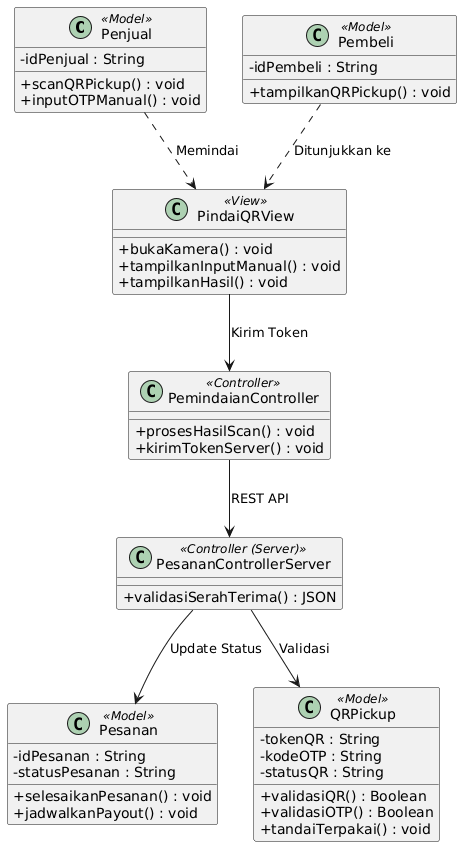

<i>Gambar 3.18. Diagram Kelas UC05</i>

 

---

## 3.6 Use Case Mengelola Pesanan

**ID Use Case:** UC06  
**Nama Use Case:** Mengelola Pesanan

### 3.6.1 Identifikasi Kelas

Tabel 3.6. Identifikasi Kelas Use Case UC06

| No | Nama Kelas Perancangan | Nama Kelas Analisis Terkait |
|:--- | :--- | :--- |
| 1 | PengaduanController | - |
| 2 | PesananController (Server) | - |
| 3 | Penjual | Penjual (C01) |
| 4 | Pembeli | Pembeli (C02) |
| 5 | Pesanan | Pesanan (C04) |
| 6 | Pengaduan | Pengaduan (C09) |

### 3.6.2 Sequence Diagram

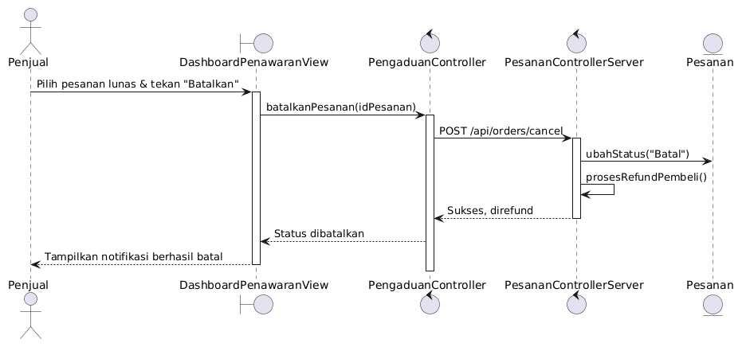

<i>Gambar 3.19. Sequence Diagram Skenario Normal UC06</i>

 

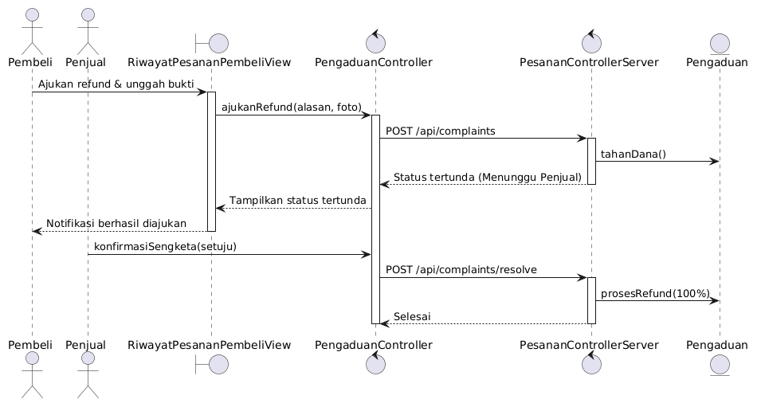

<i>Gambar 3.20. Sequence Diagram Skenario Alternatif 1 UC06</i>

 

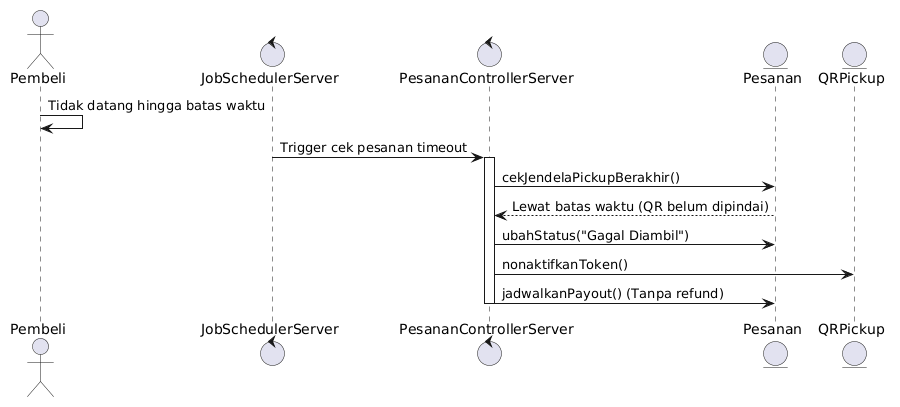

<i>Gambar 3.21. Sequence Diagram Skenario Alternatif 2 UC06</i>

 

### 3.6.3 Diagram Kelas

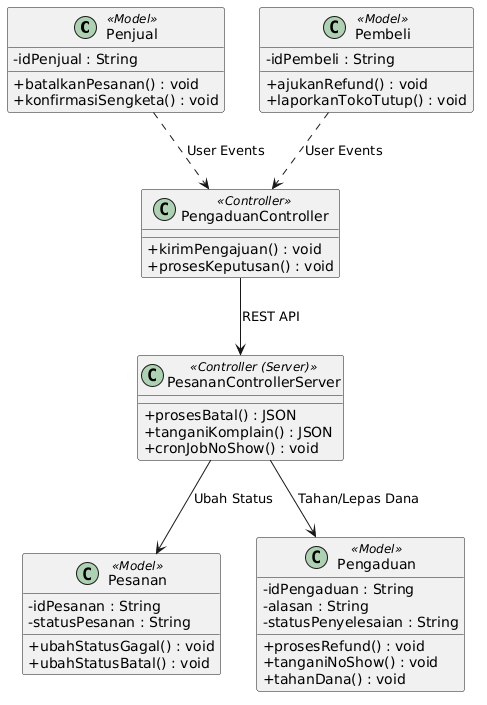

<i>Gambar 3.22. Diagram Kelas UC06</i>

 

---

## 3.7 Use Case Melihat Riwayat dan Memberikan Ulasan

**ID Use Case:** UC07  
**Nama Use Case:** Melihat Riwayat dan Memberikan Ulasan

### 3.7.1 Identifikasi Kelas

Tabel 3.7. Identifikasi Kelas Use Case UC07

| No | Nama Kelas Perancangan | Nama Kelas Analisis Terkait |
|:--- | :--- | :--- |
| 1 | RiwayatPesananPembeliView | - |
| 2 | RiwayatTransaksiPenjualView | - |
| 3 | UlasanFormView | - |
| 4 | PesananPembeliController | - |
| 5 | UlasanController | - |
| 6 | Penjual | Penjual (C01) |
| 7 | Pembeli | Pembeli (C02) |
| 8 | Pesanan | Pesanan (C04) |
| 9 | Ulasan | Ulasan (C10) |
| 10| RiwayatTransaksi | RiwayatTransaksi (C11) |

### 3.7.2 Sequence Diagram

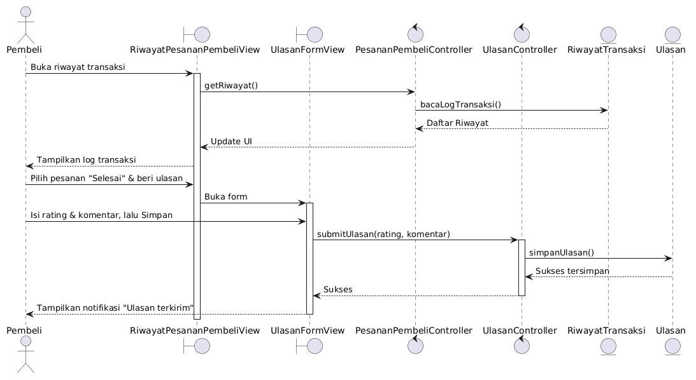

<i>Gambar 3.23. Sequence Diagram Skenario Normal UC07</i>

 

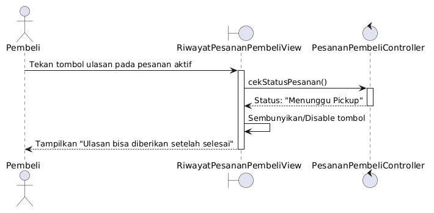

<i>Gambar 3.24. Sequence Diagram Skenario Alternatif 1 UC07</i>

 

### 3.7.3 Diagram Kelas

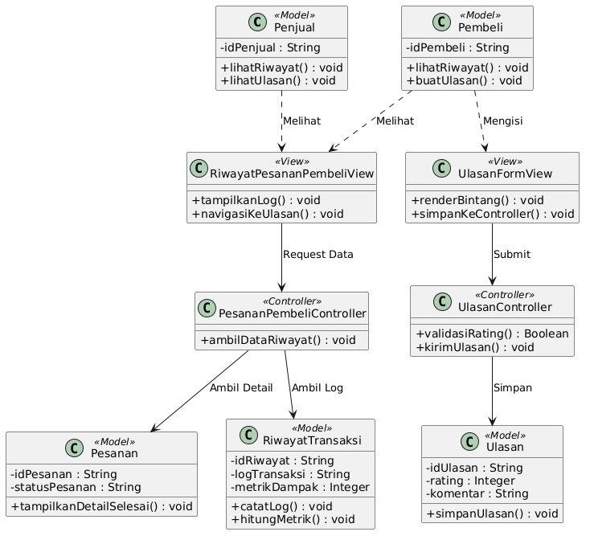

<i>Gambar 3.25. Diagram Kelas UC07</i>

 

 

---

# BAB 4: Diagram Kelas Keseluruhan

## 4.1 Diagram Kelas

Diagram kelas keseluruhan di bawah ini merupakan gabungan dari seluruh diagram kelas perancangan dari setiap use case yang telah dijabarkan pada Bab 3. Diagram ini memodelkan struktur statis sistem, mencakup Entity/Model utama (dengan ID C01-C11) beserta Controller inti yang menangani logika bisnis sistem SisaRasa.

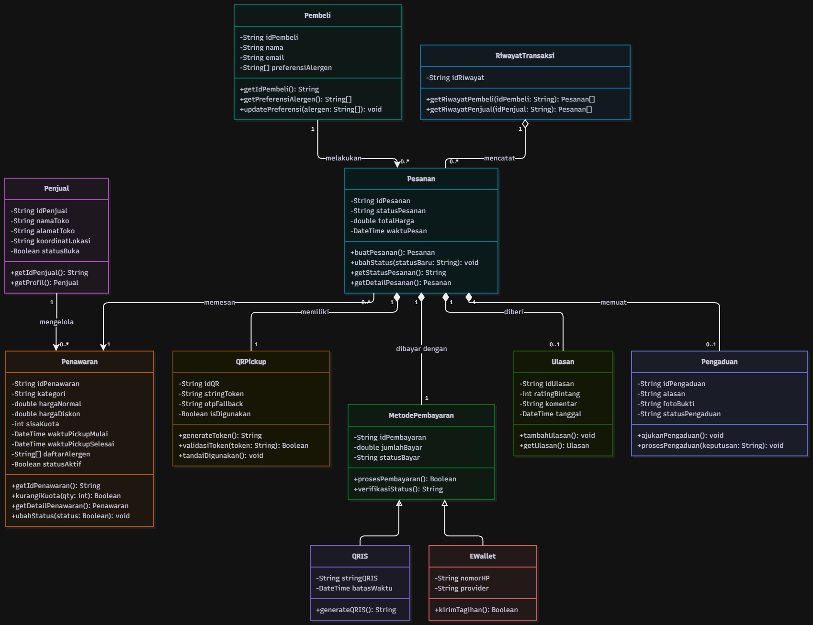

<i>Gambar 4.1. Diagram Kelas Perancangan Keseluruhan SisaRasa</i>

Tabel 4.1. Daftar Kelas Perancangan Keseluruhan

| ID Kelas | Nama Kelas | Atribut | Metode/Operasi |
| :--- | :--- | :--- | :--- |
| C01 | Penjual | - idPenjual: String - namaToko: String - alamatToko: String - koordinatLokasi: String - statusBuka: Boolean | + getIdPenjual(): String + getProfil(): Penjual |
| C02 | Pembeli | - idPembeli: String - nama: String - email: String - preferensiAlergen: String[] | + getIdPembeli(): String + getPreferensiAlergen(): String[] + updatePreferensi(alergen: String[]): void |
| C03 | Penawaran | - idPenawaran: String - kategori: String - hargaNormal: double - hargaDiskon: double - sisaKuota: int - waktuPickupMulai: DateTime - waktuPickupSelesai: DateTime - daftarAlergen: String[] - statusAktif: Boolean | + getIdPenawaran(): String + kurangiKuota(qty: int): Boolean + getDetailPenawaran(): Penawaran + ubahStatus(status: Boolean): void |
| C04 | Pesanan | - idPesanan: String - statusPesanan: String - totalHarga: double - waktuPesan: DateTime | + buatPesanan(): Pesanan + ubahStatus(statusBaru: String): void + getStatusPesanan(): String + getDetailPesanan(): Pesanan |
| C05 | MetodePembayaran | - idPembayaran: String - jumlahBayar: double - statusBayar: String | + prosesPembayaran(): Boolean + verifikasiStatus(): String |
| C06 | QRIS | - stringQRIS: String - batasWaktu: DateTime | + generateQRIS(): String |
| C07 | EWallet | - nomorHP: String - provider: String | + kirimTagihan(): Boolean |
| C08 | QRPickup | - idQR: String - stringToken: String - otpFallback: String - isDigunakan: Boolean | + generateToken(): String + validasiToken(token: String): Boolean + tandaiDigunakan(): void |
| C09 | Pengaduan | - idPengaduan: String - alasan: String - fotoBukti: String - statusPengaduan: String | + ajukanPengaduan(): void + prosesPengaduan(keputusan: String): void |
| C10 | Ulasan | - idUlasan: String - ratingBintang: int - komentar: String - tanggal: DateTime | + tambahUlasan(): void + getUlasan(): Ulasan |
| C11 | RiwayatTransaksi | - idRiwayat: String | + getRiwayatPembeli(idPembeli: String): Pesanan[] + getRiwayatPenjual(idPenjual: String): Pesanan[] |

 

---

# BAB 5: Matriks Kerunutan

Matriks berikut memetakan setiap kelas terhadap use case yang direalisasikannya. Pemetaan mengacu pada traceability SKPL dan Identifikasi Kelas M4 (C01–C11), dengan nama use case sesuai SKPL BAB 4.2.

Tabel 7.1. Matriks Kerunutan Kelas terhadap Use Case

| Kelas                  | Use Case Terkait                                                                                                                                                                                                                 |
| :--------------------- | :------------------------------------------------------------------------------------------------------------------------------------------------------------------------------------------------------------------------------- |
| C01 - Penjual          | UC01 - Membuat dan Mengelola Penawaran UC04 - Memantau Pesanan Masuk UC05 - Memvalidasi Pengambilan Pesanan UC06 - Mengelola Pesanan UC07 - Melihat Riwayat dan Memberikan Ulasan                                    |
| C02 - Pembeli          | UC02 - Menelusuri Penawaran Anonim UC03 - Melakukan Transaksi Pembayaran UC05 - Memvalidasi Pengambilan Pesanan UC06 - Mengelola Pesanan UC07 - Melihat Riwayat dan Memberikan Ulasan                                |
| C03 - Penawaran        | UC01 - Membuat dan Mengelola Penawaran UC02 - Menelusuri Penawaran Anonim UC03 - Melakukan Transaksi Pembayaran                                                                                                            |
| C04 - Pesanan          | UC03 - Melakukan Transaksi Pembayaran UC04 - Memantau Pesanan Masuk UC05 - Memvalidasi Pengambilan Pesanan UC06 - Mengelola Pesanan UC07 - Melihat Riwayat dan Memberikan Ulasan                                     |
| C05 - MetodePembayaran | UC03 - Melakukan Transaksi Pembayaran                                                                                                                                                                                            |
| C06 - QRIS             | UC03 - Melakukan Transaksi Pembayaran                                                                                                                                                                                            |
| C07 - EWallet          | UC03 - Melakukan Transaksi Pembayaran                                                                                                                                                                                            |
| C08 - QRPickup         | UC03 - Melakukan Transaksi Pembayaran UC05 - Memvalidasi Pengambilan Pesanan                                                                                                                                                  |
