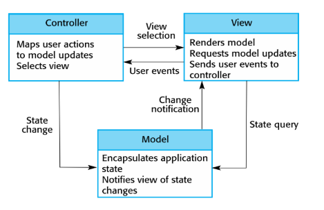

<h1>
IF2150 REKAYASA PERANGKAT LUNAK
 
TUGAS 5
 
DESKRIPSI PERANCANGAN PERANGKAT LUNAK (DPPL)
</h1>
 

## *SisaRasa*
### *[Logo Perangkat Lunak]*

### Untuk: *[Amanda Aurellia Salsabilla]*

Dipersiapkan oleh:
| Informasi | Keterangan |
| --------- | ---------- |
| Kelas     | K1         |
| Kelompok  | 6          |

| NIM      | Nama                         |
| -------- | ---------------------------- |
| 13525067 | Fathar Atandra Denaya        |
| 13525040 | Muhammad Zaky Amani          |
| 13525139 | Josephine Bintang N.L        |
| 13525070 | Devina Athalia Putri Kusumah |
| 13525004 | Nabil Rabbani                |
---

## Daftar Perubahan

| Revisi | Deskripsi |
| :--- | :--- |
| *A* | *Mengganti Format Penulisan BAB 1.5 dan 1.6* |
| *B* |  |
| *C* |  |
| ... |  |

---

 

> **Petunjuk pengerjaan:** *[Silahkan hapus bagian ini setelah selesai mengerjakan]*
>
> Dokumen ini melanjutkan **Spesifikasi Kebutuhan Perangkat Lunak (SKPL)** dan **Arsitektur Perangkat Lunak (APL)**. Gunakan nama, ID, kebutuhan, dan use case yang konsisten dengan kedua dokumen tersebut. Contoh pola ID baru di bawah dapat disesuaikan dengan kesepakatan kelompok, ID yang sudah ada tetap dipertahankan.

 

---

# BAB 1: Pendahuluan

## 1.1 Tujuan Penulisan Dokumen
Dokumen Spesifikasi Kebutuhan Perangkat Lunak (SKPL) ini bertujuan untuk merinci secara komprehensif seluruh spesifikasi fungsional, non-fungsional, serta batasan operasional yang dibutuhkan dalam pengembangan aplikasi SisaRasa. Dokumen ini dirancang sebagai acuan teknis utama bagi tim pengembang, perancang sistem, penguji (*tester*), serta pihak asisten mata kuliah Rekayasa Perangkat Lunak dalam memahami ruang lingkup dan perilaku sistem secara utuh sebelum tahap implementasi kode dilakukan.

## 1.2 Lingkup Masalah
SisaRasa adalah aplikasi *marketplace* penyelamat makanan surplus berbasis Android native (Flutter) yang memfasilitasi transaksi "paket kejutan" (*mystery box*) anonim antara *merchant* makanan (Penjual) dan konsumen (Pembeli). Solusi ini dirancang untuk mengatasi kerugian finansial *merchant* akibat penumpukan makanan layak makan yang tak terjual, sekaligus menyediakan akses pangan berkualitas dengan harga terjangkau (diskon 50%–70%) bagi masyarakat. Sistem membatasi interaksi secara anonim hingga transaksi lunas, serta mewajibkan mekanisme pengambilan mandiri (*pickup-only*) menggunakan kode QR dinamis untuk menjamin kepraktisan operasional tanpa mengganggu sistem kasir internal toko.

## 1.3 Definisi, Istilah, dan Singkatan
Semua definisi, singkatan, dan akronim yang digunakan dalam dokumen SKPL ini beserta penjelasannya diuraikan pada Tabel 1.3 di bawah ini:

Tabel 1.3. Definisi Istilah dan Singkatan

| Singkatan, Akronim, atau Istilah | Penjelasan |
| :--- | :--- |
| *SisaRasa* | Nama perangkat lunak berupa aplikasi *marketplace* penyelamat makanan surplus berbasis Android native (Flutter). |
| *P/L* | Singkatan dari Perangkat Lunak, yaitu aplikasi yang memberikan perintah kepada komputer untuk menjalankan tugas tertentu. |
| *SKPL* | Singkatan dari Spesifikasi Kebutuhan Perangkat Lunak, yaitu dokumen yang merangkum kriteria yang diperlukan untuk membangun aplikasi. |
| *KF* | Singkatan dari Kebutuhan Fungsional. |
| *KNF* | Singkatan dari Kebutuhan Non-Fungsional. |
| *UC* | Singkatan dari *Use Case*. |
| *EARS* | *Easy Approach to Requirements Syntax*, yaitu pola penulisan kebutuhan agar konsisten dan mudah diuji. |
| *Flutter* | *Framework open-source* berbasis bahasa Dart yang digunakan untuk membangun aplikasi Android native. |
| *QRIS* | *Quick Response Code Indonesian Standard*, yaitu standarisasi pembayaran menggunakan kode QR nasional untuk memproses transaksi digital. |
| *WebSocket* | Protokol komunikasi dua arah secara *real-time* antara server API dan aplikasi Android. |
| *Payout* | Proses pencairan dana dari platform kepada penjual setelah pesanan berhasil diserahkan dan divalidasi. |
| *Pickup-only* | Mekanisme pemenuhan pesanan di mana pembeli wajib mengambil makanan secara mandiri ke lokasi penjual tanpa menggunakan jasa kurir pengantaran. |

## 1.4 Aturan Penomoran
Dokumen Spesifikasi Kebutuhan Perangkat Lunak (SKPL) ini menggunakan aturan penomoran identitas (ID) yang konsisten dengan dokumen-dokumen perancangan sebelumnya. Penomoran ID digunakan untuk mempermudah pemetaan dan pelacakan (*traceability*) antar-elemen kebutuhan, aktor, *use case*, dan kelas.

Tabel 1.4. Aturan Penomoran

| Hal/Bagian | Penomoran | Keterangan |
| :--- | :--- | :--- |
| *Pemetaan Kebutuhan* | *RXX* | Menunjukkan ID kebutuhan dasar hasil analisis masalah. |
| *Kebutuhan Fungsional* | *KFXX* | Menunjukkan ID Kebutuhan Fungsional perangkat lunak. |
| *Kebutuhan Non-Fungsional* | *KNFXX* | Menunjukkan ID Kebutuhan Non-Fungsional (kualitas, keamanan, performa). |
| *Aktor* | *AXX* | Menunjukkan ID aktor pengguna yang berinteraksi dengan sistem. |
| *Use Case* | *UCXX* | Menunjukkan ID fungsi/unit interaksi pada *Use Case Diagram*. |
| *Kelas* | *CXX* | Menunjukkan ID struktur entitas data/kelas pada *Class Diagram*. |

## 1.5 Referensi
Dokumentasi dan acuan standar yang dirujuk dalam penyusunan dokumen SKPL aplikasi SisaRasa ini meliputi:

1. **Kementerian PPN/Bappenas.** (2021). *Kajian Food Loss and Waste di Indonesia dalam Rangka Membangun Ekonomi Sirkular*.
2. **Republik Indonesia.** (2012). *Undang-Undang Nomor 18 Tahun 2012 tentang Pangan*.
3. **Republik Indonesia.** (2022). *Undang-Undang Nomor 27 Tahun 2022 tentang Pelindungan Data Pribadi (UU PDP)*.
4. **IEEE Computer Society.** (1998). *IEEE Std 830-1998: IEEE Recommended Practice for Software Requirements Specifications*.
5. **PlantUML Documentation.** (n.d.). *Class Diagram Syntax and Features*. Diakses dari https://plantuml.com/class-diagram
6. **Draw.io / Diagrams.net.** (n.d.). *Open source diagramming software for UML*. Diakses dari https://www.drawio.com/
7. **Kelompok 6 K1 IF2150.** (2026). *Spesifikasi Kebutuhan Perangkat Lunak (SKPL) SisaRasa. Program Studi Teknik Informatika ITB*.   
8. **Kelompok 6 K1 IF2150.** (2026). *Arsitektur Perangkat Lunak (APL) SisaRasa. Program Studi Teknik Informatika ITB*.

## 1.6 Deskripsi Umum Dokumen (Ikhtisar)
Dokumen DPPL ini disusun secara sistematis ke dalam 5 bab utama untuk memberikan gambaran rancangan terstruktur aplikasi SisaRasa: Bab 1 menyajikan pendahuluan, lingkup masalah, daftar definisi, aturan penomoran ID, dan referensi; Bab 2 mendeskripsikan perancangan arsitektur meliputi lingkungan implementasi, pola Client-Server/MVC, identifikasi komponen, dan view arsitektur (Logical & Deployment View); Bab 3 menjabarkan realisasi seluruh use case (UC01–UC07) mencakup identifikasi kelas, sequence diagram skenario normal/alternatif, dan class diagram per use case; Bab 4 menampilkan class diagram keseluruhan beserta rincian lengkap atribut dan metodenya; serta Bab 5 memuat matriks kerunutan yang memetakan kelas terhadap use case yang direalisasikannya.

 

---

# BAB 2: Perancangan Arsitektur

## 2.1 Rancangan Lingkungan Implementasi

Sebutkan *operating system*, DBMS, *development tools*, *filing system*, dan bahasa pemrograman yang digunakan.

## 2.2 Style/Pattern Arsitektur Acuan

Tentukan *architectural style* atau *pattern* yang menjadi acuan aplikasi, misalnya *layered architecture*, *client-server*, *repository*, *pipe and filter*, atau MVC (*Model-View-Controller*).

Gunakan hasil **BAB 1 Style/Pattern Arsitektur Acuan pada dokumen APL**, termasuk alasan pemilihan dan gambar penerapannya pada P/L kelompok. Gunakan komponen aplikasi sendiri pada gambar, bukan hanya contoh pola umum.

<i>Gambar 1. Contoh Arsitektur MVC</i>

## 2.3 Identifikasi Komponen / Modul / Subsistem

Identifikasi komponen, modul, atau subsistem penyusun aplikasi berdasarkan *pattern* yang telah ditetapkan. Jelaskan tanggung jawab masing-masing komponen. Pengelompokan dapat mengikuti lapisan arsitektur atau fungsi/peran komponen dalam sistem.

Ambil dari **Tabel 2.1 dokumen APL**, lalu kelompokkan berdasarkan lapisan (Model/View/Controller). Kolom **Jenis** diisi sesuai pattern, misalnya View, Controller, Model, Service, Repository. Satu komponen merepresentasikan saatu tanggung jawab utama yang jelas,

Tabel 2.3. Identifikasi Komponen/Modul/Subsistem

| Nama Komponen/Modul/Subsistem | Jenis | Penjelasan |
| :--- | :--- | :--- |
| *[Nama komponen/modul/subsistem]* | *[Jenis]* | *[Tanggung jawab komponen]* |
| *[Nama komponen/modul/subsistem]* | *[Jenis]* | *[Tanggung jawab komponen]* |
| *...* | *...* | *...* |

## 2.4 Model Arsitektur Perangkat Lunak

Buat model arsitektur dalam bentuk satu atau lebih *view* yang memperlihatkan interaksi dan kolaborasi komponen, modul, serta subsistem dalam menjalankan fungsi sistem. Pilih notasi yang sesuai. Contoh *view*: *Logical View*, *Process View*, *Development View*, dan *Physical View*.

Gunakan hasil **BAB 3 Model Arsitektur Perangkat Lunak pada dokumen APL**. 

### 2.4.1 View [Nama View]

Tuliskan secara singkat model arsitektur yang dipilih dan alasan model tersebut cocok untuk aplikasi.

<i>Gambar 2. Contoh Logical View pada P/L E-Commerce</i>

### 2.4.X View [Nama View]
*[Lakukan hal yang sama dengan bagian sebelumnya]*

 

---

# BAB 3: Realisasi Use Case

## 3.1 Use Case [Nama Use Case 1]

**ID Use Case:** *[UC01 sesuai SKPL]*  
**Nama Use Case:** *[Nama use case sesuai SKPL]*

### 3.1.1 Identifikasi Kelas

Identifikasi kelas yang terkait dengan use case tersebut. Kelas di tahap perancangan dapat berbeda dengan dengan kelas di tahap analisis. Dapat menggunakan tabel di bawah:

Tabel 3.1. Identifikasi Kelas Use Case [UC01]

| No | Nama Kelas Perancangan | Nama Kelas Analisis Terkait |
|:--- | :--- | :--- |
| 1 | *[Nama kelas perancangan]* | *[Nama kelas analisis pada SKPL]* |
| 2 | *[Nama kelas perancangan]* | *[Nama kelas analisis pada SKPL]* |
| ... | *...* | *...* |

### 3.1.2 Sequence Diagram

Buat *sequence diagram* untuk **setiap skenario use case**, mencakup skenario normal dan alternatif pada subbab 4.4 SKPL. Diagram melibatkan kelas-kelas yang telah diidentifikasi pada SKPL. 

- **Skenario Normal**

<i>Gambar X. Sequence Diagram [UC01]</i>

- **Skenario Alternatif [Nomor]: [Nama Skenario]**

<i>Gambar X. Sequence Diagram [UC01] - [Nama skenario alternatif]</i>

### 3.1.3 Diagram Kelas

Buatlah diagram kelas untuk use case ini yang terdiri atas kelas-kelas dari 3.1.1. **Setiap kelas pada diagram wajib menampilkan atribut dan metode/operasi langsung di dalam kotak kelasnya**, sehingga tidak perlu membuat tabel daftar atribut dan metode per kelas pada subbab ini. Daftar lengkap atribut dan metode seluruh kelas disajikan pada Tabel 4.1 (Bab 4).

<i>Gambar X. Diagram Kelas [Nama Uce Case]</i>

Pada diagram, pastikan:
- Atribut dituliskan beserta visibilitas dan tipe datanya, misalnya `- email: String`.
- Operasi dituliskan beserta visibilitas, parameter, dan tipe kembaliannya, misalnya `+ login(email: String, password: String): Boolean`.
- Relasi antarkelas (asosiasi, agregasi, komposisi, generalisasi, dan dependensi) digambarkan lengkap dengan multiplisitas.
- Semua operasi yang dipanggil pada sequence diagram 3.1.2 (skenario normal dan alternatif) ada pada kelas yang bersangkutan.
- Kelas yang sama dengan kelas di use case lain memakai nama, atribut, dan metode yang konsisten.

## 3.2 Use Case XX

Silahkan lanjutkan untuk  *use case* berikutnya dengan content yang sama dengan 3.1

 

---

# BAB 4: Diagram Kelas Keseluruhan

## 4.1 Diagram Kelas

**Bagian ini diisi dengan diagram kelas keseluruhan.**

<i>Gambar 4.1. Diagram Kelas Perancangan Keseluruhan [Nama P/L]</i>

Tabel 4.1. Daftar Kelas Perancangan Keseluruhan

| ID Kelas | Nama Kelas | Atribut | Metode/Operasi |
| :--- | :--- | :--- | :--- |
| *[C01]* | *[Nama kelas]* | *[Daftar atribut]* | *[Daftar metode/operasi]* |
| *[C02]* | *[Nama kelas]* | *[Daftar atribut]* | *[Daftar metode/operasi]* |
| *[C03]* | *[Nama kelas]* | *[Daftar atribut]* | *[Daftar metode/operasi]* |
| *...* | *...* | *...* | *...* |

 

---

# BAB 5: Matriks Kerunutan

Matriks berikut memetakan setiap kelas terhadap use case yang direalisasikannya. Pemetaan mengacu pada traceability SKPL dan Identifikasi Kelas M4 (C01–C11), dengan nama use case sesuai SKPL BAB 4.2.

Tabel 7.1. Matriks Kerunutan Kelas terhadap Use Case

| Kelas                  | Use Case Terkait                                                                                                                                                                                                                 |
| :--------------------- | :------------------------------------------------------------------------------------------------------------------------------------------------------------------------------------------------------------------------------- |
| C01 - Penjual          | UC01 - Membuat dan Mengelola Penawaran UC04 - Memantau Pesanan Masuk UC05 - Memvalidasi Pengambilan Pesanan UC06 - Mengelola Pesanan UC07 - Melihat Riwayat dan Memberikan Ulasan                                    |
| C02 - Pembeli          | UC02 - Menelusuri Penawaran Anonim UC03 - Melakukan Transaksi Pembayaran UC05 - Memvalidasi Pengambilan Pesanan UC06 - Mengelola Pesanan UC07 - Melihat Riwayat dan Memberikan Ulasan                                |
| C03 - Penawaran        | UC01 - Membuat dan Mengelola Penawaran UC02 - Menelusuri Penawaran Anonim UC03 - Melakukan Transaksi Pembayaran                                                                                                            |
| C04 - Pesanan          | UC03 - Melakukan Transaksi Pembayaran UC04 - Memantau Pesanan Masuk UC05 - Memvalidasi Pengambilan Pesanan UC06 - Mengelola Pesanan UC07 - Melihat Riwayat dan Memberikan Ulasan                                     |
| C05 - MetodePembayaran | UC03 - Melakukan Transaksi Pembayaran                                                                                                                                                                                            |
| C06 - QRIS             | UC03 - Melakukan Transaksi Pembayaran                                                                                                                                                                                            |
| C07 - EWallet          | UC03 - Melakukan Transaksi Pembayaran                                                                                                                                                                                            |
| C08 - QRPickup         | UC03 - Melakukan Transaksi Pembayaran UC05 - Memvalidasi Pengambilan Pesanan                                                                                                                                                  |
