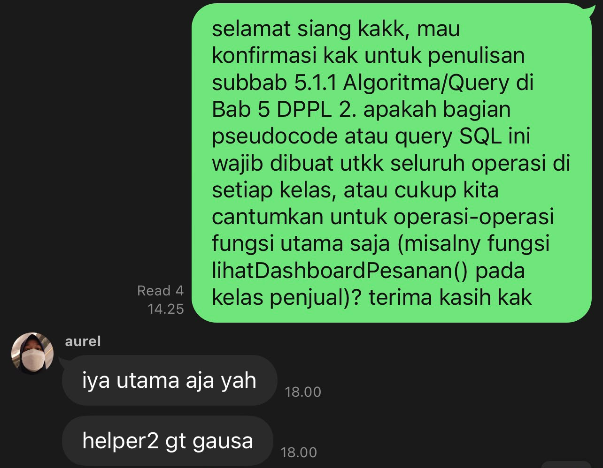

# Form Asistensi

## Tugas Besar IF2150 - Rekayasa Perangkat Lunak

| Informasi | Keterangan |
| --- | --- |
| **Hari** | *\[Minggu\]* |
| **Tanggal** | *\[25/10/2026\]* |
| **Kelas** | *\[K1\]* |
| **Nomor Kelompok** | *\[6\]*  |
| **Nama Kelompok** | *\[MZakyBTW\]*  |
| **Nama Perangkat Lunak** | *\[SisaRasa\]*  |
| **Dokumen** | *\[M3\]*  |

### Anggota Kelompok

| NIM | Nama |
| --- | --- |
| *[13525067]* | *[Fathar Atandra Denaya]* |
| *[13525040]* | *[Muhammad Zaky Amani]* |
| *[13525139]* | *[Josephine Bintang N.L]* |
| *[13525070]* | *[Devina Athalia Putri Kusumah]* |
| *[13525004]* | *[Nabil Rabbani]* |

### Catatan

| Catatan |
| --- |
| 1. *Penulisan pseudocode/Query SQL di Bab 5 Subbab 5.1.1 hanya dicantumkan untuk operasi-operasi fugsi utama saja. helper tidak usah*  |
| 2. ... |
| 3. ... |
| 4. ... |

**Notes for this section:**  
*Catatan dapat dituliskan dalam bentuk paragraf atau poin-poin, disesuaikan saja.* 

## Dokumentasi

<!--  -->

  

  <i>Gambar 1. Dokumentasi kegiatan asistensi.</i>

